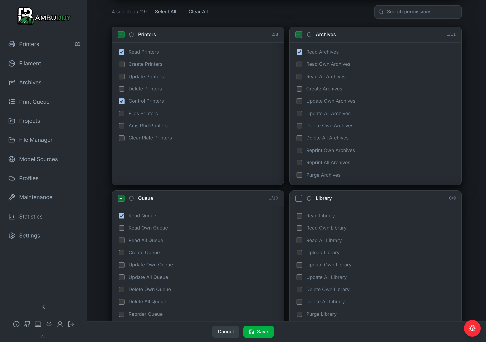
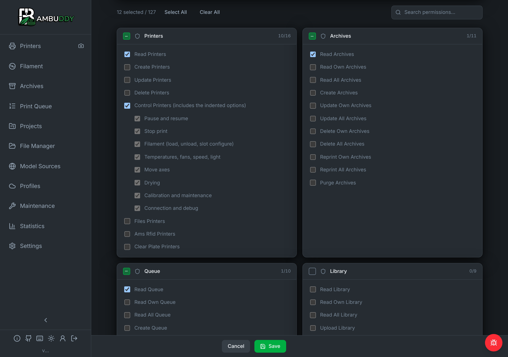
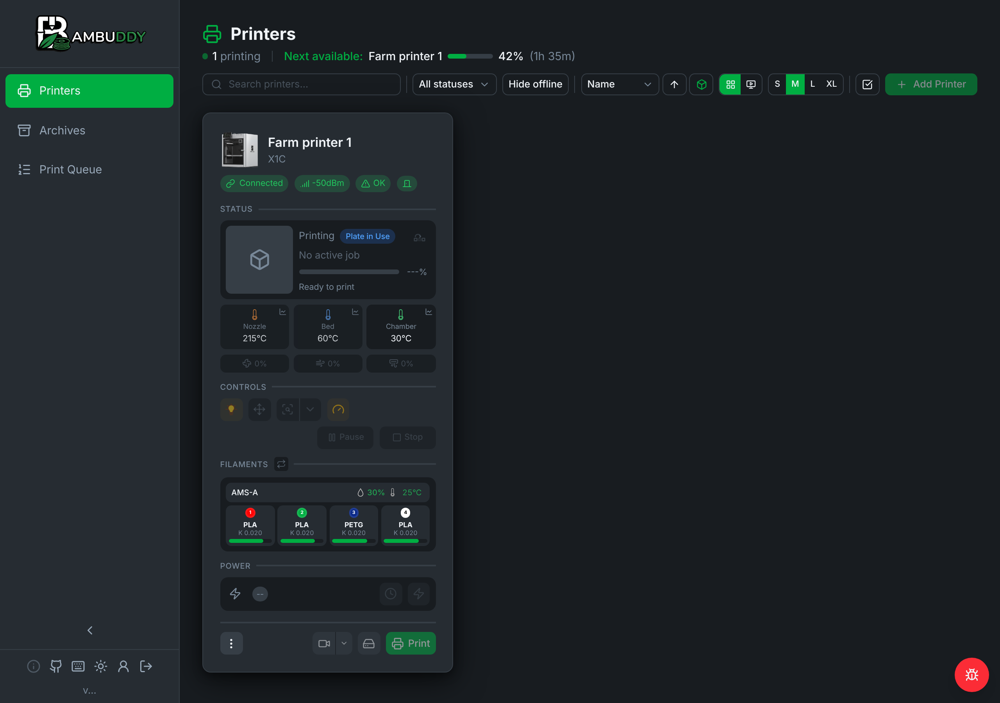
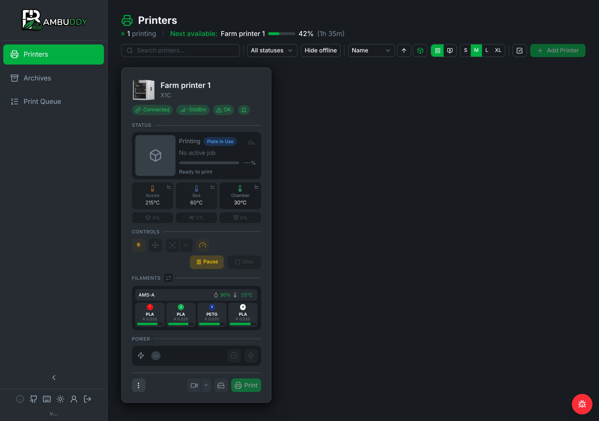
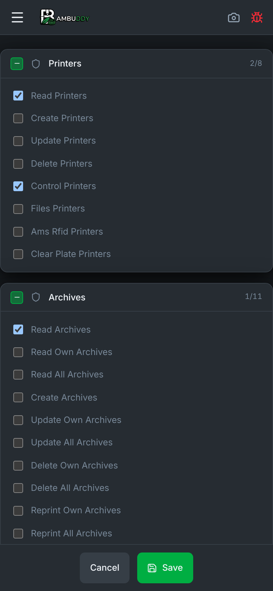
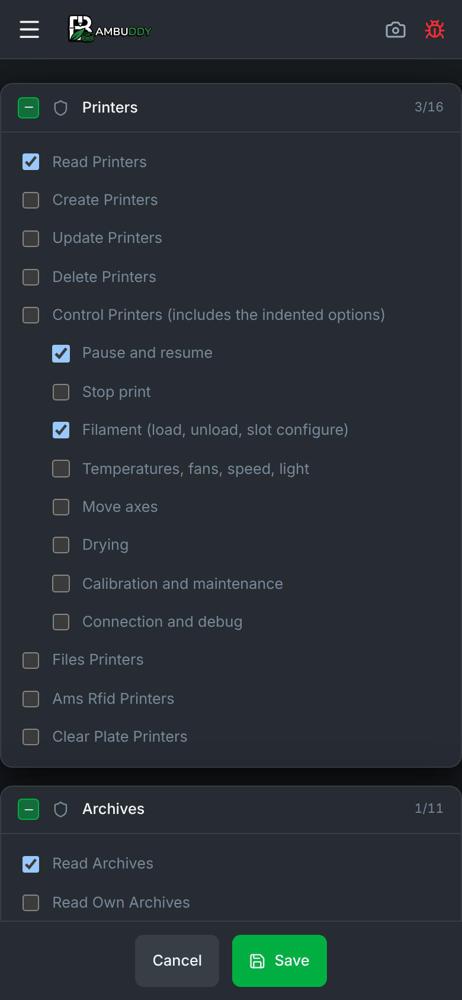
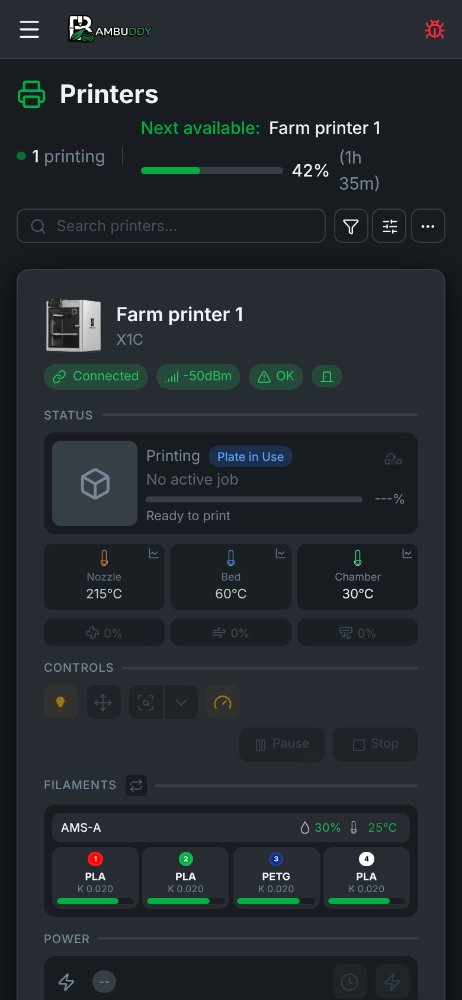
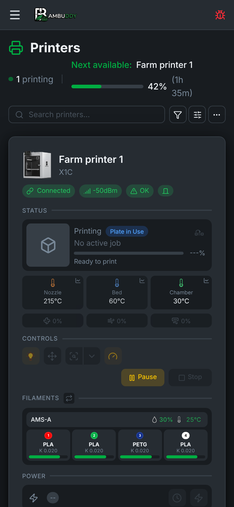

# PR draft – #3248 (finer printer permissions)

- **Base:** `maziggy/bambuddy:dev`
- **Head:** `balin77:feature/printer-permissions`
- **Title:** `Printers: finer printer permissions under Control Printers (#3248)`
- **Status:** Draft. Submit only after #3248 is assigned to balin77 (or the maintainer agrees to the wider split) and the user approves. Nothing is posted.

---

## Description

**Control Printers** (`printers:control`) allows every printer action at once. A group that should only pause and resume a print (a "farm helper") can also stop prints, change temperatures, move axes, start calibrations and reconnect or debug printers. #3248 asks for the admin and debug actions (connect, disconnect, MQTT logging) to be separate; per the discussion in the issue this PR goes a step further and splits Control Printers into task-shaped permissions:

| Permission | Label in the group editor |
|---|---|
| `printers:pause_resume` | Pause and resume |
| `printers:stop` | Stop print |
| `printers:filament` | Filament (load, unload, slot configure) |
| `printers:tune` | Temperatures, fans, speed, light |
| `printers:motion` | Move axes |
| `printers:drying` | Drying |
| `printers:maintenance` | Calibration and maintenance |
| `printers:admin` | Connection and debug |

**`printers:control` stays and is the umbrella**: every action accepts its own permission **or** `printers:control`. Existing groups, users and API keys keep exactly what they have. No migration, no change to the default groups.

## Related Issue

Fixes #3248 (the admin/debug part: connect, disconnect and MQTT logging now need `printers:admin`). Widened to the other printer actions as proposed in the comment on the issue.

## Documentation

**Companion docs PRs**:
- Wiki: maziggy/bambuddy-wiki#___

**Pick one**:
- [x] Docs PR(s) linked above
- [ ] No docs update required — reason: ___

## Type of Change

- [ ] Bug fix (non-breaking change that fixes an issue)
- [x] New feature (non-breaking change that adds functionality)
- [ ] Breaking change (fix or feature that would cause existing functionality to change)
- [ ] Documentation update
- [ ] Code refactoring
- [ ] Performance improvement
- [ ] Test addition or update

## Changes Made

**Permissions and umbrella rule**
- `core/permissions.py`: eight new `Permission` members, listed in the Printers category right after `printers:control`. `PERMISSION_UMBRELLAS` maps each to `printers:control`, and `permission_granted_by(held, permission)` is the one place that applies it.
- `User.has_permission`, `has_all_permissions` and `has_any_permission` use it, so every route check that goes through them honours the umbrella. A fine permission grants only itself: not `printers:control`, not its siblings.
- No migration. Group rows are not rewritten; a group with `printers:control` keeps passing every check through the umbrella.
- Administrators and auth-off behave as before.

**Routes** (`routes/printers.py`, `routes/scheduled_dryings.py`). Every route that required `printers:control` now requires one of the new permissions; none is stricter for a `printers:control` holder.

| Permission | Routes |
|---|---|
| `printers:pause_resume` | `POST /printers/{id}/print/pause`, `POST /printers/{id}/print/resume` |
| `printers:stop` | `POST /printers/{id}/print/stop`, `POST /printers/{id}/print/skip-objects` |
| `printers:filament` | `POST /printers/{id}/ams/load`, `POST /printers/{id}/ams/unload`, `POST /printers/{id}/slots/{ams}/{tray}/configure`, `POST /printers/{id}/ams/{ams}/tray/{tray}/reset` |
| `printers:tune` | `POST /printers/{id}/temperature/nozzle`, `/temperature/bed`, `/temperature/chamber`, `/fan-speed`, `/print-speed`, `/airduct-mode`, `/chamber-light`, `/panda-breath` |
| `printers:motion` | `POST /printers/{id}/bed-jog`, `/xy-jog`, `/extruder-jog`, `/home-axes`, `/select-extruder` |
| `printers:drying` | `POST /printers/{id}/drying/start`, `POST /printers/{id}/drying/stop`, `POST /scheduled-dryings`, `DELETE /scheduled-dryings/{id}` |
| `printers:maintenance` | `POST /printers/{id}/calibration`, `/print-options`, `/ams-backup`, `/hms/clear`, `/hms/execute-action` |
| `printers:admin` | `POST /printers/{id}/connect`, `/disconnect`, `POST /printers/{id}/logging/enable`, `/logging/disable`, `DELETE /printers/{id}/logging` |

`printers:read`, `printers:files`, `printers:ams_rfid`, `printers:clear_plate` and the create/update/delete routes are unchanged.

**Left on `printers:read` on purpose**
- `GET /printers/{id}/diagnostic` (the on-demand connection diagnostic) and `POST /printers/{id}/refresh-status`. The diagnostic only probes the printer's ports and reads what it publishes; it changes nothing on the printer, and a user who can see a printer needs it to say why it is offline. Refresh-status sends a `pushall` status request, which the printer answers with data the user may already read, and the app uses it on ordinary page flows (for example after assigning a spool), so moving it to `printers:admin` would break those for read-only users. `POST /printers/diagnostic` (Add Printer flow) stays on `printers:create`.

**Left on `printers:control` on purpose**
- **Webhooks**: stop and cancel now need `printers:stop` of the key's owner (still within the key's `can_control_printer` scope); webhook start keeps requiring `printers:control`.
- **Virtual-printer MQTT passthrough** (`services/virtual_printer/user_codes.py`): a user's slicer commands reach the real printer only with `printers:control` on it. The commands are arbitrary, so a partial permission cannot be honoured there.

**API keys**: all eight map to the existing `can_control_printer` scope (`_APIKEY_SCOPE_BY_PERMISSION`), as `printers:control` does. A key still cannot do more than its owner may.

**Group editor** (`GroupEditPage.tsx`)
- The eight permissions are shown indented under **Control Printers (includes the indented options)**.
- While Control Printers is ticked they show as ticked and disabled ("included in Control Printers") and are not stored separately; unticking Control Printers lets each be chosen on its own.
- Category and total counters count the included rows. A category-name search keeps the whole category; indent only while the umbrella row is visible.

**Printer card and other frontend**
- `AuthContext` `hasPermission`/`hasAnyPermission` apply the same umbrella map (`PERMISSION_UMBRELLAS` in `client.ts`, mirrored from the backend).
- Each control checks its own permission: Pause/Resume, Stop and skip objects, AMS load/unload/slot configure, temperatures/fans/speed/light/Panda Breath, nozzle selector, jog/home, drying start/stop, HMS clear and actions, Reconnect and MQTT debug in the card menu, bulk toolbar, camera tile controls, camera page and embedded viewer. Hidden-or-disabled behaviour per control is as before.
- Plate-detection alerts go to users who can pause/resume or stop.
- Labels for the new permissions come from the backend label table; `groups.editor.includedInControl` is added to all 16 locales.

**Changelog**: entry added.

## Screenshots

Dark theme. The group editor is shown as an administrator edits the group **Farm helper**; the printer card as the user **Farm helper** sees it, with `printers:read`, `printers:pause_resume` and `printers:filament` and a print running. Before = `dev`, After = this branch, the same mocked data on both sides. In the printer card the Before user has no `printers:control`, so every control is disabled; before this change the only way to get Pause was to grant `printers:control`, which also grants Stop, temperatures, movement and the rest.

### Desktop (1280)

| View | Before | After |
|---|---|---|
| Group editor, Printers card, **Control Printers** ticked (Before: 8 permissions; After: the 8 fine permissions indented and shown as included) |  |  |
| Group editor, **Control Printers** unticked, **Pause and resume** and **Filament** ticked | n/a |  |
| Printer card of a user with read + pause/resume + filament while printing (Pause enabled, Stop and the other controls disabled) |  |  |

### Mobile (390)

| View | Before | After |
|---|---|---|
| Group editor, Printers card, **Control Printers** ticked (Before: 8 permissions; After: the 8 fine permissions indented and shown as included) |  |  |
| Group editor, **Control Printers** unticked, **Pause and resume** and **Filament** ticked | n/a |  |
| Printer card of a user with read + pause/resume + filament while printing (Pause enabled, Stop and the other controls disabled) |  |  |

## Testing

Backend:
- `backend/tests/integration/test_printer_fine_permissions_3248.py`: a user with only one fine permission opens exactly its routes and gets 403 on the others; `printers:control` still opens every route; the diagnostic stays on `printers:read`; a read-only user gets 403 everywhere; printer scope still applies; an API key of a `printers:control` owner works and a key cannot outrank an owner who holds only a fine permission.
- `backend/tests/unit/test_permissions.py`: 4 added (permissions exist in the Printers category after Control, Administrators get them and the default groups are unchanged, the umbrella grants every fine permission, `User.has_permission` follows it).

Frontend (Vitest):
- `GroupEditPagePrinterPermissions.test.tsx`, `PrintersPageFinePermissions3248.test.tsx` (card controls per single permission, nozzle selector on motion not tune, Stop Drying, Reconnect), 2 added in `AuthContext.test.tsx`; existing printer wiring tests adjusted to the new permissions.

Checks to run before submitting: Ruff (lint + format), basedpyright against the baseline, ESLint, `tsc`, knip, `npm run check:i18n`, Vitest, backend tests. TODO user: confirm they are green on the final head.

- [x] I have tested this on my local machine
- [ ] I have tested with my printer model: <!-- TODO: user – printer model, e.g. ... -->

Tested on printer: TODO user.

## Checklist

- [x] My code follows the project's coding style
- [x] I have commented my code where necessary
- [x] My changes generate no new warnings
- [x] I have tested my changes thoroughly

## Additional Notes

**Design decisions**
- **Umbrella, not migration.** Every check accepts the action's own permission or `printers:control`. Nothing is rewritten, so an upgrade changes nothing for anyone, and the umbrella lives in one backend map and one frontend map.
- **Task-shaped split.** The eight groups follow what a helper is asked to do (pause, change filament, dry) rather than the route list.
- **Not covered by a fine permission:** `printers:filament` and `printers:control` can both relabel an AMS slot, so the existing advice not to give a filament-limited group `printers:control` applies to `printers:filament` too (wiki note).

**Known limits**
- The eight indented permissions sit directly under **Control Printers (includes the indented options)**; Files, AMS RFID and Clear Plate follow and are not included in it. Only the eight indented rows are included.
- Webhook start and the virtual-printer MQTT passthrough still need `printers:control` (see above).
- Not tested on real hardware.
