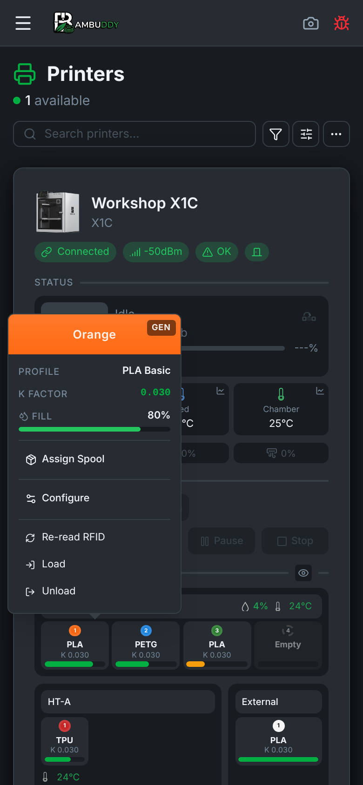
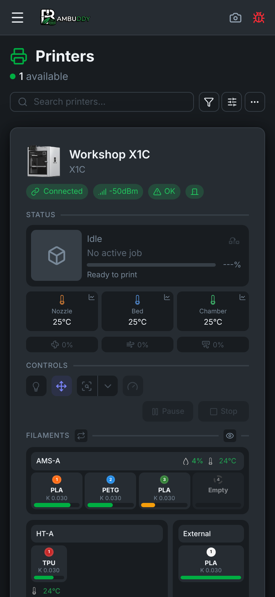
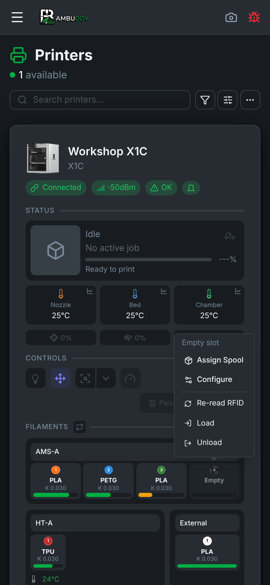
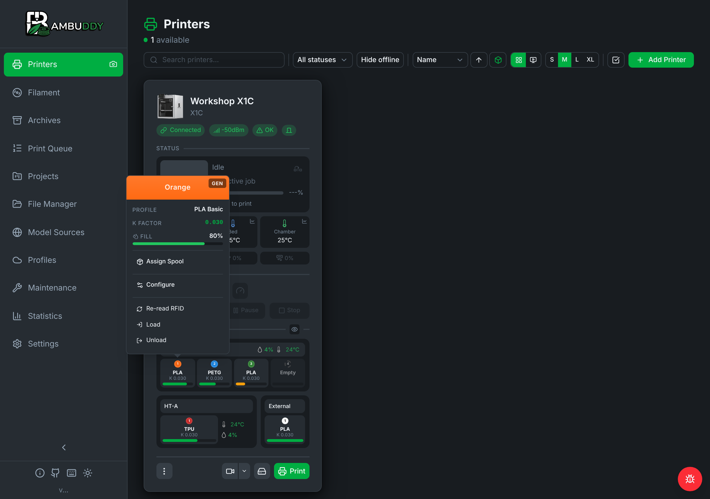
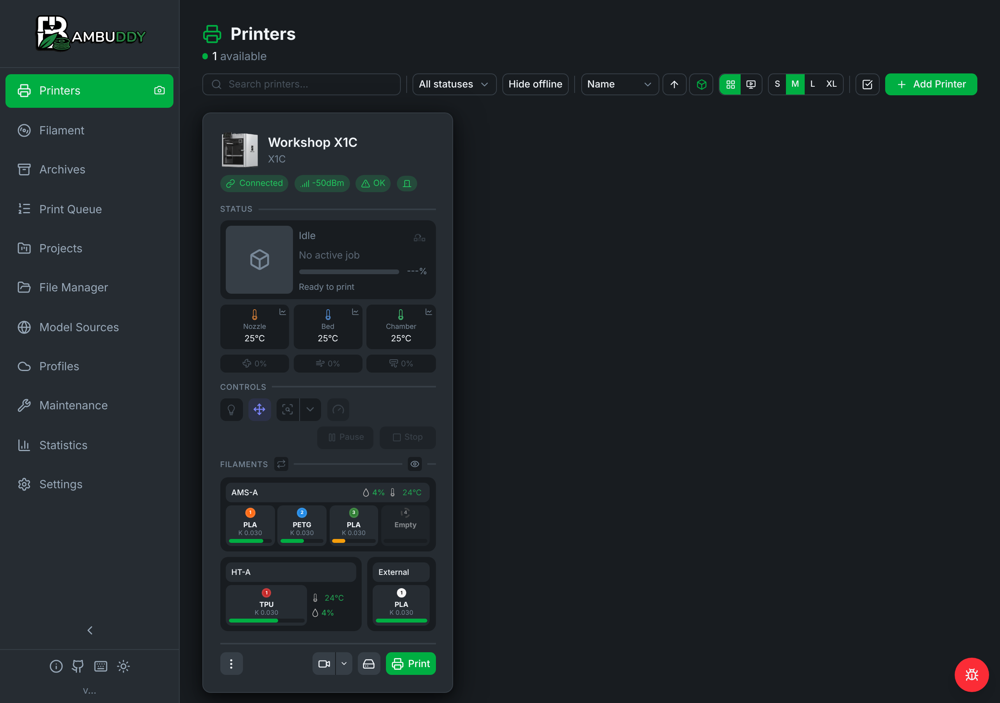

# PR draft – #3577

- **Base:** `maziggy/bambuddy:dev`
- **Head:** `balin77:fix/button-text-selection`
- **Title:** `Frontend: buttons and AMS slot tiles work on touch (#3577)`
- **Status:** Draft. Submit only after #3577 is assigned to balin77 **and** the user approves.

---

## Description

Two touch problems on phones, tablets and the installed PWA:

1. **Button labels get selected instead of pressed.** A tap that lasts a little long or moves a little starts a text selection on the label. The user sees selection handles and the copy menu, and the button is not pressed. The shared `Button` component never set `select-none`, and most of the app's ~930 buttons are raw `<button>`s. The fix is one base-layer rule in `frontend/src/index.css`, next to the existing `cursor: pointer` rule from #2791:

   ```css
   button,
   [role="button"] {
     -webkit-user-select: none;
     user-select: none;
     -webkit-touch-callout: none;
   }

   /* A role="button" row (Collapsible's summary) may hold a field; iOS Safari
      does not focus or edit one under user-select: none. */
   input,
   textarea,
   [contenteditable="true"] {
     -webkit-user-select: text;
     user-select: text;
   }
   ```

   The rule is in `@layer base`, so `select-text` can still re-enable selection on a specific element.

2. **AMS slot tiles on the printer card cannot be opened by touch.** The slot details card (`FilamentHoverCard`) only opened on mouse hover. On touch, a tap selected the tile text instead, and there was no way to reach Assign Spool / Configure / Load / Unload from the card. The tiles are now tap targets:
   - `role="button"`, `tabIndex=0`, `aria-expanded`, `aria-controls` and an `aria-label` like "AMS A Slot 2 - PLA".
   - A tap, Enter or Space toggles the card. A second tap, a tap outside, Escape or focus leaving the tile and card closes it.
   - Only one slot card is open at a time.
   - Mouse hover works as before. A click on a card that hover already opened keeps it open (no flicker for mouse and pen users).
   - Tile text is not selectable; text inside the card (profile, K factor, spool ID) is.
   - Buttons inside the card do not toggle the tile. Disabled tiles stay inert.
   - A small focus ring shows keyboard focus.

## Related Issue

Fixes #3577

## Documentation

**Pick one**:
- [ ] Docs PR(s) linked above
- [x] No docs update required — reason: touch and keyboard interaction fixes with no new setting, URL or flow. The wiki already describes the slot card and its actions; it only gains another way to open it (tap / Enter). Screenshots in the wiki are unaffected.

## Type of Change

- [x] Bug fix (non-breaking change that fixes an issue)

## Changes Made

- `frontend/src/index.css`: base-layer rule for `button` and `[role="button"]` (`user-select: none`, `-webkit-touch-callout: none`); inputs, textareas and contenteditable keep `user-select: text`
- `frontend/src/components/FilamentHoverCard.tsx`: shared `useSlotCard` hook; tiles become buttons (tap / Enter / Space toggle, outside tap, Escape and focus-out close, one open card at a time, hover unchanged, emulated mouse events after touch ignored); the card is selectable text
- `frontend/src/pages/PrintersPage.tsx`: passes the slot label (e.g. "AMS A Slot 2") to the tiles
- `frontend/src/i18n/locales/*.ts`: `printers.amsSlot.tileLabel` in all 16 locales
- `frontend/src/__tests__/components/FilamentHoverCard.test.tsx`: tap, keyboard, outside tap, Escape, focus-out, one-card-at-a-time, pen, buttons in the card, disabled tile, hover unchanged
- `CHANGELOG.md`: entries under Fixed

## Screenshots

Mobile (390 px wide, touch emulation):

| | Before | After |
|---|---|---|
| Tap on an AMS slot tile |  |  |
| Long press on a tile |  |  |
| Tap on an empty slot |  |  |
| Tap outside closes the card |  |  |

Desktop (1280 px wide):

| | Before | After |
|---|---|---|
| Mouse hover (unchanged) |  |  |
| Keyboard: Tab to a tile, Enter | _(tile not focusable)_ |  |
| Click outside closes the card |  |  |

## Testing

- [x] I have tested this on my local machine
- [ ] I have tested with my printer model: <!-- TODO: phone/browser (iOS Safari, Android Chrome), printer model -->
- Touch emulation at 390 px and keyboard at 1280 px (Playwright), before and after.
- Frontend ESLint, `tsc`, knip, `check:i18n` and Vitest pass (CI on the branch).

## Checklist

- [x] My code follows the project's coding style
- [x] I have commented my code where necessary
- [x] My changes generate no new warnings
- [x] I have tested my changes thoroughly

## Additional Notes

- The CSS rule matches only the elements that the `cursor: pointer` rule already treats as controls. A `[role="button"]` element that holds text a user might want to copy loses selection on that text; `select-text` on the inner element brings it back (done for the slot card).
- The `aria-label` uses " - " between slot and material because `check:i18n` does not allow a colon as the only joiner between two placeholders.

🤖 Generated with [Claude Code](https://claude.com/claude-code)

https://claude.ai/code/session_0127bEAsde34UE3UDyMWQtka
