# PR draft – #3590 (filament override from the inventory)

- **Base:** `maziggy/bambuddy:dev`
- **Head:** `balin77:feature/override-from-inventory`
- **Title:** `Print dialog: filament override from the inventory, with a stock hint (#3590)`
- **Status:** Submitted as maziggy/bambuddy#3618; wiki companion maziggy/bambuddy-wiki#155.

---

## Description

In "Any <model>" mode the filament override in the print dialog lists only the filaments that are loaded in a printer. A job cannot be queued for a colour that is still on the shelf, and the dialog says nothing about whether that colour is in stock.

This PR adds the inventory to the override and shows the stock next to each entry.

**It is a setting, off by default.** The maintainer asked for this in #3590: many users do not want to see the stock spools. The new install-wide setting `filament_override_inventory` ("Show inventory colours") is **off** by default. Off, everything behaves exactly as before #3590: the picker shows only the loaded filaments, the dialog makes no inventory request and shows no stock hints or warnings, the waiting reason gets no ` – none left in inventory` suffix, the scheduler does not read the inventory, and **Filament Out of Stock** is never sent. Nobody sees a change on upgrade, apart from the wording of one waiting reason (see below). It is switched with a checkbox at the top of the Filament Override section in the print dialog (persistent), or with a card in **Settings > Workflow > Queue & Dispatch**.

**Behaviour (with the setting on)**

- **Two groups.** Each slot's picker has **Loaded now** (as today) and **In inventory, not loaded**: the types and colours in stock that no printer has loaded. The list is limited to the slot's filament type. In edit mode a stored colour that is in neither group stays visible under **Saved with this job**.
- **Stock hint.** Each inventory entry shows its stock, for example `2 spools · 1.4 kg`, or `none left in inventory`.
- **Force color match.** Picking an inventory filament turns on **Force color match** for that slot, so the job waits until the spool is loaded. The user can turn it off.
- **Warnings.** The dialog warns when the inventory holds less filament than the job needs (copies, plates and slots that picked the same filament added up), and when none is left.
- **Waiting reason.** A job that waits for a forced colour with none left says so: `PLA (Earth Brown) – none left in inventory`.
- **New notification event** **Filament Out of Stock** (off by default). It is sent once, when a job's waiting reason first gains the "none left" text.
- **Spoolman mode is unchanged.** The picker shows only the loaded filaments, as before, and the checkbox is hidden.
- **Group filament rules (#3522).** An inventory filament the user's group may not print with is listed greyed out, with the same reason as a loaded one. An inventory entry carries a variant only when two variants of one colour are in stock, so there a rule on the filament id can only be judged at dispatch; the scheduler checks the loaded tray as it does for every job.
- **Saved jobs.** A job saved with an inventory colour keeps it. While the setting is off, the colour is still shown under **Saved with this job** and the job waits for it like for any forced colour, just without the stock suffix.

**One change that does not depend on the setting**

A job that is held on a printer because a filament it prints is not loaded (#2799) read `Needs PLA #7D6556`. It now names the printer, and the colour by its name where the job knows it: `A1 Left needs PLA Earth Brown`. An override stores the colour name next to the hex code, and the reason uses it; without a name the hex code stays. A model-based job that gave its printer back still reads `Needs …`. I found this on my farm: with several printers and jobs held for different colours, the hex codes did not tell me which spool to carry to which printer. It is two small commits at the end of the branch (`Queue: a job held for a filament names the colour…`, `…names the printer…`). If you want the setting to switch this too, or want it as its own PR, tell me and I will move it.

**New endpoint**

`GET /api/v1/printers/inventory-filaments` returns the aggregated stock per type, colour and (where needed) variant. It needs `queue:create`, like `available-filaments`. It is available whatever the setting says, so external tools can check the stock.

## Related Issue

Fixes #3590

## Documentation

**Companion docs PRs**:
- Wiki: maziggy/bambuddy-wiki#155

**Pick one**:
- [x] Docs PR(s) linked above
- [ ] No docs update required — reason: ___

## Type of Change

- [ ] Bug fix (non-breaking change that fixes an issue)
- [x] New feature (non-breaking change that adds functionality)
- [ ] Breaking change (fix or feature that would cause existing functionality to change)
- [ ] Documentation update
- [ ] Code refactoring
- [ ] Performance improvement
- [ ] Test addition or update

## Changes Made

**Spool identity (shared with the assign path)**
- `services/spool_identity.py` (new): `spool_tray_type()` holds the tray type derivation that `apply_spool_to_slot_via_mqtt` had inline (material reduced to the printer's name, a preset's own type wins, support suffix). `spool_override_identity()` gives a spool's type, colour and variant. `identity_matches()` is the scheduler's forced match (canonical type, first six hex digits of the colour, variant only when both sides have one).
- `api/routes/inventory.py`: the assign path calls `spool_tray_type()`. Behaviour is unchanged.
- `slicer_filament_resolver.py`: the name-based realignment of a built-in id is split out as `realign_builtin_filament_id()` (no network) so the identity can use it. `resolve_slicer_filament` calls it and behaves as before.
- `utils/color_utils.py`: `color6_key()`, one colour key shared by the scheduler and the identity.

**Stock**
- `services/inventory_stock.py` (new): `inventory_stock()` groups the built-in inventory by type and colour (and variant, see Additional Notes), with spool count and remaining grams. `stock_in()` / `stock_for()` answer for one override. Spoolman mode returns `None`.
- `api/routes/printers.py`: `GET /inventory-filaments` (next to `available-filaments`). It returns `{inventory_available, filaments[]}` with type, colour, variant, subtype, colour name, rgba, extra colours, effect, spool count and remaining grams. No spool ids, prices or locations.

**Setting**
- `schemas/settings.py`: `filament_override_inventory: bool = False` in `AppSettings` and `AppSettingsUpdate`. It is a key/value settings row, so there is no migration.
- `api/routes/settings.py`: the key is in `_BOOL_SETTING_KEYS` and in `_UI_FLAG_FIELDS`, so `GET /settings/ui-flags` returns it and users without `settings:read` get the print dialog right.

**Scheduler and notification**
- `print_scheduler.py` (held jobs, independent of the setting): `_describe_filament` prefers the colour name, `_apply_filament_overrides` carries the override's name into the requirement, and `_block_on_unmatched_filament` writes `<printer> needs …` while the job keeps its printer. `_is_unmatched_hold_reason` recognises both forms.
- `print_scheduler.py`: the setting is read once per pass. Off, the stock is not read, no suffix is added and no event is sent; the reason text is the same as before #3590. On: a forced colour that is missing gets the suffix ` – none left in inventory` when the stock is known and zero, in the model branch (also for printers that are off) and in the pinned branch. `_missing_force_color_pairs()` returns the override that wrote each text, so the suffix lands on the right entry. The stock is read once per pass, lazily, in a savepoint, and only when a forced colour is missing. The event fires on the transition (the new reason has the suffix, the saved one did not), so a restart does not repeat it.
- The gate sits in the scheduler only (its single caller); `notification_service.on_filament_out_of_stock` is not gated again.
- New event `on_filament_out_of_stock` on `NotificationProvider` (model, schema, route mapper and create, `notification_service.on_filament_out_of_stock`), template `filament_out_of_stock` with `{job_name}`, `{target_model}`, `{filament}`, `{timestamp}`, `{app_name}`.
- `database.py`: `ALTER TABLE notification_providers ADD COLUMN on_filament_out_of_stock BOOLEAN DEFAULT FALSE` and the `_PG_COLUMNS_SET_FROM_MODEL` entry.

**Frontend**
- `PrintModal/FilamentOverride.tsx`: inventory rows honour the group filament rules of #3522 (greyed out with the reason).
- `PrintModal/FilamentOverride.tsx`: the two groups, stock hint, automatic **Force color match**, warnings, all only while the setting is on. The **Show inventory colours** checkbox at the top of the section (disabled for users without `settings:update`, hidden in Spoolman mode). A stored inventory colour still shows under **Saved with this job** while the setting is off. The override value is `TYPE|COLOR|IDX` (the variant is optional, old values still parse).
- `PrintModal/SlotPicker.tsx`: optional group headers (not selectable, skipped by the arrow keys) and a per-option hint. With no groups it behaves as before.
- `PrintModal/index.tsx`: reads the setting and requests `inventory-filaments` only in model mode with the setting on; saves the checkbox through the settings API (optimistic, both settings caches follow, so a reopened dialog has the saved value); passes the copy count, keeps the variant in the saved overrides and in edit mode, and shows the panel when a loaded list has entries, or the setting is on and the inventory has entries.
- `PrintModal/inventoryMatch.ts` (new): the same match rule as the scheduler, for stored overrides.
- `pages/SettingsPage.tsx`: the card **Inventory Colours in the Filament Override** under Settings > Workflow > Queue & Dispatch (searchable), saved automatically like the other settings on that page. Hidden in Spoolman mode, and left out of the settings search there.
- `AddNotificationModal.tsx`, `NotificationProviderCard.tsx`: the **Filament Out of Stock** toggle, an **Out of stock** badge, and a hint that it is only sent while **Show inventory colours** is on. The toggle stays.
- `client.ts`: `getInventoryFilaments()`, its types and the setting. New i18n keys in all 16 locales, with real translations.

**Other**
- `CHANGELOG.md`: entry under Added.

## Screenshots

"Show inventory colours" (`filament_override_inventory`) is install-wide and OFF by default. With it off the print dialog is the same as before #3590.

### Before #3590 (reference: "off" equals "before")

| Picker, Any P1S, 1280 | Picker, Any P1S, 390 |
|---|---|
|  |  |

### Desktop (1280 px wide)

| | Setting off | Setting on |
|---|---|---|
| Print dialog "Any P1S", Filament Override section with the checkbox (unticked / ticked) | 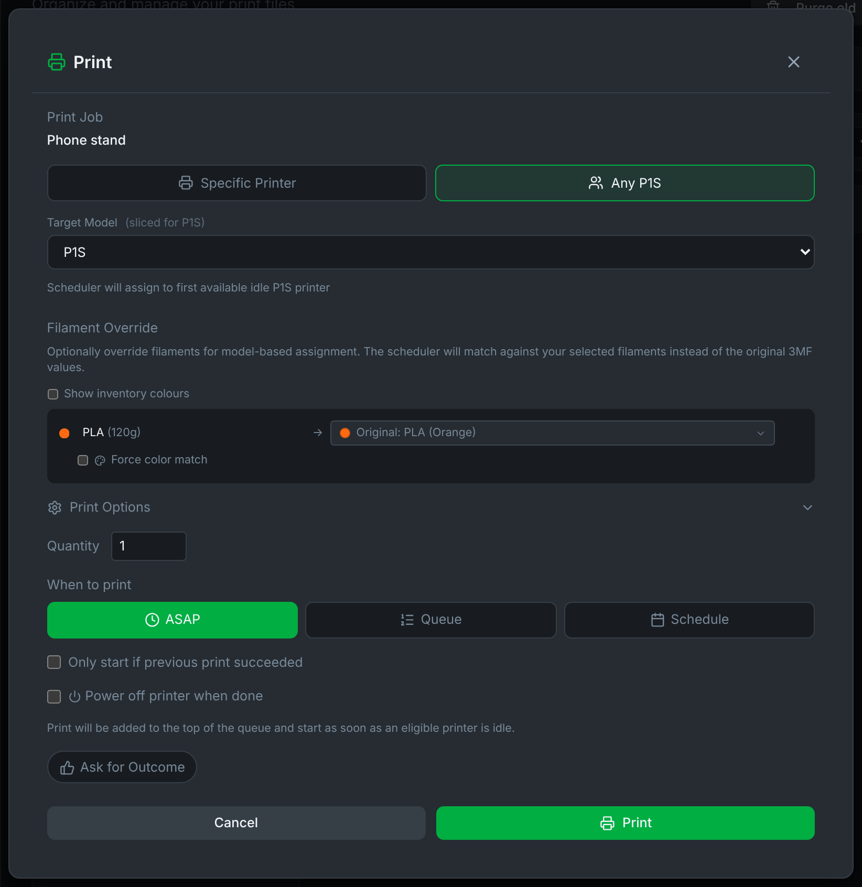 |  |
| Picker open: only loaded colours, no headers (off) vs. "Loaded now" / "In inventory, not loaded" with stock hints (on) | 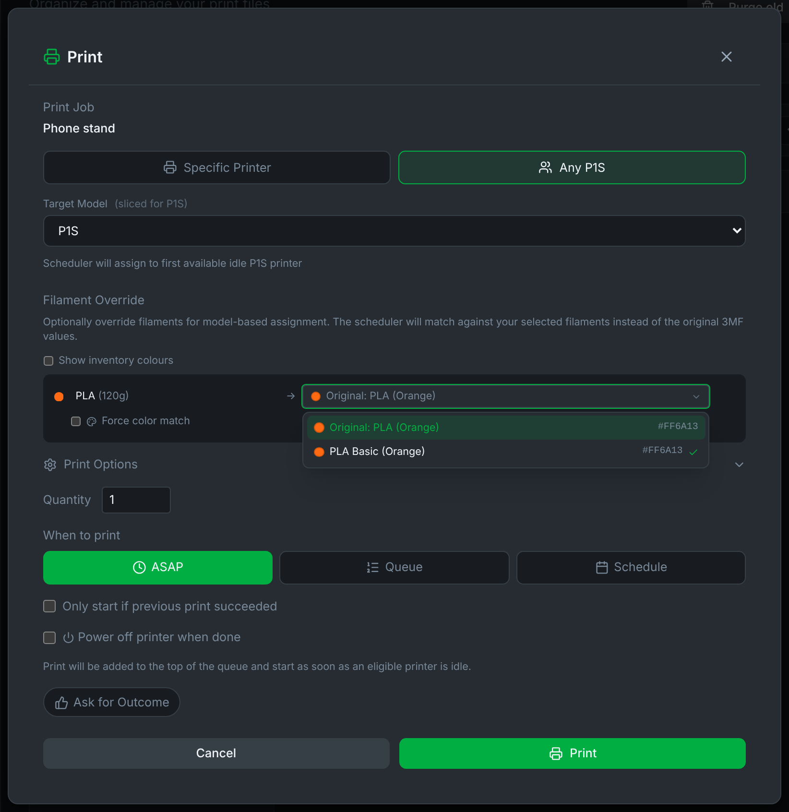 | 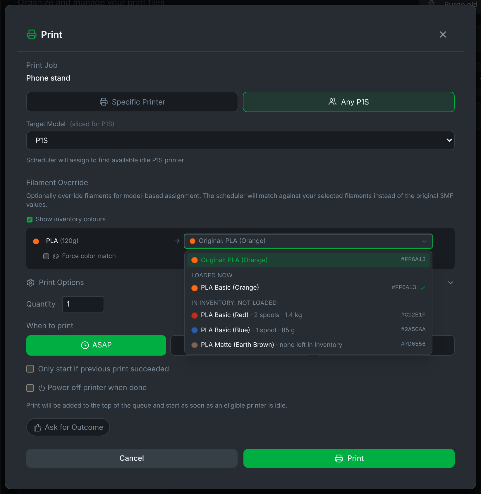 |
| Settings > Workflow > Queue & Dispatch card "Inventory Colours in the Filament Override" | 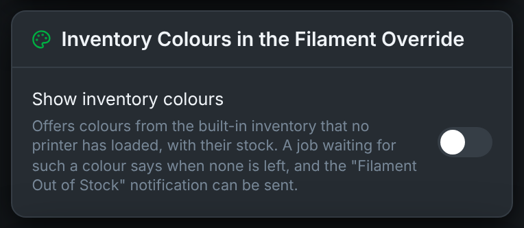 | 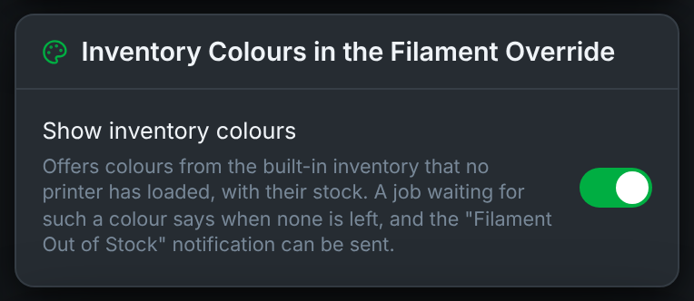 |

| Other cases (1280) | Screenshot |
|---|---|
| Setting off, editing a queued job saved with an inventory colour: picker shows the "Saved with this job" row, selected | 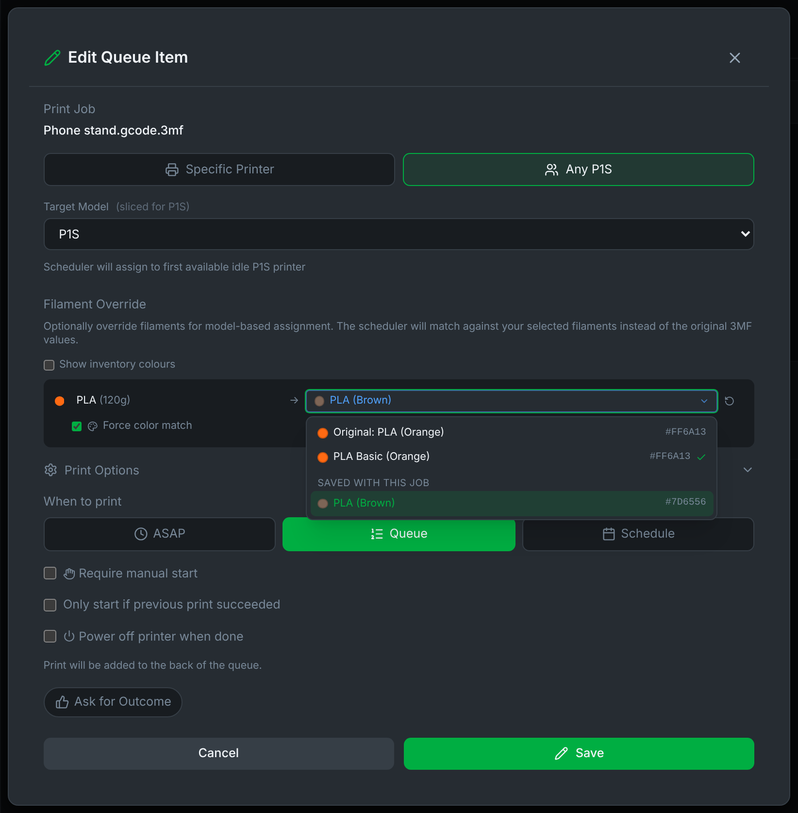 |
| User without `settings:update`: checkbox is disabled (tooltip "Only users who may change settings can switch this." on hover) | 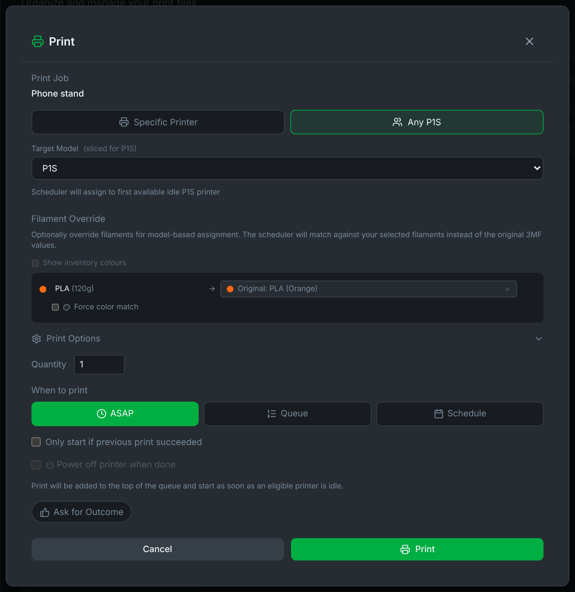 |

### Mobile (390 px wide)

| | Setting off | Setting on |
|---|---|---|
| Print dialog "Any P1S", Filament Override section with the checkbox (unticked / ticked) |  | 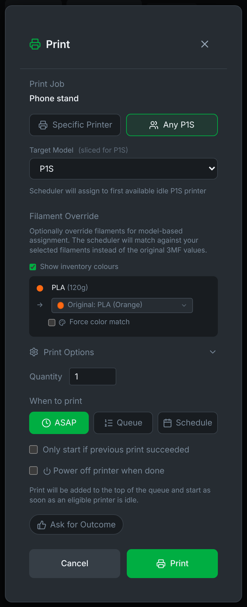 |
| Picker open | 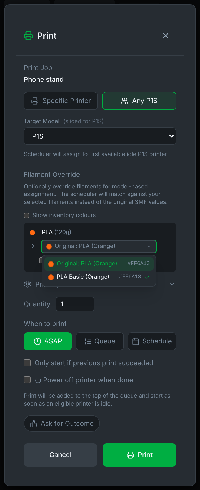 | 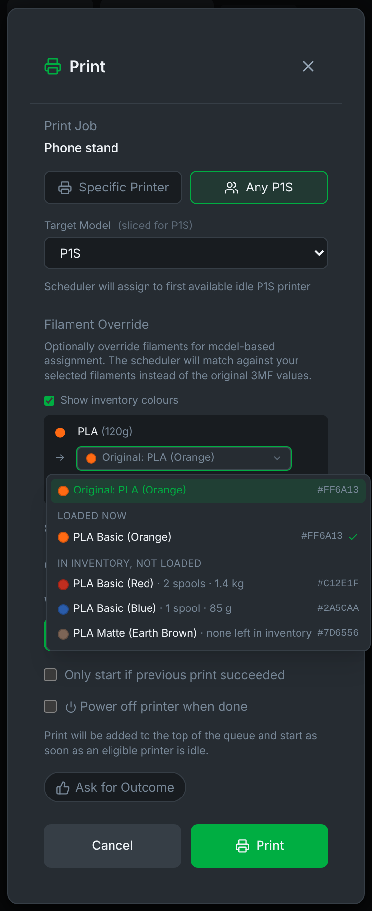 |
| Settings card | 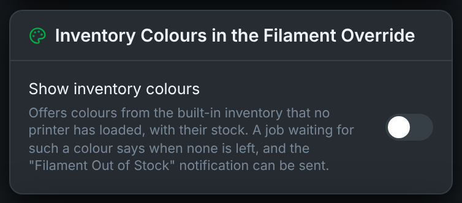 | 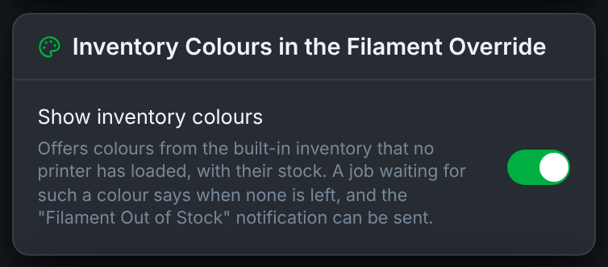 |

| Other cases (390) | Screenshot |
|---|---|
| Setting off, editing a queued job saved with an inventory colour: "Saved with this job" row selected | 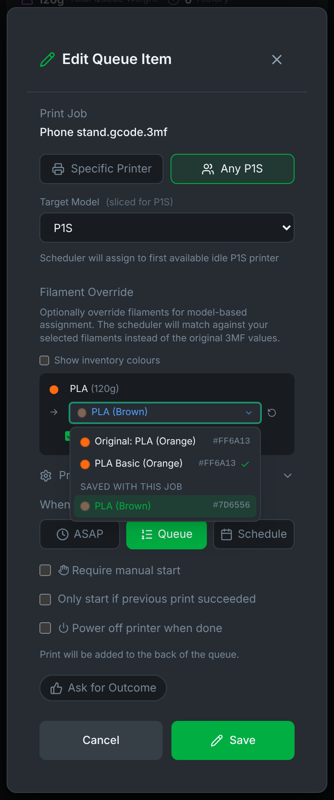 |

Screenshots use invented data (printers "P1S #1", "P1S #2", "Workshop X1C", a placeholder file, mocked inventory entries) and are not from a real printer. Dark theme.

## Testing

New tests:

Backend
- `test_spool_identity_3590.py`
- `test_inventory_stock_3590.py`
- `test_scheduler_out_of_stock_3590.py`: a held job names the colour (hex code when the override has no name) and the printer; a job that gave its printer back reads `Needs …`
- `test_scheduler_out_of_stock_3590.py`: setting off = pre-#3590 reason text for the model path, the powered-off path and the pinned path, the inventory is never read, no event; setting on = the feature as before; the setting unset or false in a queue pass
- `test_inventory_filaments_api_3590.py`: the endpoint also works with the setting off
- `test_filament_out_of_stock_notification_3590.py`
- `test_notification_out_of_stock_migration_3590.py`
- `test_settings_api.py`: the setting is off by default and round-trips
- `test_settings_ui_flags_3023.py`: `ui-flags` contains it, readable without `settings:read`

Frontend
- `FilamentOverride.test.tsx`: an inventory filament the group may not use is greyed out and cannot be picked
- `FilamentOverride.test.tsx`: without the setting a stored inventory override sits under "Saved with this job" and nothing else is grouped; the checkbox is drawn only when asked and reports a change
- `PrintModalInventoryOverride.test.tsx`:
  - off: no inventory request, loaded rows only, no headers, hints or warnings (as before #3590)
  - on: the inventory is requested and offered in its own group
  - persistence: toggling saves the setting, and a reopened dialog has the saved value
  - a user without `settings:update` sees a disabled checkbox and nothing is sent
  - off with a stored inventory override: it stays under "Saved with this job" and in the payload
  - Spoolman mode: no checkbox, no request
- `SettingsPageInventoryColours.test.tsx` (new): the card is off when nothing is set, shows the saved value, and saves a switched-on toggle
- `SlotPickerGroups.test.tsx`
- `NotificationProviderCardOutOfStock.test.tsx`
- `AddNotificationModal.test.tsx` — 2 added

Existing tests touched: `test_scheduler_model_filament_short_3137.py` (patches the renamed helper), `conftest.py`, `AddNotificationModalSecrets.test.tsx`, `TelegramVerdictMode.test.tsx` and the MSW `handlers.ts` (the new field and endpoint). The existing assign-path tests cover the `spool_tray_type()` refactor.

Checks run: the full CI workflow on the head of this branch in my fork (https://github.com/balin77/bambuddy/actions/runs/44379633752): Ruff (lint and format), basedpyright, backend tests (pytest, native and Docker), ESLint, `tsc`, knip, `check:i18n`, Vitest, the PostgreSQL upgrade check and the Docker build are all green.

- [x] I have tested this on my local machine
- [x] I have tested with my printer model: Bambu Lab A1 (with AMS)

Tested on printer: the branch runs on my farm server (Docker), with the setting on. I queued a job with three colours picked from the inventory that were not loaded. The job did not start on the printer, which had other colours loaded, and it was held with the filaments named. The stock hint, the warnings and the notification event are covered by the tests above; I did not run the stock down to zero on the farm.

## Checklist

- [x] My code follows the project's coding style
- [x] I have commented my code where necessary
- [x] My changes generate no new warnings
- [x] I have tested my changes thoroughly

## Additional Notes

**Design decisions**
- **A setting, off by default (maintainer request).** Install-wide, because the scheduler has no user. Off is exactly the behaviour before #3590, so existing installs see no change. The `inventory-filaments` endpoint stays available whatever the setting says. A user who may not change settings sees the checkbox disabled, with a hint.
- **Same identity as the assign path.** An inventory spool becomes a slot identity (type, colour) through the same `spool_tray_type()` that assigning the spool to a slot uses. A spool picked as an override therefore matches the tray the same spool would produce when assigned. There is no second copy of the rule.
- **Variant only when needed.** The variant (`tray_info_idx`) is sent only when two variants of one colour are stocked (for example PLA Basic and PLA Matte in the same colour). Otherwise the entry has no variant. The reason: a tray reports its own variant after a K-profile realign, with a per-model preset, or after a manual load. An override that names a variant the tray does not report would never match, and the forced match would block the job for good. Without a variant, type and colour decide. The variant is only used from a static, specific Bambuddy id (`GFA01` and the like). Generic, cloud, local and unknown ids give none, and a preset's own type (`type_override`, a cloud preset) is not available offline and is not used.
- **Built-in inventory only.** Spoolman mode has no stock group and no hint, and the endpoint answers `inventory_available: false`. Nothing else changes there.
- **Unknown stock is not "none left".** The suffix and the event need stock that is known and zero:
  - A colour that was never in the inventory is unknown.
  - An empty inventory, and Spoolman mode, are unknown.
  - A colour with archived spools only is "none left".
  - A spool with an unknown weight (no label weight) counts as present, so it never causes "none left".
- **New event, off by default.** It is only sent while the setting is on; the provider toggle stays, with a hint. `on_queue_job_waiting` already carries the "none left" text, so nobody needs a second message on upgrade. **Filament Out of Stock** is for those who want it on its own. Like the other stock alerts it is fleet-wide for "Any model" jobs (no printer yet); a job pinned to a printer reaches that printer's providers.
- **Endpoint permission and data.** `GET /api/v1/printers/inventory-filaments` needs `queue:create`, as `available-filaments` does. It exposes only aggregated stock: no spool ids, prices or locations.
- **Cost.** The stock is read at most once per scheduler pass, and only when a forced colour is missing. A failed read counts as unknown.
- **Scope of the notification.** The PR carries the notification event as part of the feature. It could be split into its own PR if you prefer; the waiting-reason text does not depend on it.

**For the maintainer**

The checkbox sits in the print dialog as you asked. If you would rather not have it there, it can be removed (a few lines in `FilamentOverride.tsx` and `PrintModal/index.tsx`). The Settings card alone then keeps the setting reachable. Tell me and I will drop it.

**Known limits**
- With the setting off and nothing loaded in any printer of the model, the override section stays hidden, as before. The Settings card is then the way to switch the setting on.
- `spool_tray_type()` is not used yet in the Spoolman assign paths. That is out of scope here. A follow-up is possible.

🤖 Generated with [Claude Code](https://claude.com/claude-code)
