# PR draft – #3612 (print spool labels on a network label printer)

- **Base:** `maziggy/bambuddy:dev`
- **Head:** `balin77:feature/label-direct-print`
- **Title:** `Inventory: print spool labels on a network Brother QL label printer (#3612)`
- **Status:** Draft. Submit only after #3612 is assigned to balin77 and the user approves.

---

## Description

Spool labels can only be downloaded as a PDF or PNG today. To get one onto a label printer you have to download it, open it somewhere and print it from there. That is slow for a single new spool, and awkward from a phone or tablet.

This PR lets Bambuddy print labels straight on a network label printer. The first supported printer family is Brother QL (QL-800, QL-810W, QL-820NWB). The printer is reached over its raw port (TCP 9100). Printing happens on the server, so it works from any device and behind a reverse proxy.

**What it does**

- **Settings > Filament > Label printer** card: printer type (Off / Brother QL (network)), address, model, loaded tape and a **Test print** button. The test uses the values on the page, so you can try them before saving.
- **Roll format** in the labels dialog: **Roll (label printer tape)**, with a tape width and a label length (20 to 200 mm). The label is drawn along the tape, one label per page, and the preview shows exactly what will print.
- **Print on label printer** button next to the download button in the labels dialog. It also works for the per-spool printer icon, which opens the same dialog.
- **Print label after saving** checkbox in **Add spool**. It is shown only when a label printer is set up, and the choice is remembered per device. A quick add with a quantity prints one label per created spool. If printing fails, the spool stays saved and a toast says why.
- **Print jobs.** The print routes check the request, queue the job and answer `202` with a job id. The server renders and sends the labels in the background, one job at a time per printer. The page polls the job until it is done. No HTTP request waits on the printer, so reverse-proxy timeouts do not matter.
- **Nothing changes without a printer.** With no printer set up there is no Print button and no checkbox, and the settings, API and downloads behave as before.

## Related Issue

Fixes #3612

Context: #3088, #2981, #1267 (earlier label work and requests for roll printers).

## Documentation

**Companion docs PRs**:
- Wiki: maziggy/bambuddy-wiki#___

**Pick one**:
- [x] Docs PR(s) linked above
- [ ] No docs update required — reason: ___

## Type of Change

- [ ] Bug fix (non-breaking change that fixes an issue)
- [x] New feature (non-breaking change that adds functionality)
- [ ] Breaking change (fix or feature that would cause existing functionality to change)
- [ ] Documentation update
- [ ] Code refactoring
- [ ] Performance improvement
- [ ] Test addition or update

## Changes Made

**Label printer drivers (`backend/app/services/label_printers/`, new)**
- `base.py`: `LabelPrinterConfig`, the driver protocol (`prepare`, `test_job`, `deliver`, timeouts), the `DRIVERS` registry with `get_driver`, `parse_printer_address` (host with an optional `:port`, default 9100) and the error types (`PrinterUnreachable`, `WrongMedia`, `PrinterBusy`, `PrinterDidNotFinish`, `PrinterReportedError`) with `describe_error`, which turns them into short user-facing texts.
- `brother_ql_media.py`: the tape table for continuous tape (12, 29, 38, 50, 54, 62 mm), the model list and the head constants. Pure data, so the label renderer can size a roll label without the driver.
- `brother_ql.py`: the raster protocol. 1-bit rasterising into the 720-pin line, a local PackBits encoder, job builder, 32-byte status parser, and the TCP delivery. Delivery asks for the status first, checks errors and tape width, sends the job, then reads the printer's answers until every page is confirmed. One deadline covers sending and printing. Cooling pauses extend it only when the printer reports cooling. One print at a time per printer address.

**Print jobs (`backend/app/services/label_print_jobs.py`, new)**
- In-memory job store (states `queued`, `printing`, `done`, `failed`; kept 15 minutes after finishing, at most 200 jobs) and one FIFO worker per printer address, started on demand. Shutdown marks running jobs as failed.

**Label rendering (`label_renderer.py`)**
- `RollLayout(tape, length_mm)` is a third template kind next to the fixed templates and `SheetLayout`. Label size is length x printable tape width, one label per page. Limits 20 to 200 mm.
- `iter_pdf_images` yields pages one at a time. `pdf_to_pngs` now encodes each page before it renders the next, so the PNG download no longer holds every page in memory.

**API**
- `labels.py`: `LabelOptions` accepts `template: "roll"` with `roll: {tape, length_mm}`; the preview works for it. New `POST /inventory/labels/print` and `POST /spoolman/labels/print` (202, `{job_id, total}`) and `GET /labels/print-jobs/{job_id}`. Limits: 100 labels and 4000 mm of tape per request.
- `settings.py` and `schemas/settings.py`: keys `label_printer_type`, `label_printer_host`, `label_printer_model`, `label_printer_tape` (key/value rows, no migration), validated on save. The host goes through `assert_safe_lan_service_url`. New `POST /settings/label-printer/test`. `GET /settings/ui-flags` gets `label_printer_configured` and `label_printer_tape`, so users without `settings:read` still see the Print button.
- `_label_printer_helpers.py` (new): loads the config (saved values plus optional overrides) and runs the driver off the event loop with an abandon flag.
- `main.py`: stops the print workers on shutdown.

**Frontend**
- `LabelPrinterSettings.tsx` (new) and `SettingsPage.tsx`: the **Label printer** card with search entry.
- `LabelTemplatePickerModal.tsx`: roll format (tape, length), **Print on label printer** button with progress, hints (roll format only, tape must match the printer, too many labels, too much tape), black and white forced while printing.
- `SpoolFormModal.tsx`: **Print label after saving** checkbox, one label per created spool.
- `utils/labelPrint.ts`, `utils/labelPrintJobs.ts` (new): label options for auto-print, chunking within both limits, and a module-level poller that follows a job every second and toasts the result, also after the dialog has closed. It gives up after 20 minutes with a clear message.
- `client.ts`, `useUiSettings.ts`: types, `printLabels`, `getLabelPrintJob`, `testLabelPrinter`, `isLabelPrinterConfigured`.
- New strings in all 16 locales, with real translations.

**Tests** — see Testing.

## Screenshots

### Desktop (1280)

| | Before | After |
|---|---|---|
| Settings > Filament, Label printer card | 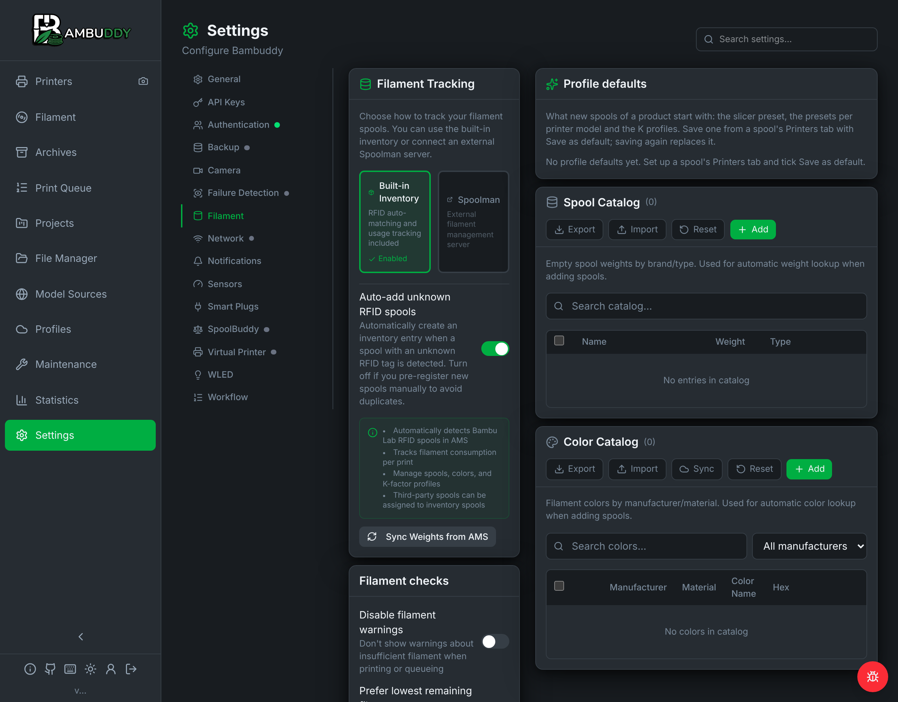 | 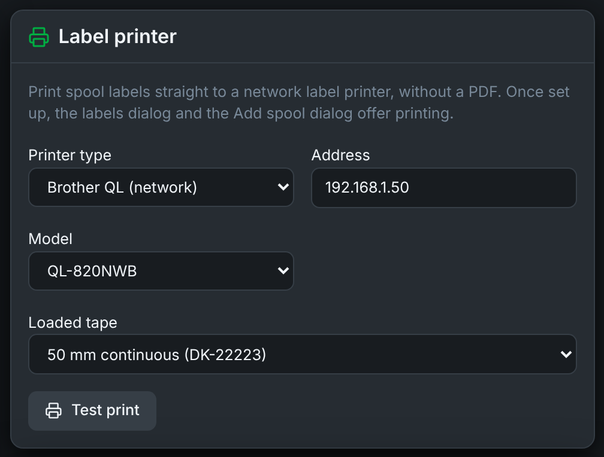 |
| Label printer card, test print answer | _(not present before)_ | 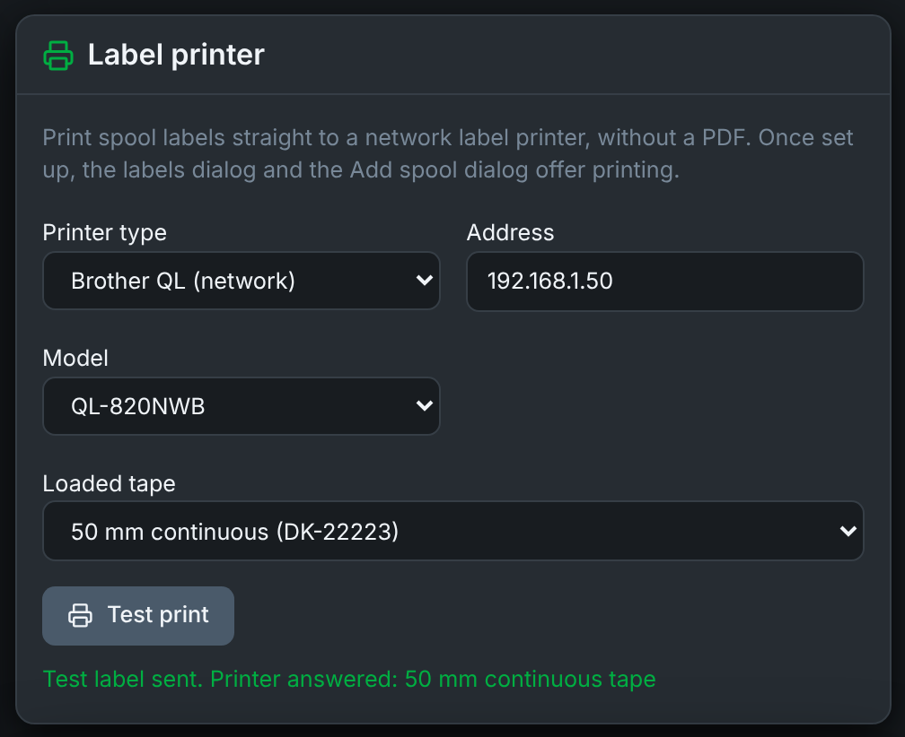 |
| Print spool labels dialog (2 spools) | 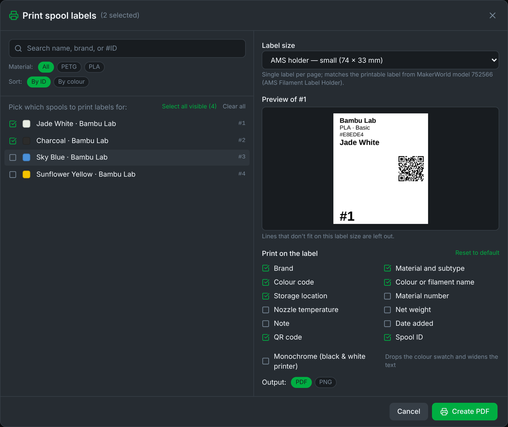 | 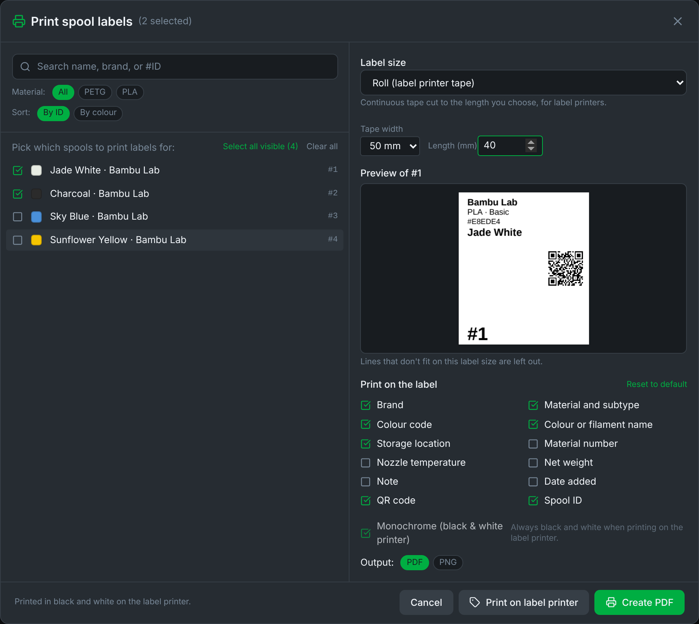 |
| Toast after printing | _(not present before)_ | 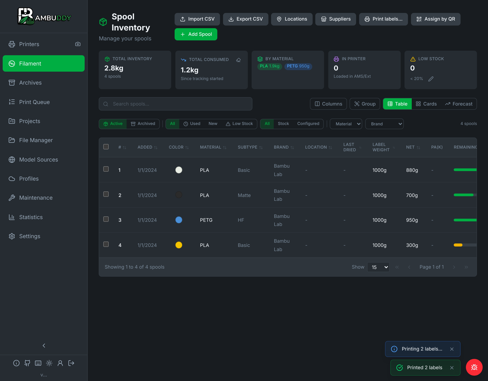 |
| Add spool: Print label after saving | 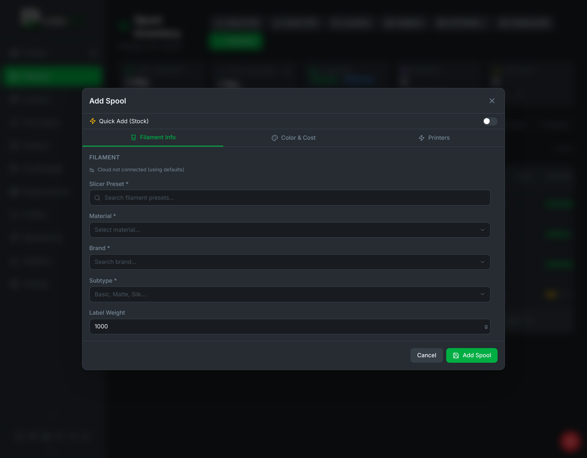 | 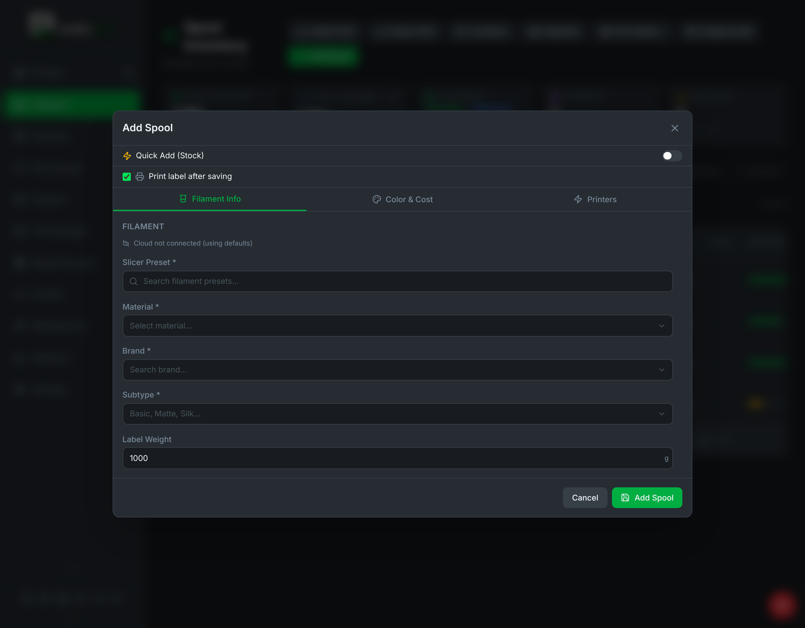 |
| Labels dialog without a label printer configured (no Print button) | _(not present before)_ | 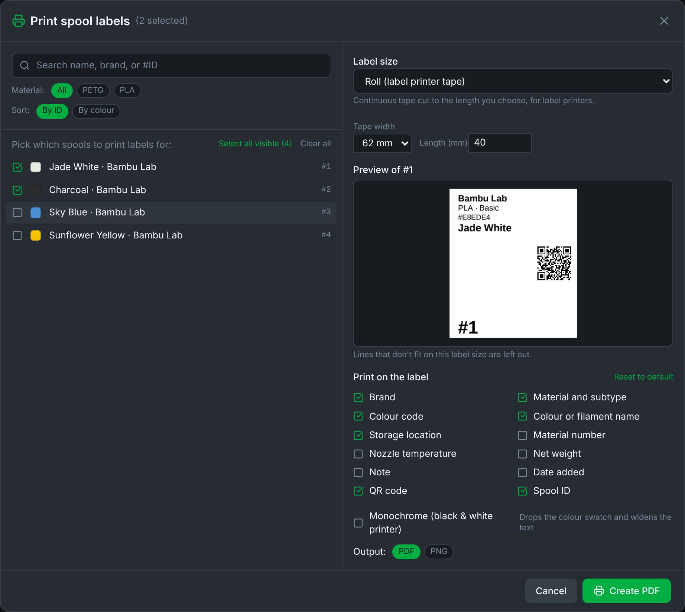 |

### Mobile (390)

| | Before | After |
|---|---|---|
| Settings > Filament, Label printer card | 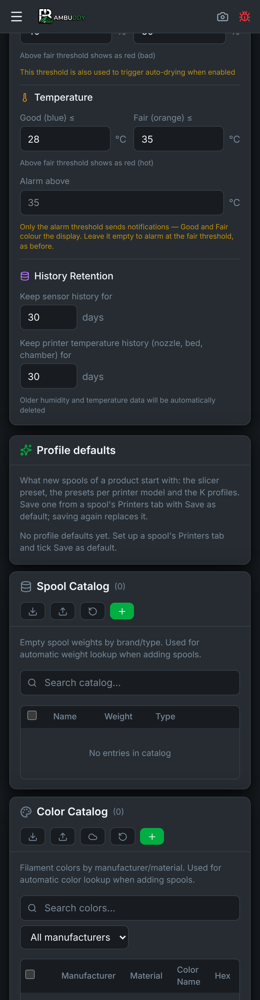 | 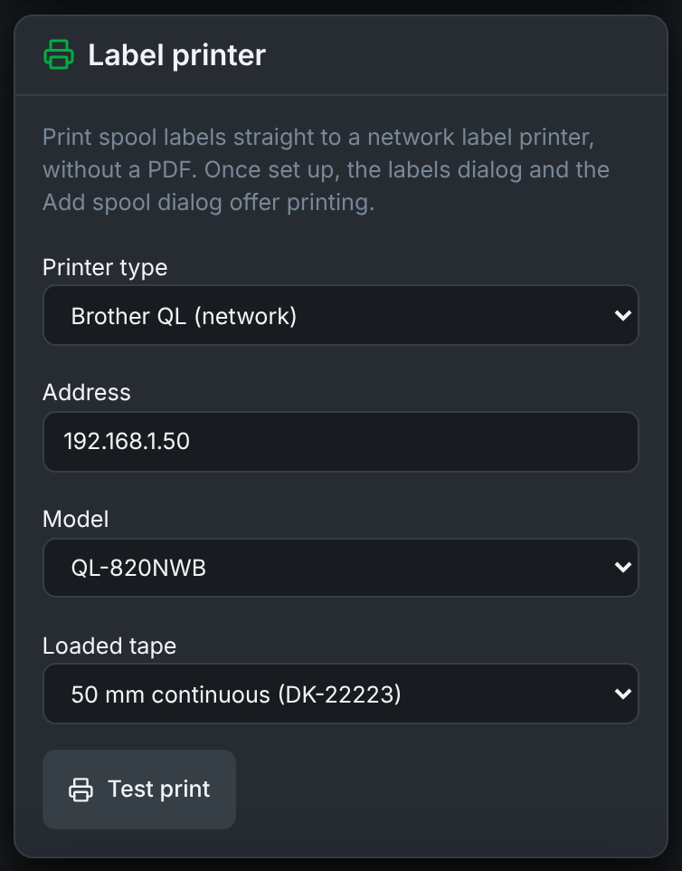 |
| Label printer card, test print answer | _(not present before)_ | 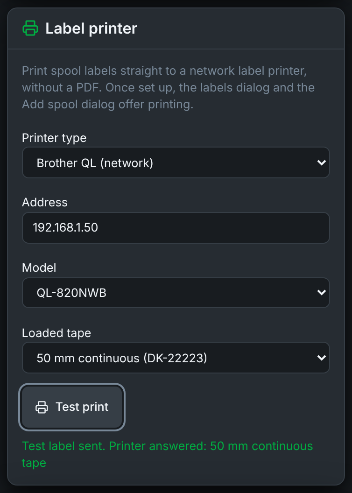 |
| Print spool labels dialog (2 spools) | 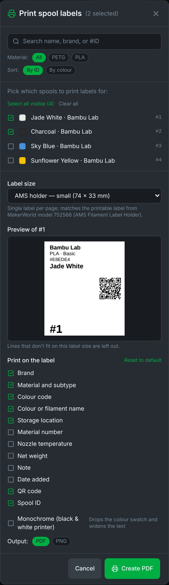 | 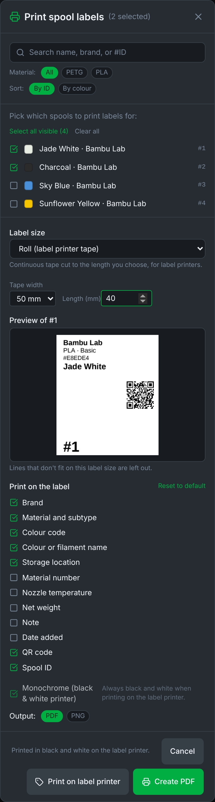 |
| Toast after printing | _(not present before)_ | 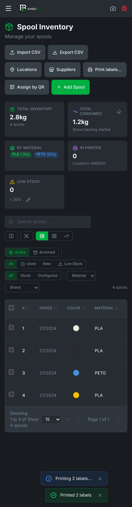 |
| Add spool: Print label after saving |  |  |

## Testing

Backend (165 tests collected in the four new files):
- `backend/tests/unit/test_brother_ql_3612.py` — raster protocol: rasterising and margins for each tape, mirroring, PackBits round trip, job byte sequence (compressed and not), status parsing, and socket tests against a local fake printer: slow reader, silent printer, error status, wrong tape, busy, multi-page confirmation, unreachable port, abandon.
- `backend/tests/unit/test_label_print_jobs_3612.py` — job store, FIFO lanes, expiry and limits, shutdown.
- `backend/tests/unit/test_label_roll_3612.py` — roll sizes, page size and limits.
- `backend/tests/integration/test_label_printing_api_3612.py` — print routes (202, 400, 409, 422, 404), job route, permissions, test endpoint, settings validation, `ui-flags`, no address in print errors.
- `test_settings_ui_flags_3023.py` — pinned fields updated.

Byte comparison against `brother_ql_next`: done once, out of tree. The same images and tape produce the same raster data, framing and commands. The only difference is the status request before the job. The package is not a dependency and is not used in the tests.

Frontend (52 new tests):
- `LabelPrinterSettings.test.tsx` — 8
- `LabelDirectPrint.test.tsx` — 18
- `SpoolFormLabelPrint.test.tsx` — 12
- `labelPrintJobs.test.ts` — 14
- `LabelTemplatePickerModal.test.tsx` and `LabelTemplatePickerKeys.test.ts` — adjusted for the roll format

Checks to run before submitting: Ruff (lint + format), basedpyright against the baseline (the baseline is updated in this PR), ESLint, `tsc`, knip, `npm run check:i18n`, Vitest, backend tests. TODO user: confirm they are green on the final head.

- [x] I have tested this on my local machine
- [ ] I have tested with my printer model: <!-- TODO: user – real hardware test, Brother QL-820NWB with DK-22223 (50 mm): test print, labels from the dialog, Add spool, wrong tape, cover open -->

Tested on printer: TODO user (QL-820NWB, DK-22223).

## Checklist

- [x] My code follows the project's coding style
- [x] I have commented my code where necessary
- [x] My changes generate no new warnings
- [x] I have tested my changes thoroughly

## Additional Notes

**Why an own implementation**
- No new dependency. The protocol is small: about 600 lines including the network handling.
- `brother_ql` has not been maintained since 2019. The forks (`brother_ql_next` and others) are GPL-3.0, have a single maintainer, and pull in `pyusb` and `click`, which Bambuddy does not need.
- Their network backend sends the job and reads no status, so it cannot tell "wrong tape", "cover open" or "printed" from "sent". The driver here does.

**Protocol**
- Brother "Raster Command Reference QL-800/810W/820NWB": invalidate, initialize, raster mode, print information, auto cut, margins, TIFF/PackBits compression, raster lines, print with feed.
- The framing is identical to `brother_ql`. The one addition is a status request (`ESC i S`) before the job, to check errors and the loaded tape. A printer that does not answer it is still printed to.
- The QL-800 takes no compression, so the job is sent uncompressed for it.

**Security**
- The address goes through `assert_safe_lan_service_url` on save and on the test. Loopback and private ranges stay allowed, as for the other LAN services. Any port from 1 to 65535 is accepted; this is documented, because the raw port is 9100 by default but some setups map it.
- Errors on the print routes and in job status never name the address. Those routes need only `inventory:read`, like the download, so they must not help to map the LAN. The test endpoint needs `settings:update` and may name it.
- `inventory:read` is enough to print, as for the download. Note that printing uses tape.
- The saved settings are not secrets. `ui-flags` exposes only whether a printer is set up, and the tape id.

**Limits**
- At most 100 labels and 4000 mm of tape per request. The dialog mirrors both and disables Print with a hint. Auto-print splits a quick add into chunks within both.
- Roll length 20 to 200 mm.
- Only the roll format prints on the printer. Sheet templates give a 400.

**Known limits**
- The job store is in memory. A restart loses job state; a job that was running is not resumed, and the page then says it no longer knows the job.
- One lane and one lock per printer address, keyed by the host string as configured (resolving a name would block). Two different names for the same printer would get two lanes, so keep one address in the settings. The printer takes one connection; a job that cannot get it in time fails with a "busy" message and can be repeated.

**Future printers**
- A printer type is one driver class registered in `DRIVERS` that implements `prepare`, `test_job`, `deliver` and the timeouts. The settings, routes, jobs and frontend do not change.

🤖 Generated with [Claude Code](https://claude.com/claude-code)

https://claude.ai/code/session_0127bEAsde34UE3UDyMWQtka
