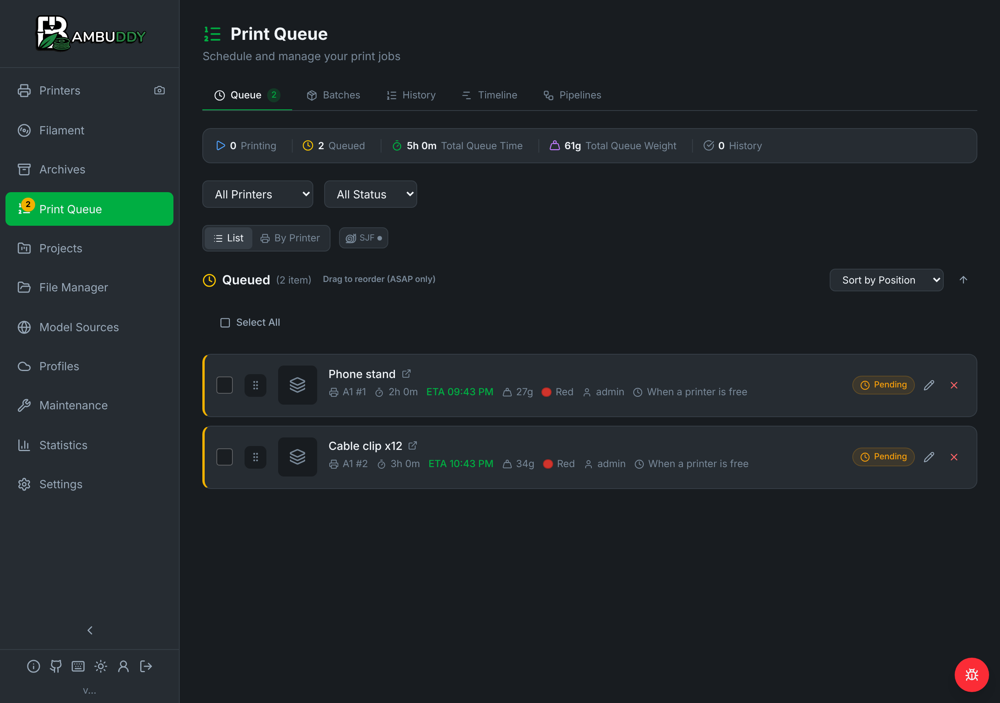
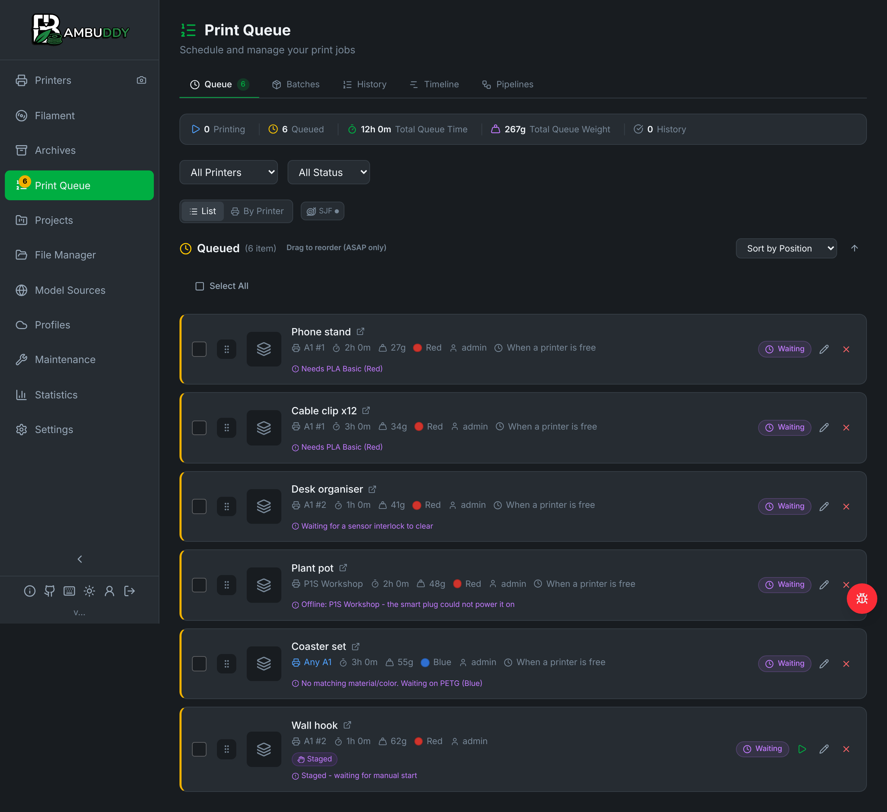
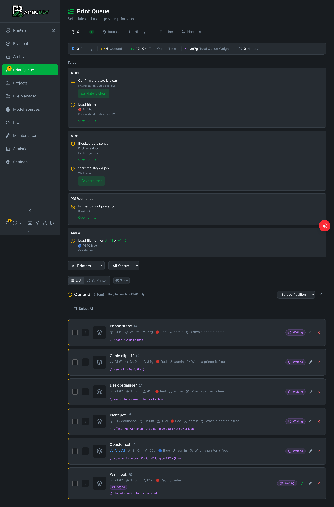
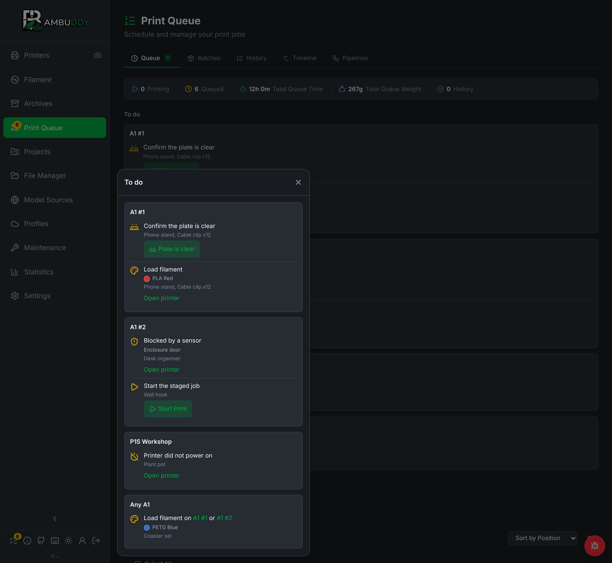
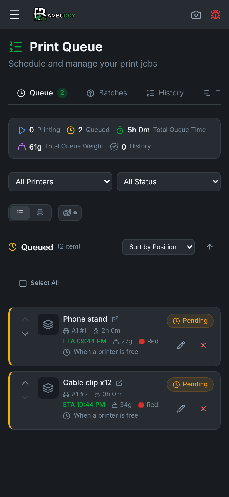
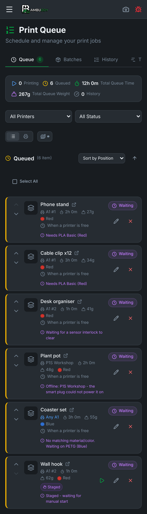
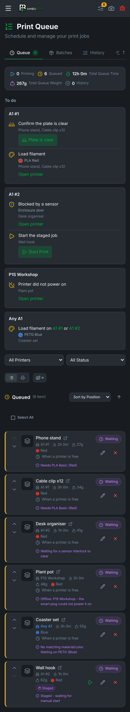
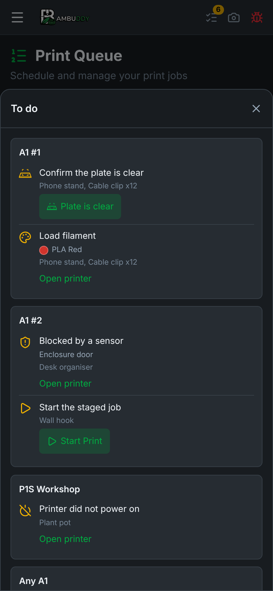
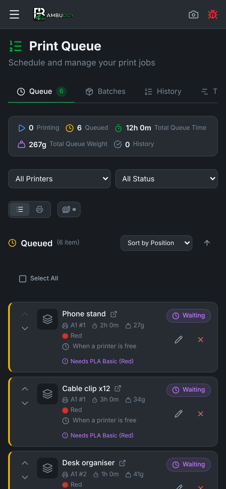
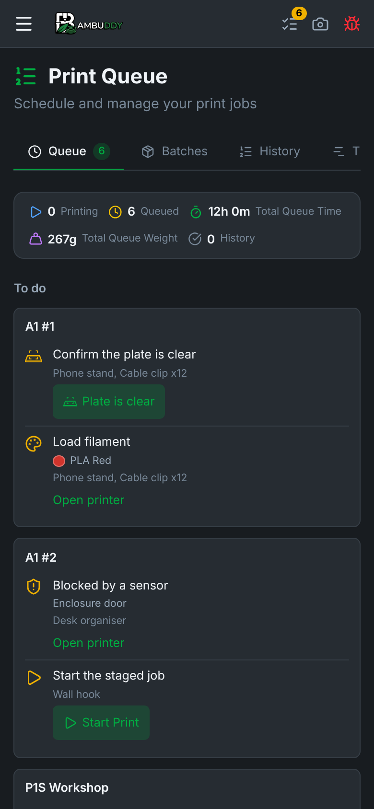

# PR draft – #3615 (queue "To do" list)

- **Base:** `maziggy/bambuddy:dev`
- **Head:** `balin77:feature/queue-todo-list`
- **Title:** `Queue: a To do list of everything the queue waits on, grouped by printer (#3615)`
- **Status:** Submitted as maziggy/bambuddy#3622; wiki companion maziggy/bambuddy-wiki#156.

---

## Description

A queued job can wait for many reasons, and today you find them one by one: a plate to clear on one printer card, a filament to load on another, a staged job on the queue page, a sensor that holds a printer, a smart plug that did not switch a printer on. There is no single place that says "the queue is waiting for you, and here is for what".

This PR adds a **To do** list. It shows everything the queue waits on, grouped by printer, with the action to fix it.

**The list**

One entry per action, with the number of jobs that wait for it. The kinds:

| Kind | Meaning | Action |
|------|---------|--------|
| Plate clear | The printer waits for the plate to be confirmed clear, and a pending job could go to it | **Plate is clear** |
| Load filament | A job needs a filament that is not loaded | Link to the printer |
| Start staged | A job is staged (manual start) | **Start**, with the existing Print-anyway confirmation |
| Sensor interlock | A sensor holds the printer (for example the enclosure door) | Shows the sensor |
| Smart plug failed to power on | The Auto Power On plug did not switch the printer on | Link to the printer |

- **Jobs for a printer model** are shown under **Any &lt;model&gt;**. A **Load filament** entry there names the printers where loading the filament lets the job start.
- **Plate is clear** and **Start** use the existing calls and the existing permissions. The buttons are disabled with the usual reason when the user may not use them.
- **Where it shows:** a badge with the count in the navigation, a panel that opens from the badge (a bottom sheet on a phone), and the top of the **Queue** page. It is hidden when the list is empty.
- **Refresh:** no new polling. The list refetches when the queue refetches (the queue page and the layout's queue poll) and on the WebSocket events the app already receives (queue item events, printer status with a changed plate-clear gate, print complete, AMS and tray changes).

## Related Issue

Fixes #3615

Related: #1497, #3131, #3587, #2799, #3280, #1148, #3590

## Documentation

**Companion docs PRs**:
- Wiki: maziggy/bambuddy-wiki#156

**Pick one**:
- [x] Docs PR(s) linked above
- [ ] No docs update required — reason: ___

## Type of Change

- [ ] Bug fix (non-breaking change that fixes an issue)
- [x] New feature (non-breaking change that adds functionality)
- [ ] Breaking change (fix or feature that would cause existing functionality to change)
- [ ] Documentation update
- [ ] Code refactoring
- [ ] Performance improvement
- [ ] Test addition or update

## Changes Made

**Backend**
- `services/queue_todo.py` (new): the shared records (`TodoFilament`, `FilamentHold`) and `build_todo()`, the pure part of the list. It groups by printer, merges entries, orders them and counts them. The route only gathers the inputs.
- `services/print_scheduler.py`: next to every place that writes a filament waiting text (pinned "Needs …", filament deficit, model matcher with missing filament, force-colour "No matching material/color"), the scheduler records a structured hold: job id, printer id (or model), and the filaments (type, colour, colour name). The records are built per pass in memory and swapped in at the end of the pass, so stale ones disappear. `filament_holds_snapshot()` returns a copy. `power_on_failed_printers()` returns the printers whose power-on failed and is still in its cool-off (#2786), including the failure of a pinned job. A staged job with no carried hold gets its filaments rebuilt without touching its text. After an exception in a pass the previous snapshot is kept, merged with what the pass recorded. The waiting texts, the order and the behaviour of the scheduler are unchanged.
- `api/routes/print_queue.py`: `GET /api/v1/queue/todo`. It reads the pending jobs (same filters and scope as the queue list), the printers the caller may see, the plate-clear gate, `ha_sensor_manager.blocked_printers()` and the scheduler snapshot, and passes them to `build_todo()`. The per-job `can_start` uses the rules of the start endpoint (ownership, awaiting review, model-target limit). The display name of a job is now one helper shared with the queue row (`_queue_item_display_name`).
- `schemas/print_queue.py`: `QueueTodoResponse`, `QueueTodoGroup`, `QueueTodoEntry`, `QueueTodoJob`, `QueueTodoFilament`, `QueueTodoPrinter`.

**Frontend**
- `api/client.ts`: `getQueueTodo()` and the types.
- `hooks/useQueueTodo.ts` (new): the query (`['queue-todo']`, no interval) and `useQueueTodoAutoRefresh()`, which refetches the list when a `['queue']` query has refetched. It is mounted once in `Layout.tsx`.
- `hooks/useWebSocket.ts`: invalidates `['queue-todo']` on the queue item events, on a changed plate-clear gate, on print complete and on AMS and tray changes.
- `hooks/useStartQueueItem.tsx` (new): the start call with the Print-anyway confirmations (filament deficit #1496, missing tray #2799), moved out of `QueuePage.tsx` so the queue page and the list share it.
- `components/QueueTodoList.tsx` (new): the list. An icon per kind, job names (a count for more than two jobs), colour swatches and names, the interlock detail, and the actions.
- `components/QueueTodoLauncher.tsx` (new): the badge and the panel. A bottom sheet on a phone, a floating panel from 768 px. Escape and the backdrop close it. It renders nothing at 0.
- `components/Layout.tsx`: the launcher in the compact header and in the sidebar.
- `pages/QueuePage.tsx`: the list at the top of the Queue tab, and the start flow through `useStartQueueItem`.
- `pages/PrintersPage.tsx`: `/printers#printer-card-<id>` scrolls to that card (or opens it in S mode), so the list can link to a printer.
- `i18n/locales/*.ts`: new `queueTodo.*` keys in all 16 locales, with real translations.

**Tests** — see Testing.

## Screenshots

### Desktop (1280)

| View | Before | After |
|---|---|---|
| Queue, empty to-do list (no list, no badge) |  |  |
| Queue with to-do list over several printers |  |  |
| Navigation badge (6) and opened panel | _(not present before)_ |  |

### Mobile (390)

| View | Before | After |
|---|---|---|
| Queue, empty to-do list (no list, no badge) |  |  |
| Queue with to-do list over several printers |  |  |
| Navigation badge (6) and opened panel (bottom sheet) | _(not present before)_ |  |
| Queue page on mobile |  |  |

## Testing

Backend (51 test functions):
- `backend/tests/integration/test_queue_todo_3615.py` — 31: each kind, merging jobs of one printer and filament set, separate entries for different filaments, model jobs under "Any &lt;model&gt;" with their printers, printer entries only while a job waits, scope filtering, permissions, `can_start`, an empty list
- `backend/tests/unit/test_queue_todo_scheduler_3615.py` — 19: the scheduler records a hold at each writer, the snapshot swap drops stale holds, rebuild for staged jobs, a failed pass keeps the previous snapshot
- `backend/tests/unit/test_queue_todo_power_on_3615.py` — 1

Frontend (23 tests):
- `QueueTodo.test.tsx` — 19: rendering per kind, merged entry, empty list renders nothing, badge count and hidden at 0, actions call the right API and respect permissions, refresh on queue refetch
- `PrintersPageCardHash3615.test.tsx` — 3
- `useWebSocket.test.ts` — 1 added

Checks run: the full CI workflow on the head of this branch in my fork is green (https://github.com/balin77/bambuddy/actions/runs/44382974116): Ruff (lint + format), basedpyright, pytest (native and Docker), ESLint, `tsc`, knip, `npm run check:i18n`, Vitest, the PostgreSQL upgrade check and the Docker build.

Manual test: the list runs on my farm server (two A1, Docker) since 19 November, in a build that also carries my other open branches. I have not yet walked through every kind of entry on the real printers; that test is under way and I will add the result here. The screenshots were taken against a mocked API, not real printers.

- [x] I have tested this on my local machine
- [ ] I have tested with my printer model: Bambu Lab A1 — in progress, see above

## Checklist

- [x] My code follows the project's coding style
- [x] I have commented my code where necessary
- [x] My changes generate no new warnings
- [x] I have tested my changes thoroughly

## Additional Notes

**Design decision: a structured record, not the waiting text**
The filament entries do not come from parsing `waiting_reason`. That text is written for people, it is translated in the frontend by its prefixes, and other PRs change it. Parsing it would break whenever a wording changes. Instead the scheduler writes a small structured record (job, printer, filaments) at the same place where it writes the text. The text itself is not touched: the scheduler's texts, order and behaviour are byte-identical to `dev`.

**Where the records live**
- In memory, rebuilt on every scheduler pass and swapped in at the end, so nothing stale stays.
- A staged job gets its filaments rebuilt after a restart. Other holds appear again on the next pass (seconds after the start).
- No table and no migration.

**Permissions and scope**
- `GET /queue/todo` needs the same permissions as `GET /queue` (`queue:read_all` or `queue:read_own`) and applies the same printer scope and ownership filter.
- Jobs outside the scope are invisible. Printers outside the scope never appear.
- A printer entry (plate clear, interlock, power-on failed) appears only while a pending job the caller can see could go to that printer: pinned to it, or a model job whose model and location fit.
- **Plate is clear** and **Start** need the same permissions as today. `can_start` per job comes from the backend with the rule of the start endpoint.

**Known limits**
- No HMS faults and no other printer errors. The list is about what the queue waits on.
- No notification. The list is for looking, not for alerting.
- A job for a printer model lists the printers with the fewest missing filaments, since loading there is the quickest way to start it. Other printers that miss more are not listed.
- A dual-nozzle printer's detail (which nozzle or extruder) is not shown.
- `no_stock` ("none left in inventory") is always false on this branch, because this PR makes no inventory query. See below.

**When other open PRs land**
These are the places to adapt when they merge. None of them is needed for this PR. On my farm the three adaptations below already run together with this branch, so they are written and tested.
- **#3590** (colour names, "&lt;Printer&gt; needs &lt;Filament&gt;" text, " – none left in inventory"): the hold records take their colour names from the requirement dicts, so the new names flow through. Fill `no_stock` from #3590's stock logic where the holds are recorded.
- **#3587** ("Waiting for filament: …" with the "priority in N h" / "has priority" suffix): show the priority on the entry, for example as a `detail`. The skip mode does not stage, so check that a skipped job still records its hold.
- **#3575** ("Plate changer empty: &lt;printer&gt;"): add a kind `plate_changer_empty`, with the same rule that the entry appears only while a job waits for that printer.

🤖 Generated with [Claude Code](https://claude.com/claude-code)
