# PR draft – #3619 (spool form: last spool, brand colours, brand empty spools)

- **Base:** `maziggy/bambuddy:dev`
- **Head:** `balin77:feature/spool-form-last-used`
- **Title:** `Spool form: start with the last spool, list the brand's colours and empty spools first (#3619)`
- **Status:** Draft. Submit only after #3619 is assigned to balin77 and the user approves. Nothing is posted.

---

## Description

Adding many colours of one product means typing brand, material, subtype, preset, weights, location, cost, category and supplier again for every spool. The colour list and the empty spool list also do not follow the brand. This PR changes the Add Spool form in three parts. It is frontend only: no schema change, no migration, no new dependency.

**Part 1: start with the last spool**

A new spool starts with the values of the last spool created in this browser. This is always on and only in create mode. Edit and Copy are unchanged.

- **Carried:** brand, material, subtype, slicer preset, label weight, empty spool weight (with its catalog entry), storage location, cost per kg, category, suppliers.
- **Not carried:** colour fields (colour, name, extra colours, effect), note, used weight, tag and RFID data, last dried, material number, low-stock threshold, supplier article numbers. These belong to the single spool.
- **Stale records.** A storage location, empty spool entry or supplier that no longer exists is dropped silently, once its list has loaded. A late list never overwrites what you changed in the meantime.
- **Saved** after a successful create, also for Quick Add and bulk create. Never on open, cancel, edit or copy. Storage that is missing, blocked or holds bad JSON means an empty form, as today.
- **Spoolman mode** has its own memory (`bambuddy-last-spool-spoolman`; built-in uses `bambuddy-last-spool`). The Spoolman filament link is not carried, because the colour belongs to that filament. A Spoolman tare that you never set (it is inherited from the filament) is not carried either.
- **Hint and Clear.** A line at the top of the form reads **Started with your last spool (Polymaker PLA Matte) · Clear**. **Clear** empties the form and hides the line.
- **Suppliers** from memory are saved only when the backend's inheritance attached none to the new spool. They never overwrite inherited suppliers. In Spoolman mode there is no inheritance, so they are saved.
- **Preset.** A remembered preset stays against the profile defaults (#1326) while brand and material still match the remembered product. If the preset itself came from a profile default, or you change brand or material, the next product's default may replace it again. An empty preset is still filled by the profile default.

**Small fix in the same code: trailing `+`**

The catalog fallback for a trailing `+` ("PLA Silk+" falls back to "PLA Silk") dropped `extra_colors` and `effect_type`, so picking such a colour gave a flat swatch. It now carries both like the other branches. This is its own commit with its own test. It is a separate bug, so I can split it into its own PR if you prefer.

**Part 2: colours of the chosen brand**

The catalog colour list now matches the brand when the brand is a product line, and when the material is the form material at the end of a product line name.

- A catalog entry also matches when its material **ends with the form material as a whole word**, for any brand: Polymaker + PLA lists "PolyTerra PLA" and "PolyLite PLA". Only single-word product lines count.
- The **brand can be the product line**: brand PolyTerra finds the manufacturer Polymaker's "PolyTerra PLA" entries.
- **Variant and material words are excluded** from product lines. A brand such as "Silk", "Basic" or "PLA" does not pull in every line that contains the word. "Carbon Fiber PLA" or "CF PLA" is not plain PLA.
- **No CF/GF leak:** PLA-CF, PLA+, Glass Fiber and similar never show up for PLA, unless the form material or subtype names them.
- **No brand:** nothing changes.
- **Show all colours** widens the list to every catalog colour of the brand, matching ones first. It also appears next to the fallback palette when the brand has catalog colours but none match the material. It resets when brand or material changes.
- The colour section is shared, so this is also visible on SpoolBuddy's write-tag page.

**Part 3: empty spools of the brand first**

The **Empty Spool Weight** picker groups its entries into **Suggested** and **All**, like the brand and material dropdowns (#1905). Nothing is hidden, and the typed filter applies to both groups. Without a brand the list is as today.

- Suggested are entries whose name starts with the brand as a whole word, for example "PolyMaker - Cardboard" for Polymaker.
- Aliases come from the colour catalog, with no hard-coded names: a manufacturer also goes by its product lines ("PolyTerra PLA - Cardboard" for Polymaker), and a product line also goes by its manufacturer. Variant and material words never become aliases.
- Without the colour catalog only the brand itself matches.

## Related Issue

Fixes #3619

Related: #1905 (Suggested / All grouping), #1326 (profile defaults), #1234, #480, #419.

## Documentation

**Companion docs PRs**:
- Wiki: maziggy/bambuddy-wiki#___

**Pick one**:
- [x] Docs PR(s) linked above
- [ ] No docs update required — reason: ___

## Type of Change

- [x] Bug fix (non-breaking change that fixes an issue): the trailing `+` colour fix only
- [x] New feature (non-breaking change that adds functionality)
- [ ] Breaking change (fix or feature that would cause existing functionality to change)
- [ ] Documentation update
- [ ] Code refactoring
- [ ] Performance improvement
- [x] Test addition or update

## Changes Made

**Part 1: last spool**
- `spool-form/constants.ts`: storage keys `LAST_SPOOL_KEY` and `LAST_SPOOL_SPOOLMAN_KEY`.
- `spool-form/utils.ts`: `LastSpool` type, `loadLastSpool(mode)` (versioned, every field type-checked, wrapped in try/catch) and `saveLastSpool(mode, data)` (never throws).
- `SpoolFormModal.tsx`:
  - the create branch of the reset effect applies the remembered fields, the preset input and the hint state;
  - location, empty spool entry and suppliers are applied by a separate effect once their lists have loaded and still contain the record (suppliers are always fetched fresh);
  - `rememberSpool()` runs after a successful single, Quick Add and bulk create;
  - `shouldSaveSupplierLinks(created)` saves remembered suppliers only when the create response shows none inherited (always in Spoolman mode);
  - the preset logic keeps a remembered preset against profile defaults (#1326) and releases it when the product changes;
  - the hint with **Clear**; lists-loaded flags for location and catalog.
- `i18n/locales/*.ts` (16 locales): `inventory.lastUsed.{hint,hintPlain,clear}`.

**Fix: trailing `+`**
- `spool-form/catalogColors.ts`: the `+` branch carries `extra_colors` and `effect_type`.

**Part 2: brand colours**
- `spool-form/catalogColors.ts` (new): the catalog matching moved out of `ColorSection` into a pure `matchCatalogColors()` with unchanged behaviour (own test commit first), then extended with the product-line rules. Also `allBrandCatalogColors()` and `brandAliases()`.
- `spool-form/ColorSection.tsx`: uses the helpers; **Show all colours** toggle in the catalog section and next to the fallback palette; resets on brand or material change.
- `i18n/locales/*.ts` (16 locales): `inventory.catalogColors.{showAll,showMatching,allBrand}`.

**Part 3: brand empty spools**
- `spool-form/GroupHeading.tsx` (new): the heading row, shared with the #1905 dropdowns.
- `spool-form/utils.ts`: `splitSuggested()` now takes a key function for non-string options (strings behave as before); new `brandSuggestedNames()`.
- `spool-form/AdditionalSection.tsx`: `SpoolWeightPicker` groups **Suggested** and **All**. New optional props `brand` and `catalogColors`.
- `spool-form/FilamentSection.tsx`: imports the shared heading, no behaviour change.
- `spool-form/types.ts`, `SpoolFormModal.tsx`: pass `brand` and `catalogColors` to the additional section.
- `SpoolBuddyWriteTagPage.tsx` and `BulkEditSpoolsModal.tsx` are untouched. New props are optional, so they behave as before (the write-tag page gets the colour change from part 2).

## Screenshots

### Desktop (1280)

| View | Before | After |
|---|---|---|
| New spool form | 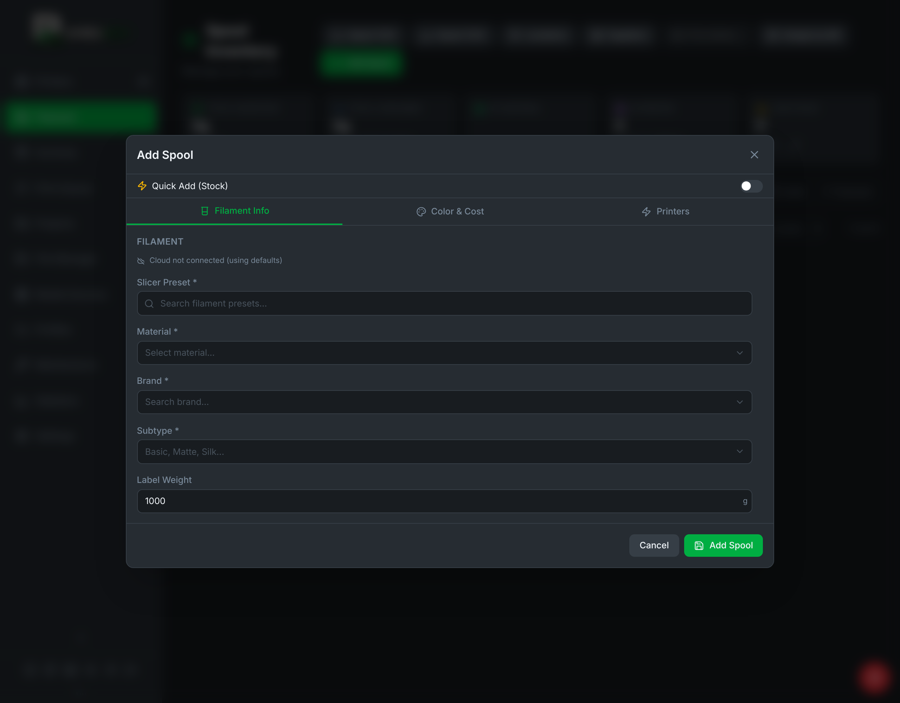 | 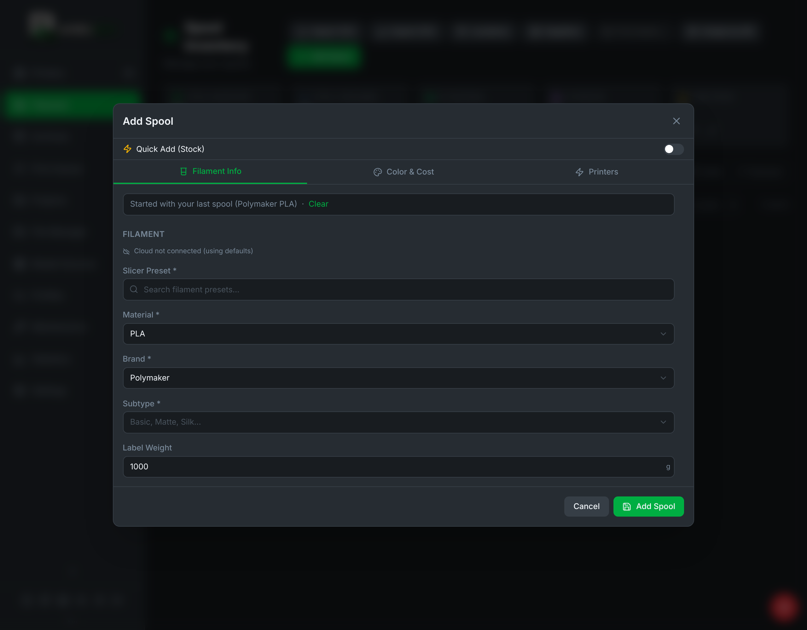 |
| Colours, Polymaker PLA | 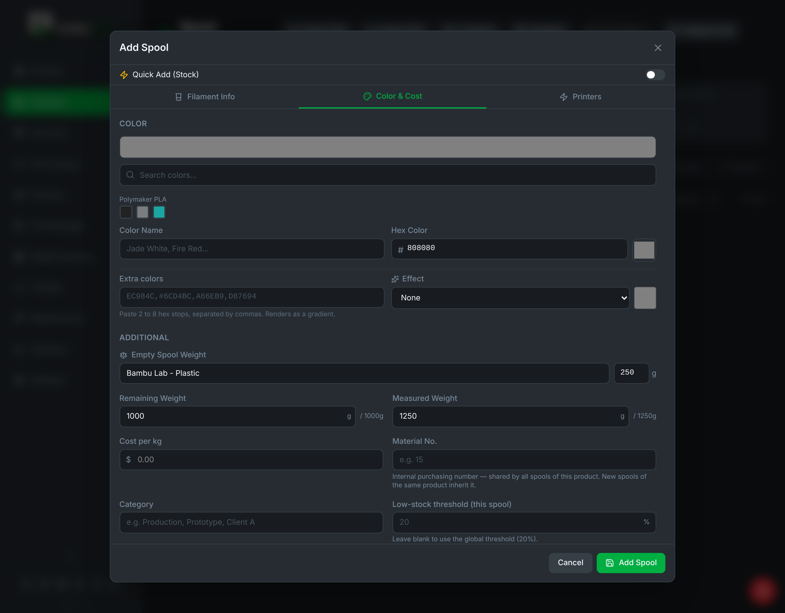 | 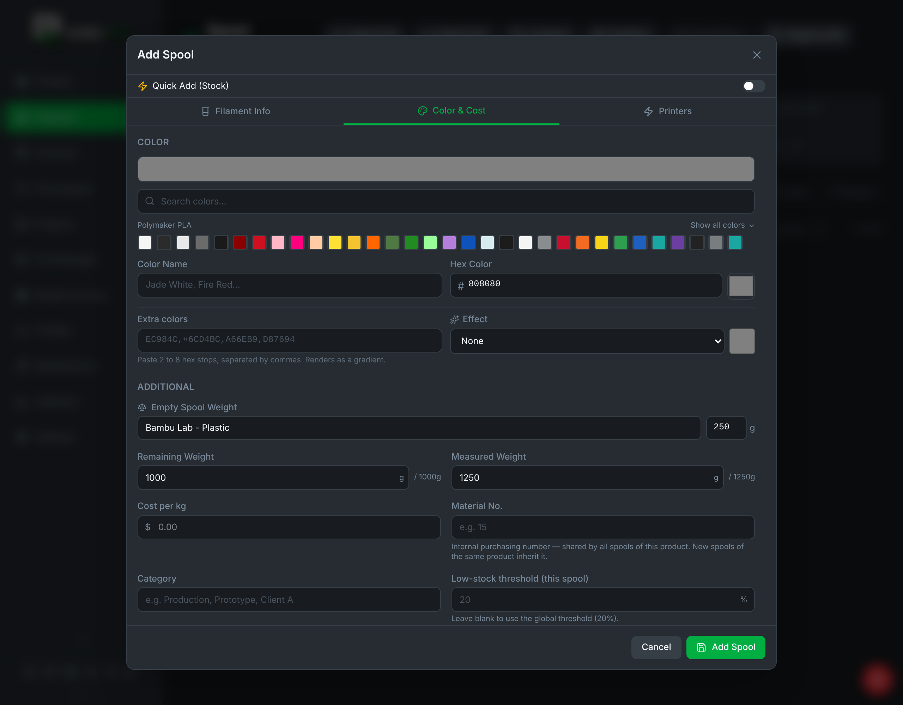 |
| Empty spool weight picker | 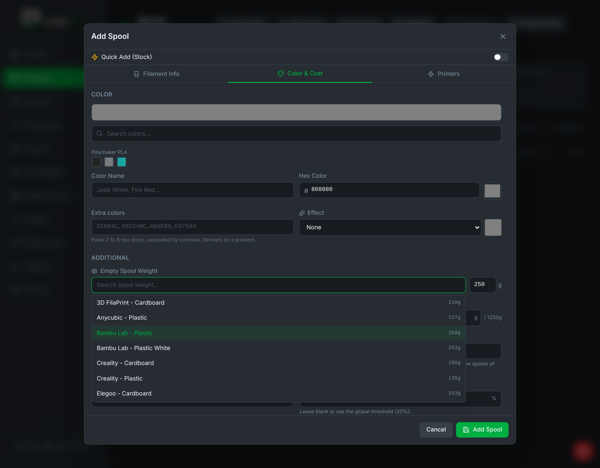 | 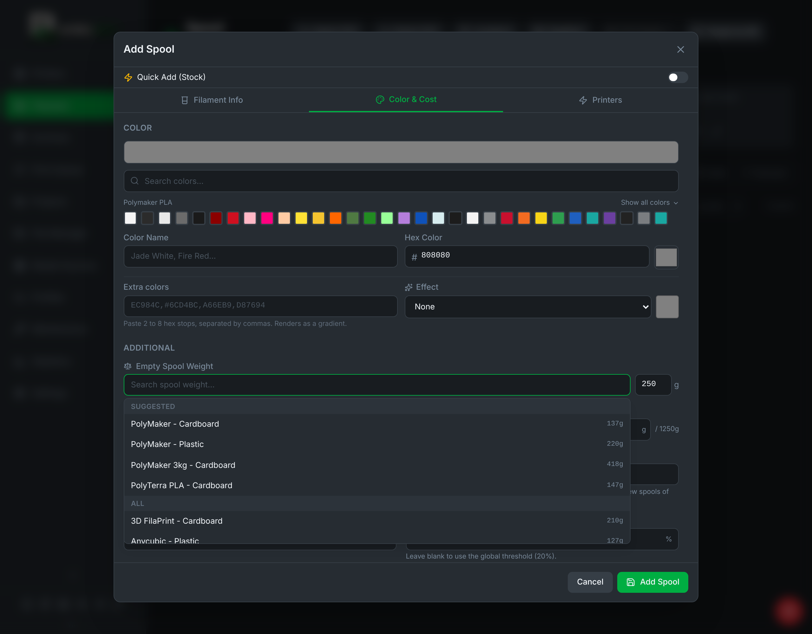 |

### Mobile (390)

| View | Before | After |
|---|---|---|
| New spool form | 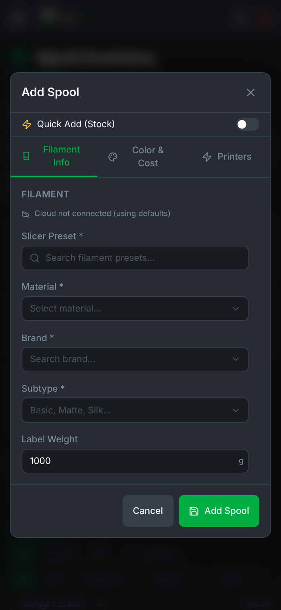 | 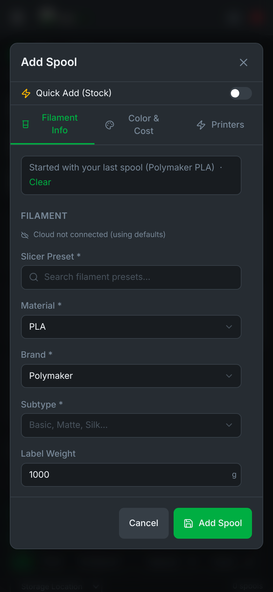 |
| Colours, Polymaker PLA | 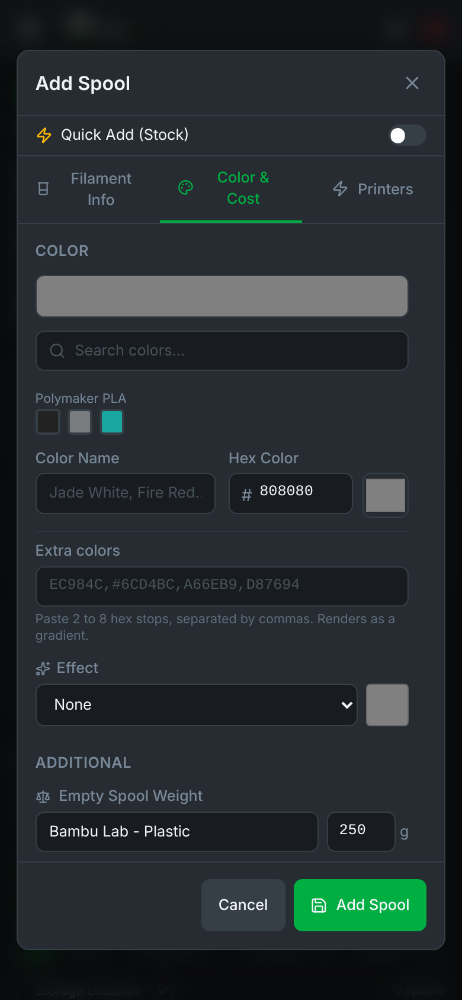 | 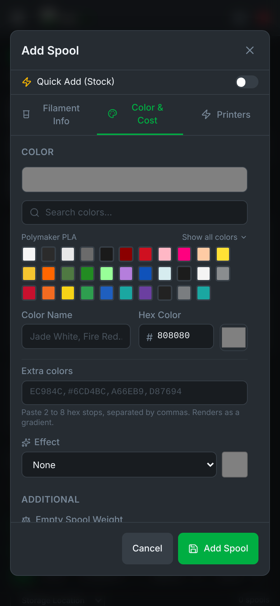 |
| Empty spool weight picker | 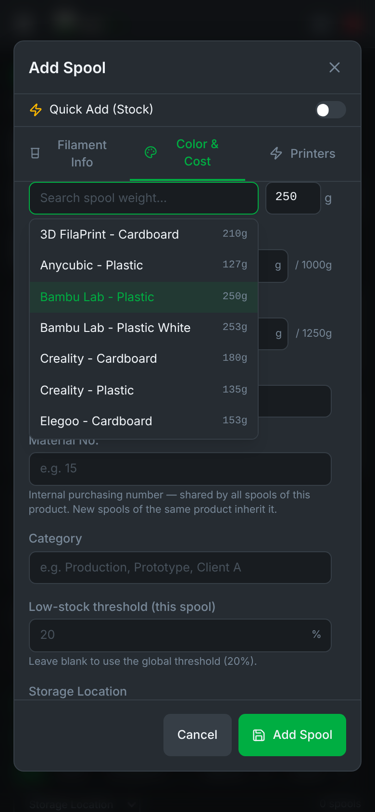 | 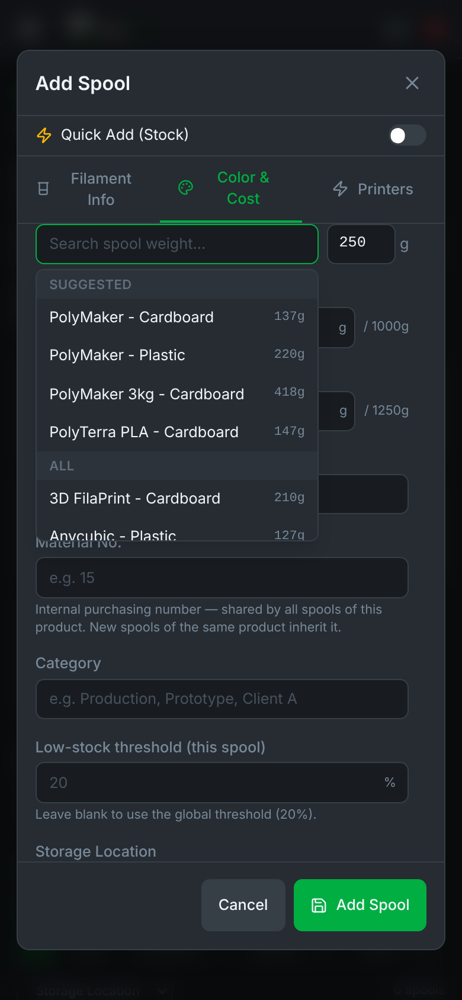 |

The screenshots use a mocked API: PolyTerra PLA and the other brands' colours and the empty-spool entries are the seed catalog's; the PolyLite PLA / PolyLite PETG / PLA Pro entries were added to show the product-line match and the Show all colours toggle.

## Testing

**Covered by tests (Vitest, frontend)**

- `SpoolFormLastUsed.test.tsx` (new, 26 tests) pins:
  - remembered fields applied, per-spool fields left alone;
  - stale location, empty spool entry and supplier dropped;
  - corrupt JSON, missing or unreadable storage, wrong field types: empty form;
  - saved after create, Quick Add and bulk create; never on cancel, edit, copy;
  - **Clear**; hint with and without a product name; hint and memory dropped when the modal closes;
  - Spoolman and built-in memory kept apart, filament link not carried;
  - suppliers: saved in Spoolman mode, not saved over inherited ones (single and bulk), saved on bulk when nothing was inherited;
  - submit before the lists loaded keeps the memory; a late list does not overwrite user changes but still fills an untouched location;
  - preset: remembered against profile default, empty filled by default, default-filled gives way to the next default, untouched remembered gives way when the material changes;
  - several empty spool entries with the same weight keep the remembered one.
- `spool-form/catalogColorMatching.test.ts` (new):
  - today's rules before the change: brand only, exact material + subtype, prefix fallback, trailing `+`, PLA vs PLA-CF / PLA+, empty brand;
  - the `+` fix (extra colours and effect kept);
  - product lines: Polymaker + PLA, PolyTerra + PLA, PolyLite, subtype, no PLA-CF / PLA+ / PETG leak, whole word only, no brand, variant and material words as brand, Carbon Fiber / Glass Fiber / CF / GF prefixes, `allBrandCatalogColors`, `brandAliases`.
- `spool-form/ColorSectionCatalogToggle.test.tsx` (new, 6 tests): the toggle widens and narrows, is absent when nothing is added or without a brand, appears when no colour matches the material, names the brand, resets on brand or material change.
- `spool-form/AdditionalSectionBrandSpools.test.tsx` (new, 10 tests): Suggested / All for Polymaker and PolyTerra, typed filter on both groups, unchanged without a brand, no empty heading, aliases from the catalog, no variant-word aliases.

**Checked in the UI**

- Screenshots of the three parts, taken with a mocked API (placeholders above).
- Manual test on the author's server with real spools: TODO user.

Checks to run before submitting: ESLint, `tsc`, knip, `npm run check:i18n`, Vitest. TODO user: confirm they are green on the final head.

- [x] I have tested this on my local machine
- [ ] I have tested with my printer model: <!-- TODO: user – the printer model is not relevant to this form; fill in or leave open -->

Tested on printer: TODO user.

## Checklist

- [x] My code follows the project's coding style
- [x] I have commented my code where necessary
- [x] My changes generate no new warnings
- [x] I have tested my changes thoroughly

## Additional Notes

**One PR or split.** The issue asks for all three together and they share the form, so I made one PR with one commit group per part. The project prefers one feature per PR, so I can split it: part 1 (with its tests), the `+` fix, part 2 and part 3 are independent commits. Say which you prefer.

**Known limits**
- The memory is **per browser** (localStorage). Another browser or device starts empty.
- Carried values are **what the last create had**, not a profile of the product. If you change a value for one spool, the next form starts with that value.
- Suggestions are only an order. Nothing is hidden, so an unusual combination stays one click away.

**Wiki PR:** maziggy/bambuddy-wiki#___ (`features/inventory.md`, `spoolbuddy/usage.md`).

🤖 Generated with [Claude Code](https://claude.com/claude-code)

https://claude.ai/code/session_0127bEAsde34UE3UDyMWQtka
