# PR draft – #3628 (File Manager: a "Group as versions" group is one card/row)

- **Base:** `maziggy/bambuddy:dev`
- **Head:** `balin77:feature/variant-group-card`
- **Title:** `File Manager: show a group of versions as one card, row or column entry (#3628)`
- **Status:** Submitted on 20 November 2026 as maziggy/bambuddy#3643; wiki companion maziggy/bambuddy-wiki#161.

---

## Description

Files grouped with **Group as versions** (one print sliced for several printer models) took one card, row and column entry per version, so a print with four slices filled four places in the File Manager. This PR shows a group as **one** card or row in the grid, list and columns view. It also fixes a visibility gap in the variant group endpoints that the new view would have made easy to hit.

**This PR touches the backend** (two parts, flagged below), the frontend, and the 16 locale files. No migration and no new dependency.

**What you see**

- **Collapsed:** one card (grid), row (list) or column entry (columns) with the first version's thumbnail, the printer models, the number of versions and the file type. Versions of different types show a grey **Mixed** badge.
- **Versions open:** in the list and columns view the versions open in place. In the grid view **Show versions** opens a popover under the card (desktop; it flips up or left to stay visible, scrolls inside and is at most 60% of the window high) or a bottom sheet on a phone (✕ button, dimmed backdrop). The versions are listed, each with its printer model, print time and weight, and its own actions: **Preview**, details, download, rename, **Print this version only**, **Remove from group**, delete.
- **Group menu:** **Print all versions as one job** (existing alternatives path), **Ungroup** (no file is deleted) and **Delete all versions**. The delete confirm counts the versions and says how many sit in other folders.
- **Versions in other folders** are listed with their folder name (**in <folder>**), or **in another folder** / **in the library root** where no name is known.
- **A group with only one visible version** is shown as a plain file, without a badge.
- **Grid:** the card never changes size or place and no other card moves. The popover closes with a second click on the toggle, a click outside, Escape (focus goes back to the toggle), Tab out of it, scrolling the page on desktop, or dragging the card. Only one is open at a time. An action that opens a dialog (for example Delete) closes it first.
- **Columns view keyboard:** →/← and Enter open and close the versions of the focused group; Space ticks it.
- **Tick box:** a real checkbox button, reachable and togglable by keyboard (Space/Enter) without opening the row.
- Ungrouped files look and behave as before.

**Deviations from the issue's six proposals**

1. **Only versions the user may read are shown.** A user with read-own permission sees only their own versions of a mixed group. A group with one visible member is a plain file. Showing the rest would leak other users' file names and counts.
3. **The card tick selects only the versions in the current folder.** Move, Delete and Tag then never reach into other folders, the same as a drag. The card's **Print** still prints all visible versions as one job, and a selected group that is fully ticked is one job in the bulk Print. **Print selection only** (offered when a group is partly ticked) keeps full groups as one job and prints only what is ticked of a partial group.
5. **Ungroup and Delete all versions are enabled only when the user may modify every version** (update permission for Ungroup, delete permission for Delete all). Otherwise the entries are disabled with a reason.

The other proposals (2, 4, 6) are done as written.

**Backend change 1: `GET /library/files?with_variant_members=true`** (additive)

- New optional query parameter, default `false`. With the default the response is unchanged, except for the visible-member count fix below.
- With `true`, for every group in the result the visible, non-trashed members that are not already in it (other folders, outside the filter) are appended, flagged `variant_elsewhere: true`. They respect internal/external folder kinds like the list itself.
- New response fields, all additive with defaults: `variant_group_name`, `variant_position`, `variant_elsewhere`, `folder_name`.
- One query for members and one for folder names, no N+1.

**Backend change 2: a visibility fix in the variant group endpoints**

- `GET /library/variant-groups/{id}` and `/by-file/{id}` list only the members the caller may read. A caller who sees none gets 404, not a confirmation that the group exists. `variant_count` in the file list counts only visible, non-trashed members.
- Every change (rename, reorder, add member, remove member, ungroup) now requires owning **all active members**, unless the caller has update-all. Before, any user with update-own could change a group containing other users' files, which changes what those files do in the print queue.
- Trashed members no longer block reorder and no longer keep a group alive: a group with fewer than two live members dissolves.
- A group name that equals the filename of a member the caller cannot read is masked, as is that file's name in the "both sliced for <model>" collision message.
- **Consequence:** a user with read-own and update-own cannot remove their own file from a mixed group. They get 403, because the group holds files of other users.

## Related Issue

Fixes #3628

Related: #3462 (selecting files prints one job; here a selected group is one job), and the existing variant groups feature.

## Documentation

**Companion docs PRs**:
- Wiki: maziggy/bambuddy-wiki#161 (`features/file-manager.md`, `features/print-queue.md`)

**Pick one**:
- [x] Docs PR(s) linked above
- [ ] No docs update required — reason: ___

## Type of Change

- [x] Bug fix (non-breaking change that fixes an issue): the variant group visibility and ownership checks
- [x] New feature (non-breaking change that adds functionality)
- [ ] Breaking change (fix or feature that would cause existing functionality to change)
- [ ] Documentation update
- [ ] Code refactoring
- [ ] Performance improvement
- [x] Test addition or update

## Changes Made

**Backend** (touches the backend)
- `backend/app/api/routes/library_variants.py`: `visible_members_query()`, `can_read_all_members()`, `masked_group_names()`; group responses list only readable members; `_authorize_group_change()` (404 when nothing is visible, 403 when a live member belongs to someone else, unless update-all) used by rename, reorder, add, remove and ungroup; dissolve and reorder count live members only.
- `backend/app/api/routes/library.py`: `with_variant_members` parameter, the appended members, the group fields, the visible-member `variant_count`.
- `backend/app/schemas/library.py`: `variant_group_name`, `variant_position`, `variant_elsewhere`, `folder_name`.

**Frontend**
- `frontend/src/pages/fileManager/variantGroups.ts` (new): `groupLibraryRows()` folds the list into file rows and group rows, with the filter and sort rules (`filterSort.ts` holds the moved filter and sort helper, behaviour unchanged).
- `frontend/src/pages/fileManager/variantSelection.ts` (new): the print plan and the drag rule. `useBulkVariantPrint.tsx` (new): the bulk Print for groups, with the confirm for partly ticked groups.
- `frontend/src/components/fileManager/` (new): `VariantGroupCard`, `VariantGroupListRow`, `VariantGroupColumnRow`, `VariantMemberLine`, `VariantGroupActionStrip`, `VariantSelectionBox`, `useVariantGroupActions`, `variantTypes.ts`.
- `frontend/src/pages/FileManagerPage.tsx`: the per-view switch between file and group, the selection rule, the bulk Print hook. `frontend/src/utils/libraryFolders.ts`, `frontend/src/pages/fileManager/invalidate.ts`, `frontend/src/api/client.ts`: small helpers and the new parameter and fields.
- `frontend/src/i18n/locales/*.ts` (16 locales): `fileManager.variants.*`.

**Other**
- `CHANGELOG.md`: one entry.

## Screenshots

### Desktop (1280)

| View | Before | After, collapsed | After, expanded |
|---|---|---|---|
| Grid | 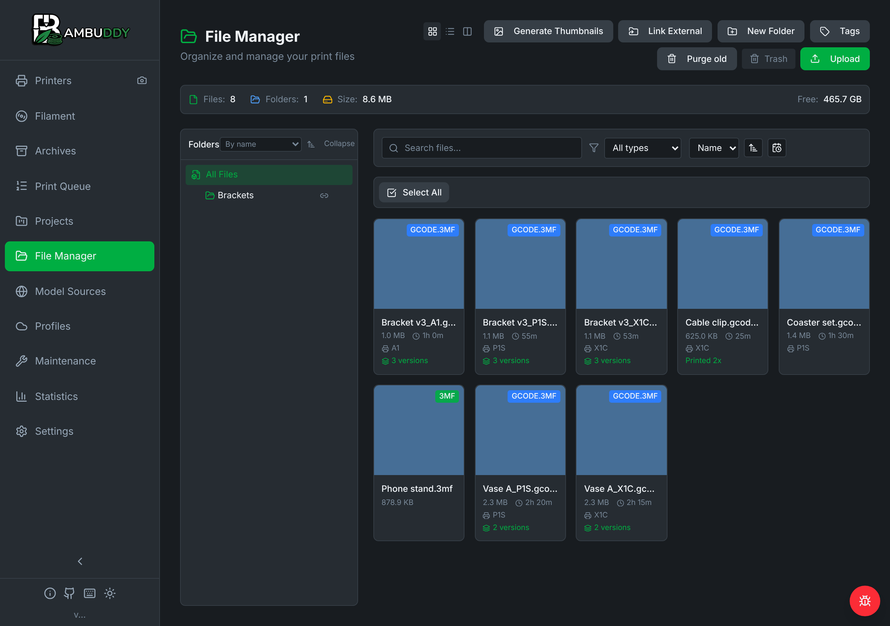 | 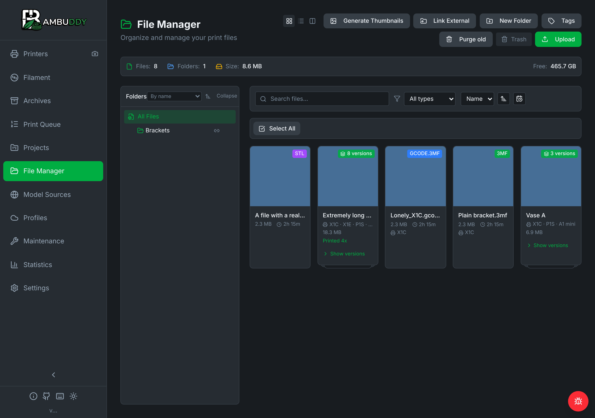 | 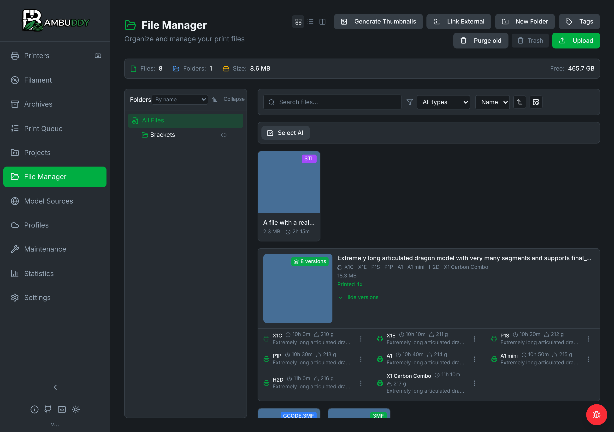 |
| List | 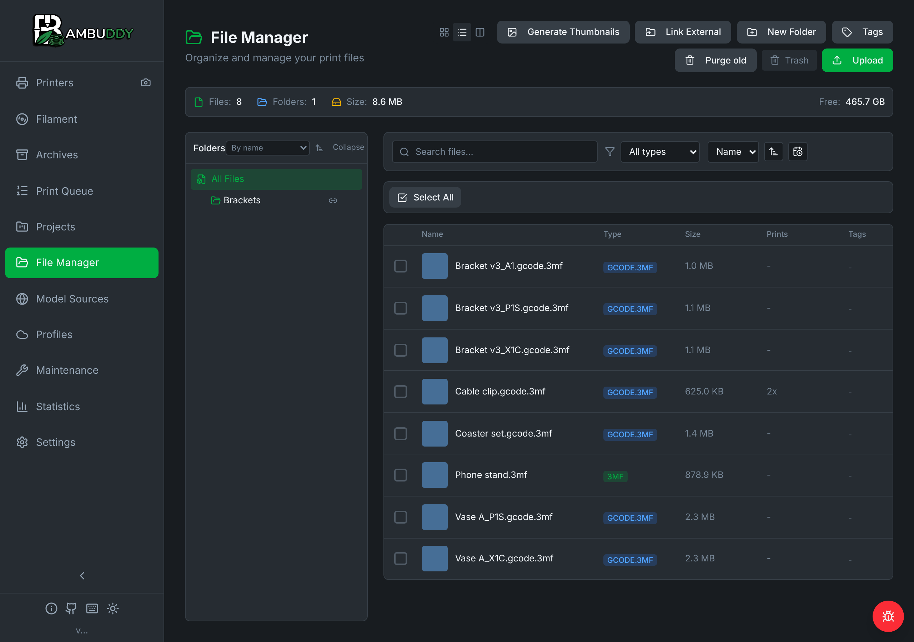 | 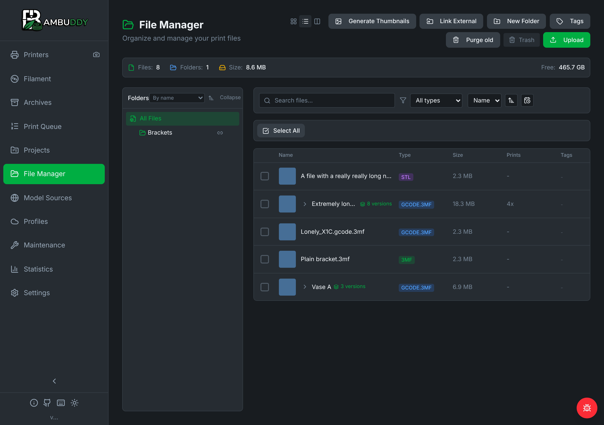 | 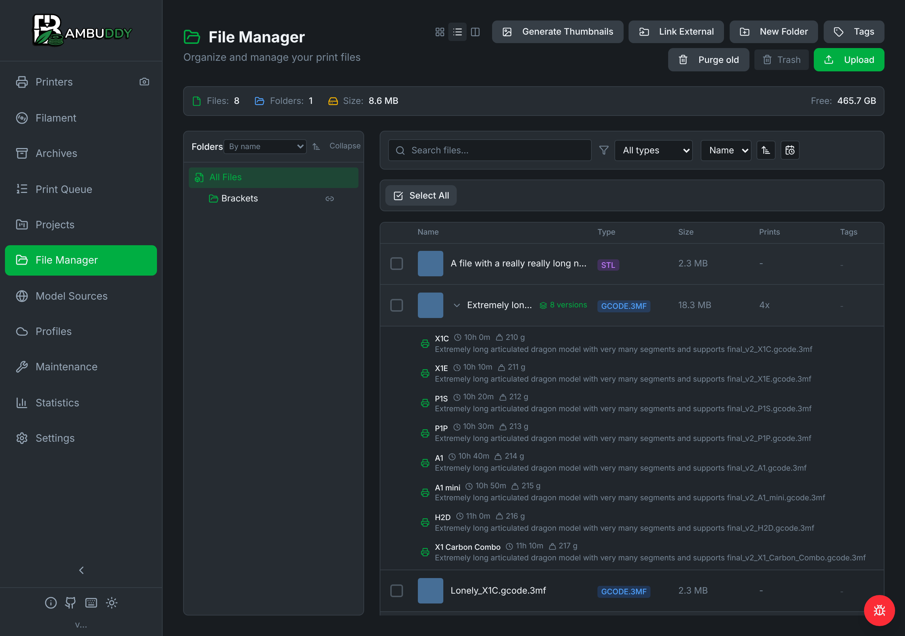 |
| Columns | 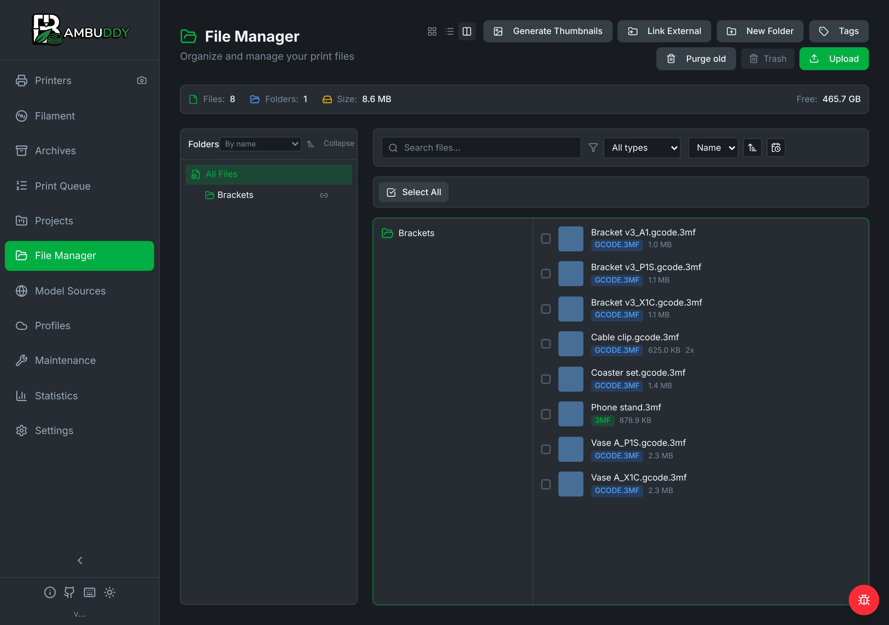 | 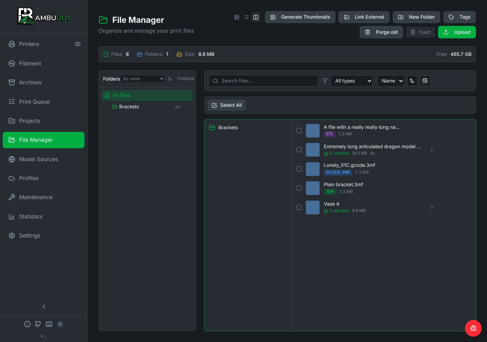 | 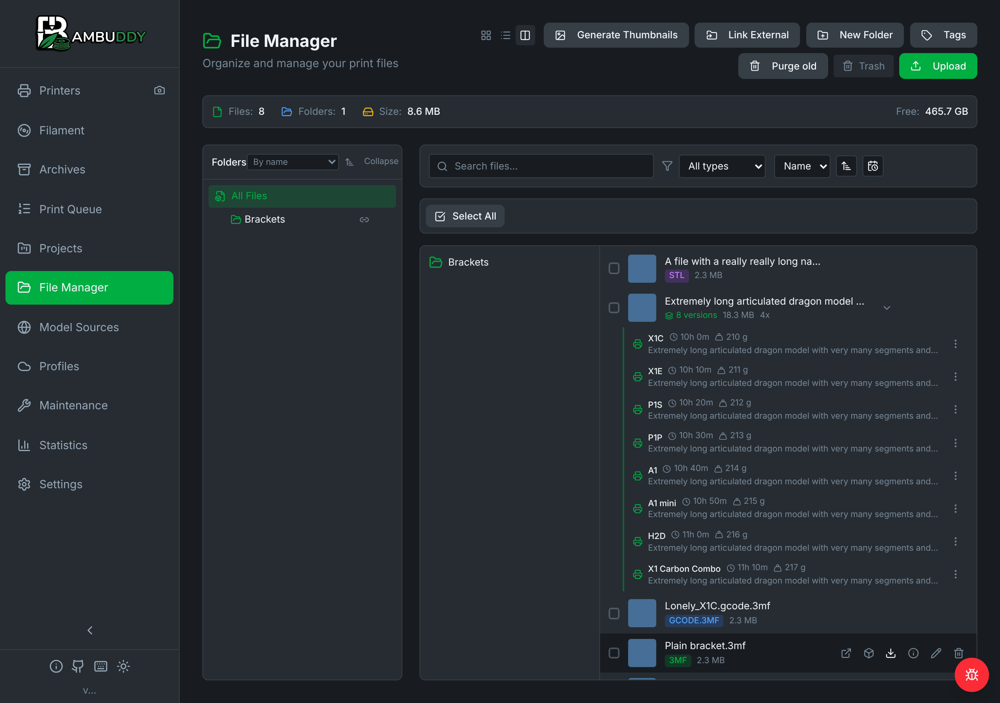 |

### Mobile (390)

| View | Before | After, collapsed | After, expanded |
|---|---|---|---|
| Grid | 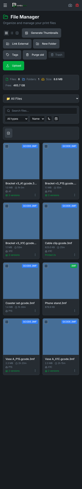 | 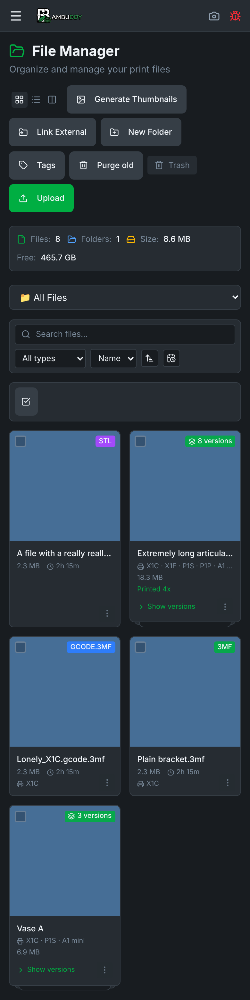 | 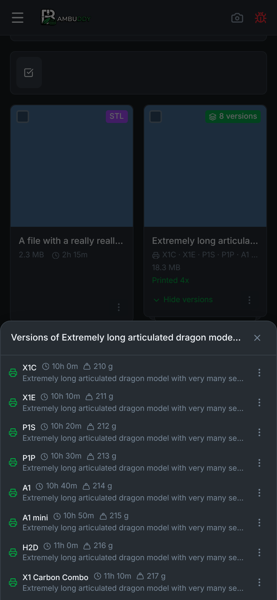 |
| List | 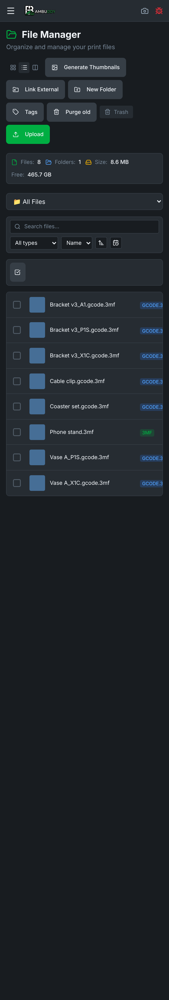 | 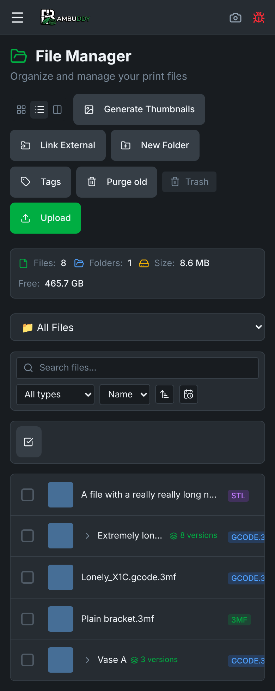 | 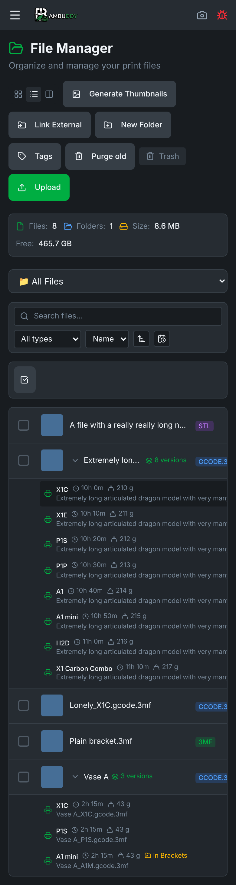 |
| Columns | 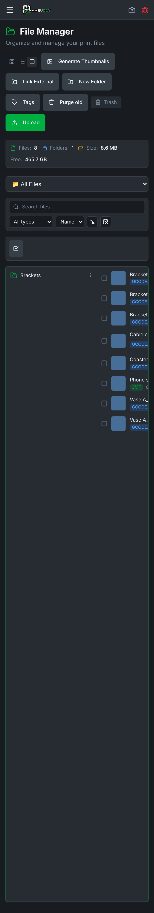 | 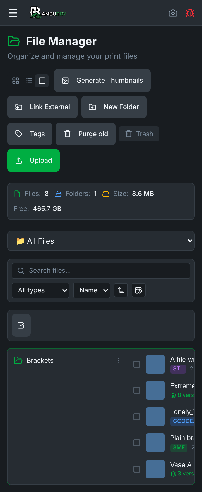 | 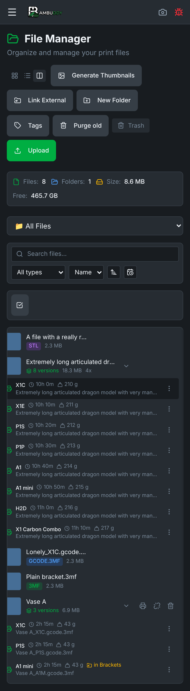 |

The screenshots use a mocked API with fake names. The expanded images show a group with a version in another folder.

## Testing

**Covered by tests (backend, pytest)**

- `backend/tests/integration/test_library_variant_visibility_3628.py` (new) pins:
  - read-own sees only own members and own count, gets 404 when none is theirs; read-all sees every member; trashed members are excluded; `variant_count` counts visible members;
  - the default file list is unchanged; with `with_variant_members` members from other folders are appended and flagged, not duplicated, and ownership, trashed members and internal/external folder kinds are respected; ungrouped files get no group fields;
  - every change is 404 for a foreign group and 403 for a mixed group; a trashed foreign member does not block the owner or an admin; owner and admin still succeed; removing down to one live member dissolves the group;
  - the collision message and the group name never reveal a file the caller cannot read; the mutation response uses the read permission; an own-scoped API key behaves like its owner.

**Covered by tests (Vitest, frontend)**

- `FileManagerVariantGroups.test.tsx` (new) pins: one card, row and column entry per group with a badge; a single visible version as a plain file; expanding with the mouse and the keyboard; the hint for versions in another folder; the card tick and its menu; the delete confirm count; the versions popover in the grid (opens under the card without changing the card or the grid, a portal to the body, focus on its first control once visible, closes with a second click, Escape with focus back to the toggle, an outside click, Tab out and a drag, ignores the scroll its own opening causes, closes on page scroll but not on its own scroll, is placed again on resize and when the card moves, closes before a dialog opens, one at a time, gone with the card when the view changes, version menus work inside it) and on a phone the bottom sheet (heading, close button, backdrop click, page locked behind it, stays open on scroll); list alignment and the Mixed badge; columns keyboard (arrows, Enter, Space, a group visible in two panes); filter and sort; permissions (Ungroup, delete, rename, remove, Print, Preview disabled without the permission); ungroup, delete all, remove one version, print as one job; edge cases (40 versions, a long name, external folder, no double-click preview); the checkbox button.
- `FileManagerVariantSelection.test.tsx` (new) pins: a full group is one job and the button counts jobs; the confirm for a partly ticked group; print selection only; the print plan; drag moves only this folder's changeable versions; deleting a selected group counts files; the tick, Move and Select all stay in this folder; the queue item has every version as an alternative.
- `pages/fileManager/variantGroups.test.ts` (new) pins `groupLibraryRows()`: ordering, names, single visible member, filters, members from elsewhere, sort rules, many versions, null positions.
- `FileManagerPage.test.tsx` (changed, 5 lines): the existing group print test opens the group card's menu instead of a file card.

**Checked in the UI**

- Screenshots with a mocked API (above).
- Used on my server (19 and 20 November 2026) with real files: grouping, the card in the three views and the versions popover in the grid work as described. Not checked there: selection across folders, the restricted-user cases and the phone layout; those are covered by the tests above and the screenshots.

Checks run: CI on the head of this branch in my fork: https://github.com/balin77/bambuddy/actions/runs/44697658506 (green)

- [x] I have tested this on my local machine
- [ ] I have tested with my printer model: not applicable, the change needs no printer

## Checklist

- [x] My code follows the project's coding style
- [x] I have commented my code where necessary
- [x] My changes generate no new warnings
- [x] I have tested my changes thoroughly

## Additional Notes

**Size.** `FileManagerPage.tsx` grows by about 190 lines net (366 added, 178 removed), though most of the logic is in the new components and hooks. I kept the page to the per-view switch, the selection rule and the bulk Print hook.

**Split option.** The permission tightening (backend change 2) is a fix on its own and does not depend on the view. I can move it into its own PR if you prefer; the visibility part is needed by this PR, the ownership part for mutations is not.

**Why a popover.** Projects expand to a full row because they show a lot of content; the versions of one file are a short list tied to one card, so a popover like the ⋮ menus keeps the grid still and the user keeps their place.

**Known limits**
- A user with read-own and update-own cannot remove their own file from a mixed group (403), see above.
- A group with a single visible version is a plain file, so its group actions are not offered to that user.
- Versions in other folders are listed and can be printed and previewed, but a tick never selects them.
