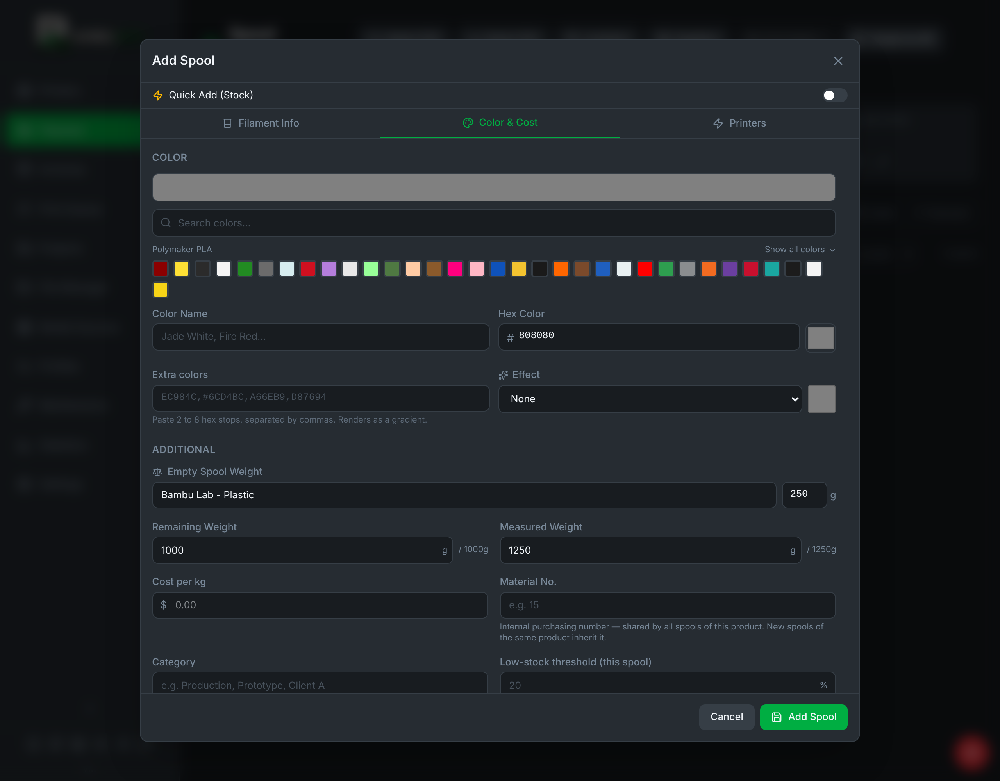
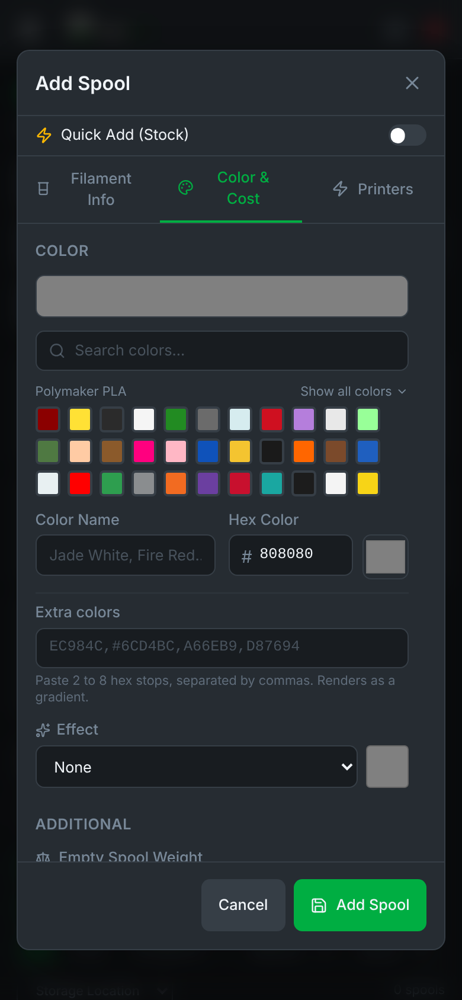
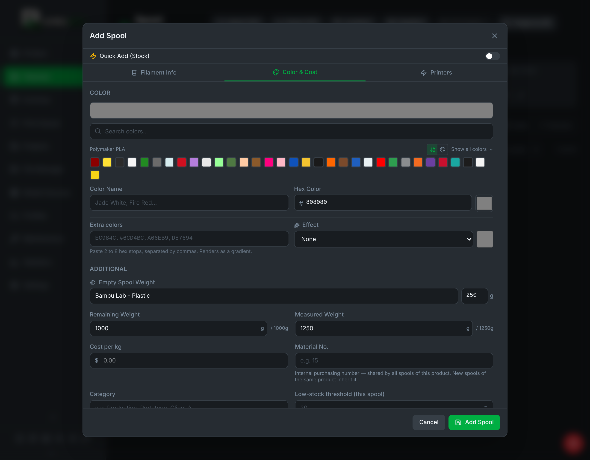
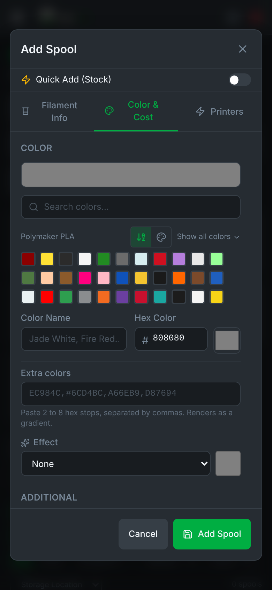
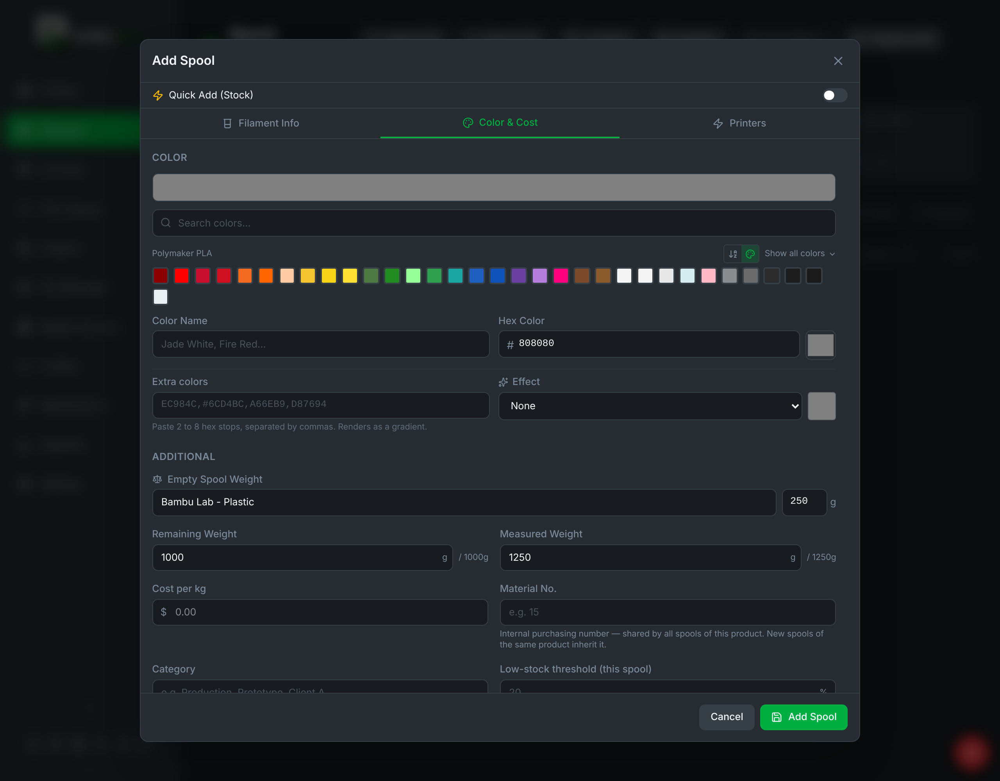
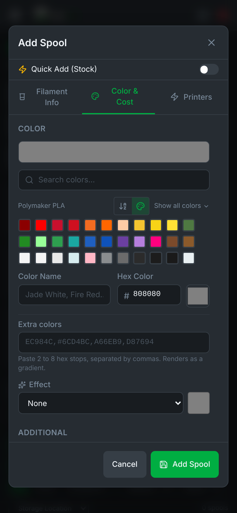
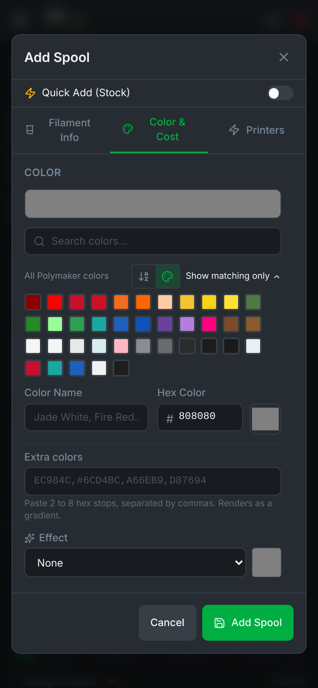

# PR draft – #3633 (Add Spool: order the catalog colours by colour or by name)

- **Base:** `maziggy/bambuddy:dev`
- **Head:** `balin77:feature/spool-form-color-order`
- **Title:** `Spool form: catalog colours can be ordered by colour (#3633)`
- **Status:** Draft. Submit only after #3633 is assigned to balin77, **#3626 is merged**, and the user approves. Nothing is posted.
- **Builds on #3626.** The branch starts from `feature/spool-form-last-used` (PR #3626, #3619), because the catalog colour list it sorts (`spool-form/catalogColors.ts`, **Show all colors**) comes from there. Once #3626 is merged, this PR's diff shrinks to the #3633 commits. Until then GitHub would show both.

---

## Description

In the Add Spool form the catalog colours of a brand are listed by name, product line by product line, in the order `GET /inventory/colors` returns them. With a spool in hand, finding its swatch means scanning the whole list: PolyTerra alone has 40+ colours.

This PR adds a small **by name / by colour** toggle next to the catalog colours. It is frontend only: no schema change, no migration, no server setting, no new dependency.

- **By name** is the order so far and stays the default. Nothing changes for anyone who does not touch the toggle.
- **By colour** sorts with the existing `colorSortKey` from `utils/colors.ts`, the same order as the inventory's Color column (#2729): the colour wheel from red to pink, then brown, then white through grey to black, Clear last. Within a family by hue, neutrals from light to dark. No second colour sort was written.
- **Multicolour and gradient** entries sort by their first colour (`hex_color`).
- **Clear:** the form drops the alpha channel when it turns a catalog entry into a swatch, so `colorSortKey` could not see Clear. Each swatch now keeps the catalog hex with its alpha for sorting (`sortHex`), and Clear sorts last.
- **Stable:** equal colours keep the server order among themselves.
- **Show all colors:** the colours of the chosen material stay first and the brand's other product lines follow, each block sorted on its own. A PETG red therefore never lands between the PLA reds. Search results follow the chosen order.
- **Remembered per browser** in localStorage (`bambuddy-catalog-color-order`), like the recent colours of the same form. Read and written in try/catch; a missing, unreadable or unknown value means *by name*.
- **Not changed:** the recent colours row and the fallback palette. Without catalog colours there is no toggle.
- The colour section is shared with SpoolBuddy's write-tag page, so the toggle is there too. The buttons are 32 px on small screens and 24 px from `sm` up.

## Related Issue

Fixes #3633

Related: #2729 (colour order of the inventory), #3619 / #3626 (catalog colours of the brand, Show all colors).

## Documentation

**Companion docs PRs**:
- Wiki: maziggy/bambuddy-wiki#___

**Pick one**:
- [x] Docs PR(s) linked above
- [ ] No docs update required — reason: ___

## Type of Change

- [ ] Bug fix (non-breaking change that fixes an issue)
- [x] New feature (non-breaking change that adds functionality)
- [ ] Breaking change (fix or feature that would cause existing functionality to change)
- [ ] Documentation update
- [ ] Code refactoring
- [ ] Performance improvement
- [x] Test addition or update

## Changes Made

- `spool-form/catalogColors.ts`: `CatalogColorOrder` type and `sortCatalogColors(colors, order)`, a pure, stable sort on `colorSortKey`; `toDisplay` keeps the catalog hex with alpha as `sortHex`.
- `spool-form/types.ts`: optional `sortHex` on `CatalogDisplayColor`.
- `spool-form/constants.ts`: `CATALOG_COLOR_ORDER_KEY`.
- `spool-form/utils.ts`: `loadCatalogColorOrder()` and `saveCatalogColorOrder()`, both in try/catch.
- `spool-form/ColorSection.tsx`: the toggle (`role="group"`, two buttons with `aria-pressed`, `aria-label` and tooltip, icons `ArrowDownAZ` and `Palette` from lucide-react) left of **Show all colors**; the visible list sorted per block.
- i18n: `inventory.catalogColors.sortBy`, `sortByName`, `sortByColor` in all 16 locales.
- `CHANGELOG.md`: entry under Added.

## Screenshots

Polymaker + PLA, mocked API.

| | Desktop (1280) | Mobile (390) |
|---|---|---|
| Before |  |  |
| By name (default) |  |  |
| By colour |  |  |
| By colour, Show all colors |  |  |

## Testing

**Covered by tests (Vitest, frontend)**

- `spool-form/catalogColorOrder.test.ts` (new): colour wheel order of the chromatic families, brown after pink, white → grey → black, Clear last (alpha `00`), multicolour by its first colour, equal colours keep their order, *by name* returns the input unchanged and the input is not mutated.
- `spool-form/ColorSectionCatalogOrder.test.tsx` (new): the toggle switches the order, the choice survives a remount, default *by name*, garbage and throwing localStorage fall back to *by name*, no toggle with the fallback palette, Show all colors keeps the matching block first with each block sorted, search follows the order.
- All existing spool-form and component tests pass (`src/__tests__/components`: 228 files, 3010 tests).

**Checked in the UI**

- Screenshots above, taken with a mocked API at 1280 and 390 px: no horizontal scroll, the toggle sits left of Show all colors.
- Used on my server (19 November 2026) with real spools: the toggle, the colour order, the remembered choice and Show all colors work as described.

**Known behaviour of the shared sort:** very light tints (pastel pink, pale cyan) count as white in `colorSortKey`, so they sort among the whites, as they do in the inventory's Color column.

Checks run: the full CI workflow on the head of this branch in my fork is green (https://github.com/balin77/bambuddy/actions/runs/44531787997). ESLint, `tsc`, knip, `npm run check:i18n`, Vitest, and the backend jobs.

- [x] I have tested this on my local machine
- [ ] I have tested with my printer model: not applicable, the change is frontend only and needs no printer

## Checklist

- [x] My code follows the project's coding style
- [x] I have commented my code where necessary
- [x] My changes generate no new warnings
- [x] I have tested my changes thoroughly

## Additional Notes

**Depends on #3626.** Please merge #3626 first. If you would rather have it independent, I can move the sort onto `dev`'s current `ColorSection`, but then #3626 would need an adjustment.

**Wiki PR:** maziggy/bambuddy-wiki#___ (`features/inventory.md`, a paragraph under the colours of the brand added by the #3619 wiki PR maziggy/bambuddy-wiki#158).
