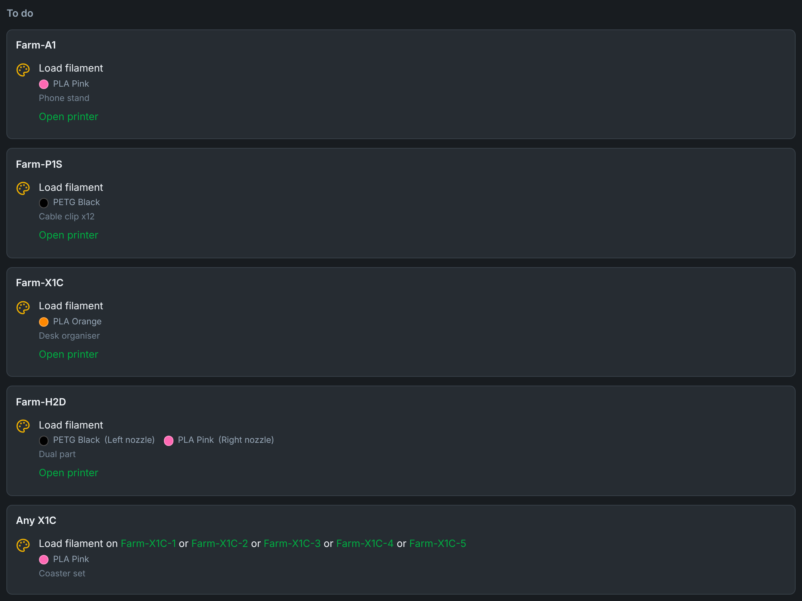
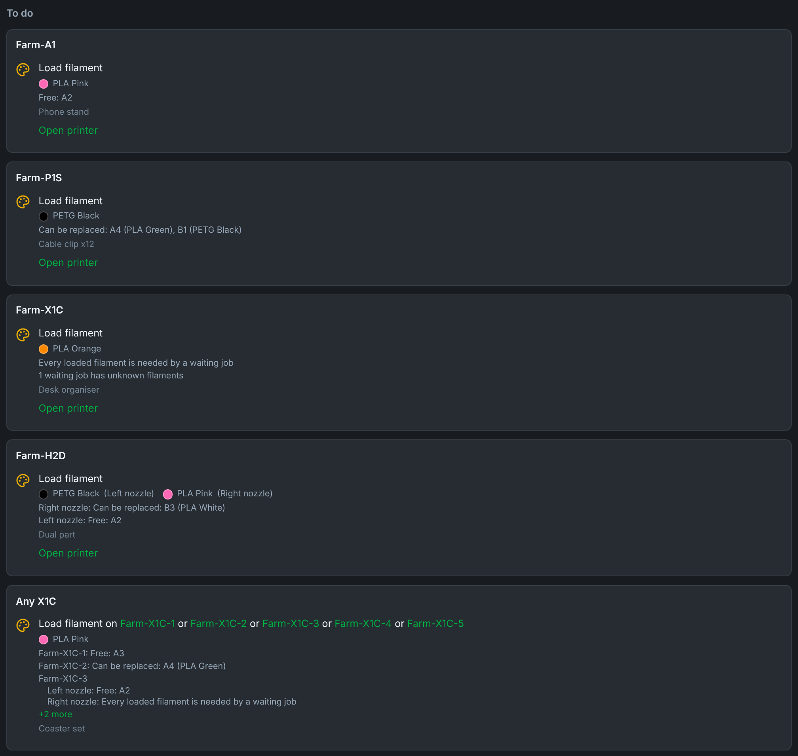
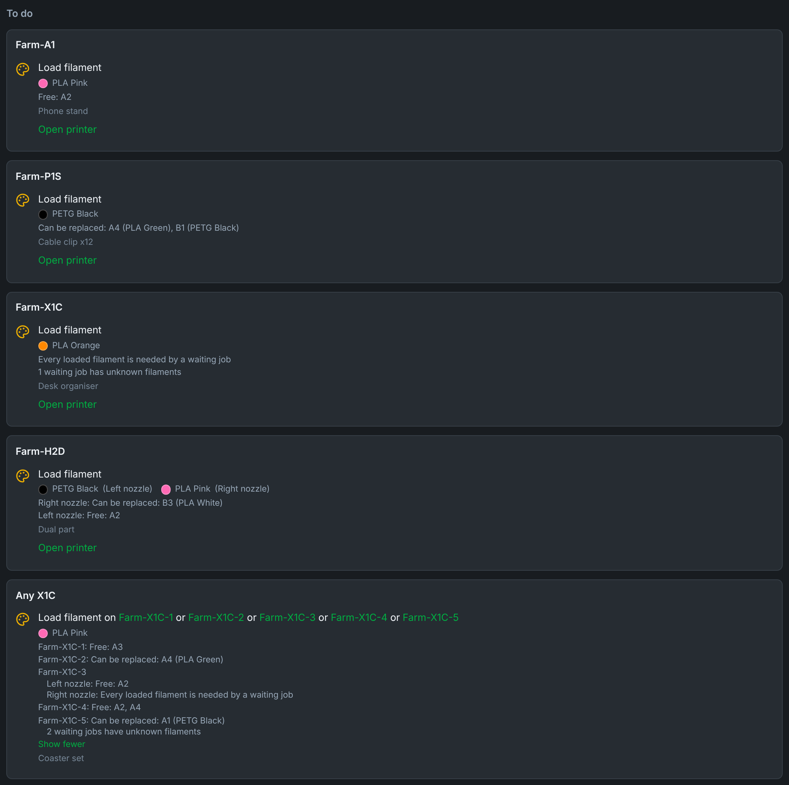
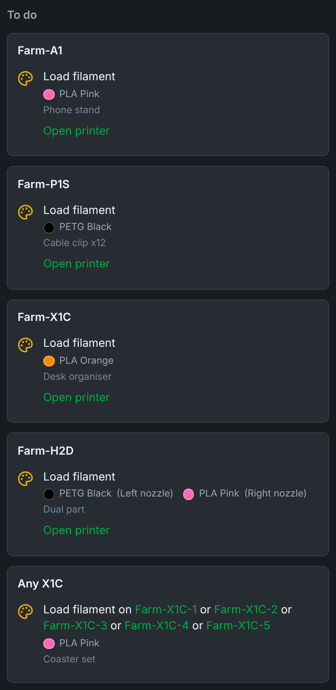
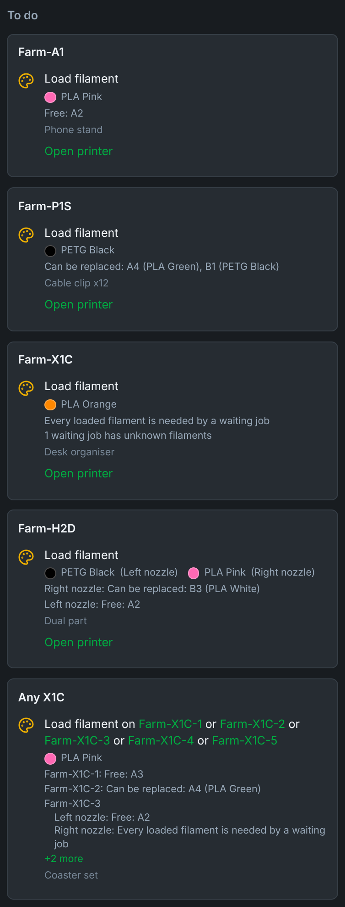
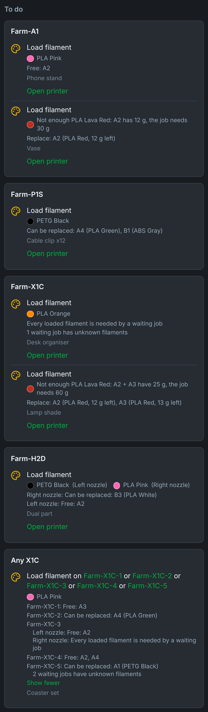

# PR draft – #3634 (To do list names the slot a missing filament can go into)

- **Base:** `maziggy/bambuddy:dev`
- **Head:** `balin77:feature/queue-todo-replace-slot`
- **Title:** `Queue: the To do list names the slot a missing filament can go into, and the spool that is too short (#3634)`
- **Status:** Draft. Submit only after #3634 is assigned to balin77, **PR #3622 (#3615) is merged**, and the user approves. Nothing is posted.
- **Builds on #3622.** The branch starts from `feature/queue-todo-list` (PR #3622, #3615), because the To do list it extends comes from there. Once #3622 is merged, this PR's diff shrinks to the #3634 commits. Until then GitHub would show both.

---

## Description

A **Load filament** entry in the To do list (#3615) says which filament a printer waits for, but not where to put it. With a full AMS you have to open the queue, look at every job waiting for that printer and compare their colours with the four slots, to find a spool you can take out without making the queue wait again. This PR makes the entry name the place, and it also covers a job that is held because a loaded spool has **too little filament**. It is a hint only: nothing is reserved or changed on the printer, and the scheduler decides exactly as before. No migration, no new setting, no new dependency.

**What the user sees**

Under the filament(s) of a **Load filament** entry there is one more line:

- **Free: A2**: the printer reports an empty slot (all of them are listed).
- **Can be replaced: A4 (PLA Green), B1 (PETG Black)**: every slot is loaded, and these are the ones no waiting job needs, with the filament in them.
- **Every loaded filament is needed by a waiting job**: nothing can be taken out. The entry says so, so you know you have to choose.
- **1 waiting job has unknown filaments** / **N waiting jobs have unknown filaments**: added when a waiting job's file could not be read. That job may need a slot, so the hint is not the whole story.
- **Dual-nozzle printers** get a line per nozzle (**Left nozzle: ...**, **Right nozzle: ...**), and an entry for one nozzle is only offered slots of that nozzle.
- **"Any <model>" entries** get one line per printer, for example **X1C-2: Can be replaced: A4 (PLA Green)**. Three printers are shown, the rest sit behind **+N more** (a button with `aria-expanded`; **Show fewer** folds it again).
- A printer that has not reported its trays gets **no hint**. It never says "every filament is needed" for a printer it knows nothing about.

**A spool that is too short**

A job can also be held although its filament is loaded: the spool holds fewer grams than the job needs. Before this PR such a job was listed like a missing filament, and its hint offered every other slot, including a second spool of the same colour. Now:

- The entry says what is wrong: **Not enough PLA Lava Red: A2 has 12 g, the job needs 40 g**. With AMS Filament Backup the spools that are counted together are named together: **Not enough PLA Lava Red: A2 + A3 have 25 g, the job needs 40 g**. Without known amounts it reads **Not enough PLA Lava Red: in A2**.
- The slot hint of such an entry is **Replace: A2 (PLA Lava Red, 12 g left)**: only the short spool(s), nothing else.
- A short and a missing entry of one filament stay two entries.
- A **missing** filament is never offered a slot that already holds a spool of it (same type, same or similar colour, the same preset when both name one; the exact colour when the colour is forced), since the scheduler would use that spool. This is one predicate (`tray_fits_filament`) that a test holds against the matcher. A spool of the wanted filament is therefore never offered as replaceable or free.
- A tray whose spool was swapped for another filament since the pass is no longer offered for replacing.

The scheduler's decisions, the number of entries, the waiting texts and the notifications are unchanged.

Slot names are the ones on the printer card (`formatSlotLabel`): **A4**, **HT-A**, **Ext**, **3H-7**. Colour names come from the same `getColorName` as the printer card, using the tray's product line (sub brand) when the printer reports one.

**How "needed" is decided**

- **Same mapping as the scheduler.** `missing_filament_for_start` held the read-only "planned mapping" (the stored `ams_mapping` if it still fits, completed by `_fill_unresolved_slots`, else a fresh match). That logic is now its own function `_planned_mapping(db, item, printer_id)`, and `missing_filament_for_start` calls it. There is no second matching code.
- **Which jobs count:** every pending job that could go to the printer: jobs pinned to it, model jobs whose model, location and creator's printer scope fit it (`_model_job_printer_ids`), and staged, scheduled, behind-a-running-print and the holding jobs themselves. A tray is needed when the planned mapping of any of them uses it.
- **Never offered:** the trays of the running print (its AMS mapping, and the tray the extruder holds, also on dual nozzle). An idle printer's old mapping is not a running print.
- **Unreadable files:** a job whose 3MF cannot be read still claims the trays of its stored mapping, and is counted in `unknown_jobs`.
- **Empty means confirmed empty:** no `tray_type` and the presence bit says absent (or, without a presence bit, the firmware state like the frontend's `getEmptySlotKind`). A spool the printer cannot identify is not a free slot.
- **External spool holder:** offered only when the printer has no AMS or HT slot (on that nozzle), and never called free.
- **Nozzle filter:** as in the matcher, trays are restricted to the nozzle of the missing filament, unless a Filament Track Switch is installed.

## Related Issue

Fixes #3634

Related: #3615 / #3622 (the To do list).

## Documentation

**Companion docs PRs**:
- Wiki: maziggy/bambuddy-wiki#___ (the To do section comes from maziggy/bambuddy-wiki#156; this one depends on it)

**Pick one**:
- [x] Docs PR(s) linked above
- [ ] No docs update required — reason: ___

## Type of Change

- [ ] Bug fix (non-breaking change that fixes an issue)
- [x] New feature (non-breaking change that adds functionality)
- [ ] Breaking change (fix or feature that would cause existing functionality to change)
- [ ] Documentation update
- [x] Code refactoring: `_planned_mapping` extracted, no behaviour change
- [ ] Performance improvement
- [x] Test addition or update

## Changes Made

**Scheduler (`backend/app/services/print_scheduler.py`)**
- `_planned_mapping(db, item, printer_id)`: the read-only logic of `missing_filament_for_start`, moved out unchanged. It leaves the per-pass memos alone (a request still clears them first, as today). Own commit with its own tests.
- A **separate step after each pass**, only for printers that have a load-filament hold in this pass (`_compute_slot_hints`). It does not change which job is held, started or skipped. The result is swapped in with the holds and read through `slot_hints_snapshot()`.
- The step runs in a **savepoint** (`begin_nested`): if a query fails, only the hint step is rolled back and the pass goes on. A hint that fails for one printer does not hide the others, and is warned about once until it works again.
- **Per-printer memo.** The signature is the reported trays, the running print, and the candidate jobs including their file identity (replaced archive file, trashed library file). A printer whose signature is unchanged maps nothing on the next pass. A hint is **not memoised** when a job failed to map or was unknown, so it is computed again.
- The setting that decides how colours are matched is **read once per pass**. Jobs that map the same way (same inputs) are **deduplicated** and mapped once; unknown twins are still each counted.
- **Quiet logging:** the hint path logs nothing at INFO. A pass that holds no printer forgets the memo and the warnings.
- `_compute_ams_mapping_for_printer` and `_match_filaments_to_slots` get a `quiet` keyword (default off) that silences their INFO logging on the hint path; the loaded-tray dicts also carry `tray_sub_brands`. Decisions are unchanged.

**Queue (`backend/app/services/queue_todo.py`, `backend/app/api/routes/print_queue.py`, `backend/app/schemas/print_queue.py`)**
- `build_todo` takes the scheduler's `slot_hints` and puts them on `load_filament` entries. `visible_slot_hints()` drops printers the caller may not see.
- Additive schema fields: `slot_hint` and `slot_hints` on `QueueTodoEntry`, with `QueueTodoSlotHint`, `QueueTodoPrinterSlotHint`, `QueueTodoNozzleHint` and `QueueTodoHintSlot`.

**API example** (`GET /queue/todo`, a `load_filament` entry of a printer, and of an "Any" group):

```json
{
  "kind": "load_filament",
  "jobs": [{"id": 14, "name": "Lid", "can_start": false}],
  "filaments": [{"type": "PLA", "color": "#E91E63", "color_name": "Pink", "no_stock": false}],
  "printers": [],
  "detail": null,
  "slot_hint": {
    "state": "replaceable",
    "slots": [
      {
        "ams_id": 0, "tray_id": 3, "is_ht": false, "is_external": false,
        "ams_type": 1, "nozzle": null,
        "type": "PLA", "color": "#4CAF50", "tray_info_idx": "GFA00", "tray_sub_brands": "PLA Basic"
      }
    ],
    "unknown_jobs": 0,
    "by_nozzle": []
  },
  "slot_hints": []
}
```

For an "Any <model>" entry `slot_hint` is `null` and `slot_hints` is a list of the same objects plus `printer_id`, one per listed printer that has a hint. `state` is `free`, `replaceable` or `all_needed`; `slots` is empty for `all_needed`. On a dual-nozzle printer without a Filament Track Switch `by_nozzle` has one `{nozzle, state, slots}` part per nozzle of the entry, and each slot carries `nozzle` (`left` / `right`). `state` can also be `replace` (see below). Everything is additive: a client that ignores the fields behaves as before.

**API fields for the shortage case** (all additive, on the same `GET /queue/todo`):

```json
{
  "kind": "load_filament",
  "filaments": [
    {
      "type": "PLA", "color": "#C12E1F", "color_name": "Lava Red", "no_stock": false, "nozzle": null,
      "short": true,
      "short_trays": [{"ams_id": 0, "tray_id": 1, "remaining_grams": 12.0}],
      "required_grams": 40.0
    }
  ],
  "slot_hint": {
    "state": "replace",
    "slots": [
      {"ams_id": 0, "tray_id": 1, "is_ht": false, "is_external": false, "ams_type": 1, "nozzle": null,
       "type": "PLA", "color": "#C12E1F", "tray_info_idx": "GFA00", "tray_sub_brands": "PLA Basic",
       "remaining_grams": 12.0}
    ],
    "unknown_jobs": 0,
    "by_nozzle": []
  }
}
```

`short`, `short_trays` and `required_grams` are on every filament (`false`, `[]` and `null` for a missing one). `remaining_grams` is `null` when the amount is not known.

**Shortage (`filament_deficit.py`, `queue_todo.py`, `color_utils.py`)**
- The deficit check keeps the trays it counted (with AMS Filament Backup the whole pool) and the grams. `describe_deficit(rows, color=..., color_name=...)` turns deficit rows into those facts: the short trays with their remaining grams and the grams the job needs. It is a shared helper; a notification can use the same facts (the notification text is **not** changed here, see #3642).
- `TodoFilament` gets `short`, `short_trays` and `required_grams`, none of which takes part in equality, so existing comparisons behave as before. Merging holds of several jobs keeps a short and a missing filament apart, adds the short trays of the other job and keeps the larger amount.
- `colors_are_similar` moves to `color_utils` (the scheduler's `_colors_are_similar` calls it), so the predicate and the matcher share it.
- New hint state `replace`. A slot of a `replace` hint carries `remaining_grams`.

**Visibility**
- No job names in a hint. The jobs of the entry stay as the list shows them.
- `unknown_jobs` counts only jobs the caller may see in the list. A reader of all jobs counts everyone's.
- Printers outside the caller's printer scope are dropped from `slot_hints`.

**Frontend**
- `api/client.ts`: types for the new fields.
- `QueueTodoList.tsx`: `SlotHints` under the filaments of a `load_filament` row; per-nozzle lines; per-printer lines with **+N more**.
- Short entries: **Not enough ...** text and the **Replace** hint, with grams kept on one line. New keys under `queueTodo` in all 16 locales.
- `i18n/locales/*.ts` (all 16 locales): `queueTodo.slotHint.{free,replaceable,allNeeded,unknownJobs,labelled,more,less}` and the plural forms `unknownJobs_one` / `unknownJobs_other` (and the other forms a language needs). **`unknownJobs` is the base key** that Slavic plurals (pl, ru, uk) fall back to for their extra forms.
- **`labelled`** (`{{label}}: {{text}}`) is its own key so a language can set its own separator: French puts a space before the colon, Chinese uses the full-width colon.
- `frontend/scripts/check-i18n-parity.mjs`: `{{label}}: {{text}}` added to the **COGNATES** lists of the locales that write it the same (de, it, ja, pt-BR, ko, es, sv, tr, ru, uk, nl, pl). It holds only placeholders and a colon, so it is the same in those languages and would otherwise fail the identical-to-English check.

**Changelog:** one entry under Added.

## Screenshots

### Desktop (1280)

| View | Before | After |
|---|---|---|
| To do list, Load filament entries |  |  |
| "Any <model>" entry, +N more expanded | |  |

### Mobile (390)

| View | Before | After |
|---|---|---|
| To do list, Load filament entries |  |  |
| "Any <model>" entry, +N more expanded | |  |

The screenshots use a mocked API with invented printer names. They show the three states, a short spool with its **Replace** hint, the unknown-jobs line, a dual-nozzle printer and an "Any" entry with more than three printers.

## Testing

**Covered by tests (backend, pytest)**

- `backend/tests/unit/test_slot_hints_3634.py` (new, 65 tests) pins:
  - `_planned_mapping`: a stored mapping that fits is kept, one that conflicts is matched afresh, unreadable or nothing to match, and the per-pass memos are left alone;
  - the hint: free slot (also on the firmware state without a presence bit; a spool the printer cannot identify is not free), replaceable, all needed, staged and scheduled jobs still claim their trays, a job pinned elsewhere claims nothing, the running print's trays and the tray the extruder holds are never offered, an idle printer's old mapping is not a running print, no trays reported or offline gives no hint, unknown jobs counted and claiming nothing, a forced override claiming its tray, only printers with a filament hold get a hint;
  - external holder: offered without AMS slots, not next to them, never free;
  - dual nozzle and Filament Track Switch, single nozzle names no nozzle;
  - model jobs: model, creator scope and location decide whether a job claims trays;
  - unit types: AMS-HT, AMS Lite, 3H rack ids, external holder, sub brand;
  - in the pass: a held printer gets its hint and the job is held as before, the hint goes with the hold, a failing hint step does not touch the pass, a failed pass keeps the hints it did not reach;
  - cost: an unchanged second pass maps nothing; changed trays, running print or jobs compute again; duplicates mapped once; the setting read once; no INFO logging from the hint path;
  - failures: one warning per failing printer, others unaffected, the savepoint rolls back the hint step alone;
  - stale memo: not kept after a failing or unknown job, after a rolled-back step, with a replaced archive file or a trashed library file, or when the external holder changes between empty and absent.
- `backend/tests/unit/test_todo_short_spool_3634.py` (new, 59 cases) pins the shortage case: the deficit facts (trays, remaining grams, the grams a job needs, a pool counted together); a short and a missing filament of one colour stay two entries; the `replace` hint offers the short spools and nothing else; two jobs short on different trays name both; a model entry names each printer's own tray; a swapped spool is not offered; a spool of the wanted filament is never offered as replaceable or free; and `tray_fits_filament` agrees with the scheduler's matcher on a table of type, colour, preset and forced-colour cases.
- `backend/tests/unit/test_queue_todo_hint_3634.py` (new, 6 tests): an entry for one nozzle is only offered that nozzle, both nozzles show both parts, a nozzle without a slot gets no hint rather than the other nozzle's, a filament without a nozzle may go anywhere; the route drops hints of printers the caller may not see; `unknown_jobs` counts only visible jobs.
- `backend/tests/integration/test_queue_todo_3615.py` (8 new tests): fields on a printer entry, `null` without a hint, no hint on other kinds, one hint per printer of an "Any" entry, one-nozzle entries, printers out of scope dropped, no foreign job names, a reader of all jobs counts everyone's unknown job.
- `backend/tests/unit/test_scheduler_backup_gate.py`: the test's `_capture_match` stub accepts the extra keyword (`**_kw`). No assertion changed.
- Existing scheduler tests are unchanged. The one change to an existing test is the exact-equality assertion in `test_queue_todo_3615.py` that now lists the new filament keys. Scheduler decisions are not changed by this PR.

**Covered by tests (frontend, Vitest)**

- `frontend/src/__tests__/components/QueueTodo.test.tsx` (18 new tests for the hint, plus the shortage rows: the amounts of one spool and of a pool, no amounts, the `Replace` hint with grams left, grams kept on one line, all locales): free slot; replaceable slots with their filament; labels of AMS-HT, 3H and the external holder like the printer card; every loaded filament needed; unknown jobs singular and plural; nothing without a hint; nozzle prefix, none on a printer without nozzle parts, never a combined state; colour names (the material type is not passed as the range, the tray's sub brand is, plain catalogue otherwise); the localised separator (French space, Chinese full-width colon); an "Any" entry per printer with three shown and **+N more**; continuation lines hang under their printer; no toggle for three printers or fewer; no hint on other kinds.

**Checked in the UI**

- Screenshots only, against a mocked API (placeholders above).
- **Not yet on real printers.** I have not run this branch against a live printer with a full AMS; I will add the result here when I have.

Checks run: the full CI workflow on the head of this branch in my fork: https://github.com/balin77/bambuddy/actions/runs/44724501706 (green)

- [x] I have tested this on my local machine (unit and component tests, mocked API)
- [ ] I have tested with my printer model: not yet, see above

## Checklist

- [x] My code follows the project's coding style
- [x] I have commented my code where necessary
- [x] My changes generate no new warnings
- [x] I have tested my changes thoroughly (tests; no real-printer run yet)

## Additional Notes

**Known limits**
- **Staged holds keep their grams until Start.** A staged job keeps the amounts it was held with until it is started or its hold is rebuilt, so the grams on a short entry can be older than the spool.
- **Spools without a slicer preset are never pooled by AMS Filament Backup.** The backup only swaps to a spool with the same preset, so such a spool is shown as short on its own. That is a separate topic and not changed here.
- **Same type, different colour.** The hint uses the scheduler's matching, so a tray of the same material but another colour can be claimed by a job, as the scheduler would use it. That tray is then not offered even if the colour looks wrong to a person. No second, stricter matching was written on purpose.
- **Inventory remain overrides** (spool remain values) are not part of the memo signature. A change there shows after the next change to trays, running print or jobs, not at once.
- **When it updates.** The hint is computed in the scheduler pass, so it follows a tray or queue change after the next pass (a few seconds), not instantly. After a restart it appears on the first pass.
- Several missing filaments on one printer share one list of slots; the entry does not assign a slot to each filament.
- The hint is advice. A job started by hand, or a tray changed meanwhile, can make it stale until the next pass.

**Wiki PR:** maziggy/bambuddy-wiki#___ (depends on #156, which adds the To do section).
