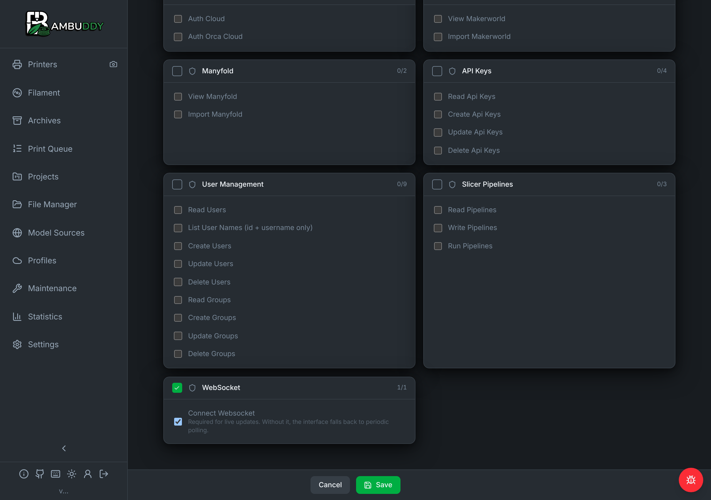
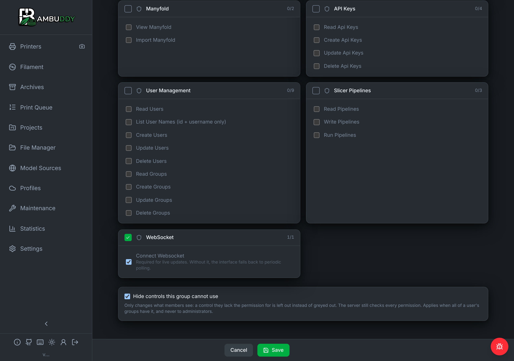
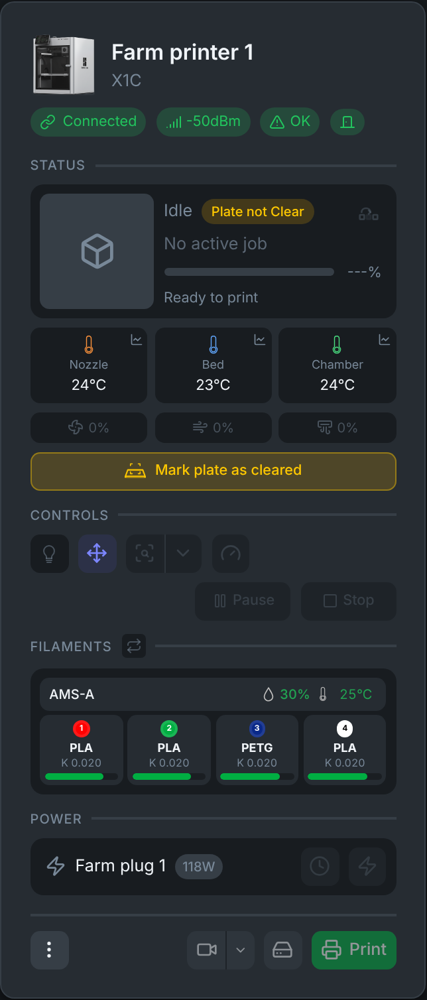
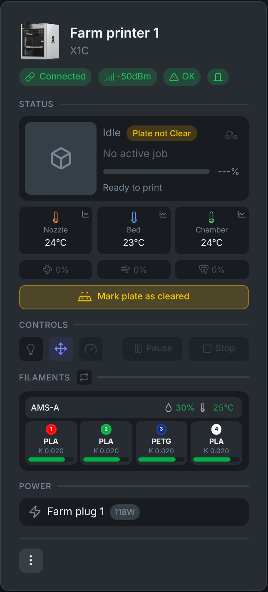
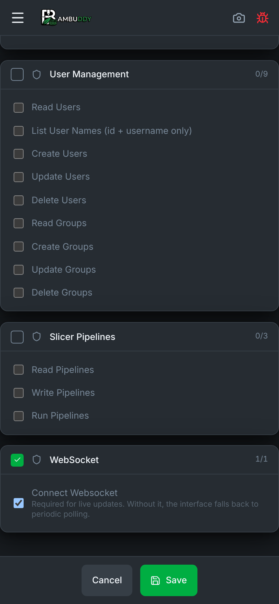
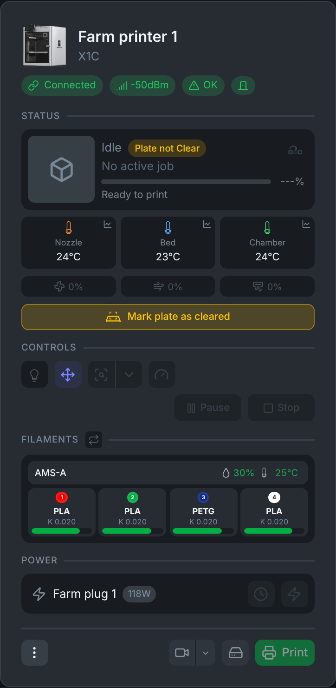
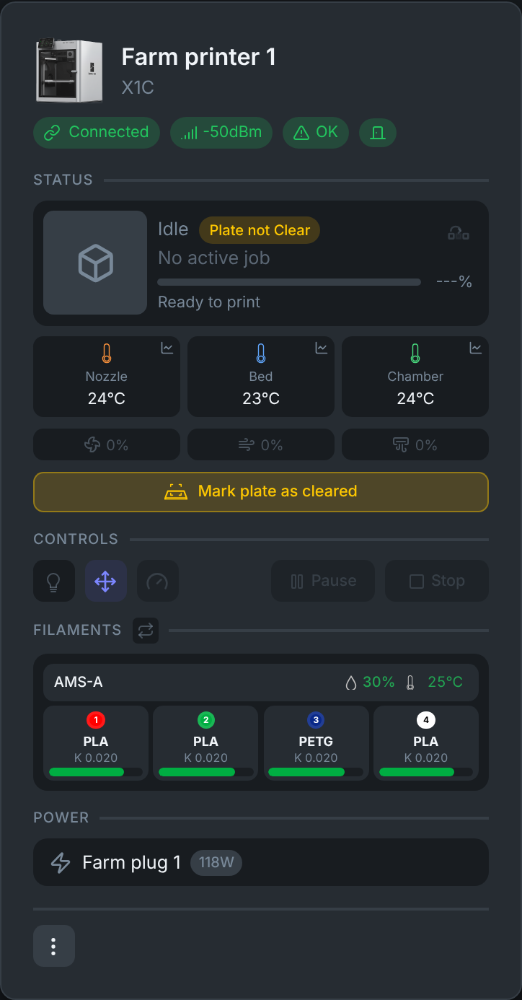

# PR draft – #3639 (hide the controls a group cannot use)

- **Base:** `maziggy/bambuddy:dev`
- **Head:** `balin77:feature/hide-unpermitted-controls`
- **Title:** `Groups: an option to hide the controls a group cannot use (#3639)`
- **Status:** Draft. Submit only after #3639 is assigned to balin77 and the user approves. Nothing is posted.
- **Independent of #3248.** The branch starts from `upstream/dev` and gates the controls by the permissions `dev` has today. With #3248 (finer printer permissions) merged, the option hides each control by its own fine permission, with no further change.
- **Farm note (not for the PR text):** on `farm` the same change is carried by the cherry-picks plus one adaptation commit ("farm: adapt #3639 to farm with the fine printer permissions"): the gates use the fine permissions of #3248 (`printers:pause_resume`, `stop`, `filament`, `tune`, `motion`, `drying`, `maintenance`, `admin`), the HMS dialog and the AMS backup switch follow `printers:maintenance`, and the Panda Breath tile is not on `farm`.

---

## Description

A user without the permission for a printer action sees its button greyed out. That is a good default: it shows the function exists. For a helper on a print farm it is the opposite of helpful: someone who may only clear plates and pause a print meets a printer card full of controls that never work for them. This PR adds a per-group option, **Hide controls this group cannot use**, that gives such a group a simpler Printers page. It is off by default, so nothing changes for anyone on upgrade.

**The option.** A checkbox at the bottom of the permission list on the group editor page. Stored as `groups.hide_unpermitted_controls` (BOOLEAN, default false), like `restrict_printers`.

**Server computation.** `GET /auth/me` (and the user list) return `hide_unpermitted_controls` for the user. It is true only when the user has at least one group and **all of their groups** have the option on, and never for administrators. Authentication off and API keys never get it. The frontend makes no extra request.

**Administrators.** The Administrators group cannot have the option: saving it as on is refused with 400 ("Administrators always see every control"), and the editor shows a note instead of the checkbox. Administrators keep every control anyway.

**What is hidden.** On the Printers page, a control that is disabled **only because the user lacks the permission** is left out: plate clear, the AMS slot actions (RFID re-read, load, unload), the card menu entries (edit, maintenance mode, delete), the maintenance exit button, skip objects, the Controls section (light, airduct, movement, plate detection, speed, pause, stop), the smart plug buttons, camera, files and Print in the card footer, and on the page the bulk select and Add Printer buttons. Print is offered only with both `library:upload` and `queue:create`.

**What stays.** A control that is disabled for another reason (printer offline, nothing printing, a request running) is still drawn and greyed, otherwise the card would change shape all the time. The temperature, fan and speed tiles stay as plain readouts (without the "no permission" hint and the dimming), and the skipped-objects count stays as a readout.

**Sections disappear with their controls.** The Controls section (heading, divider and both groups) is not drawn when nothing in it is left; a group of buttons that is empty reserves no gap; the AMS slot hover card draws no empty bordered box; the page toolbar's action group, its divider and the compact Actions menu are left out when they would be empty; the status text no longer keeps room for the skip-objects button when that button is hidden.

**Dialogs.** The HMS error dialog leaves out Clear Errors and the fault actions (the faults themselves stay); the AMS Filament Backup dialog leaves out its switch (the unit list stays); the firmware dialog leaves out the version list for a user without `firmware:update` (the current version stays).

**Display only.** The server keeps checking every permission exactly as before. A hidden control that is reached some other way is still refused.

**Migration.** One additive column on `groups` with a default that keeps today's behaviour, for SQLite and PostgreSQL, with the usual backfill of NULL for a table `create_all()` already gave the column, and the entry in `_PG_COLUMNS_SET_FROM_MODEL`. `scripts/check_postgres_upgrade.py` passes.

## Related Issue

Fixes #3639

## Documentation

**Companion docs PRs**:
- Wiki: maziggy/bambuddy-wiki#___ (Authentication: the new checkbox and its rules)

**Pick one**:
- [x] Docs PR(s) linked above
- [ ] No docs update required — reason: ___

## Type of Change

- [ ] Bug fix (non-breaking change that fixes an issue)
- [x] New feature (non-breaking change that adds functionality)
- [ ] Breaking change (fix or feature that would cause existing functionality to change)
- [ ] Documentation update
- [ ] Code refactoring
- [ ] Performance improvement
- [x] Test addition or update

## Changes Made

**Backend**
- `models/group.py`, `core/database.py`: the column, its migration and the PostgreSQL entry.
- `schemas/group.py`, `api/routes/groups.py`: create, update and response; Administrators refused.
- `models/user.py`, `schemas/auth.py`, `api/routes/auth.py`, `api/routes/users.py`: the computed `hide_unpermitted_controls` on the user.

**Frontend**
- `contexts/AuthContext.tsx`: `hideUnpermitted` (auth on, not an administrator, the user's flag).
- `hooks/usePermissionGate.ts` (new): `gate(permission | permissions[])` gives `{ allowed, render }`; a control is drawn when it is allowed or the option is off, and disabled when it is not allowed.
- `pages/PrintersPage.tsx`, `components/HMSErrorModal.tsx`, `components/AmsBackupModal.tsx`: the controls above.
- `pages/GroupEditPage.tsx`, `i18n/locales/*.ts` (all 16 locales): the checkbox, its help text and the Administrators note.

**Changelog:** one entry under Added.

## Screenshots

### Desktop (1280)

| View | Before | After |
|---|---|---|
| Group editor |  |  |
| Printer card, option off |  |  |
| Printer card, option on |  |  |

### Mobile (390)

| View | Before | After |
|---|---|---|
| Group editor |  |  |
| Printer card, option off |  |  |
| Printer card, option on |  |  |

The screenshots use a mocked API with invented names. The helper in "Printer card" has only pause/resume and clear plate permissions.

## Testing

**Covered by tests (backend, pytest)**

- `backend/tests/integration/test_group_hide_unpermitted_controls_3639.py` (new): off on a new group; the option round-trips through create, read and update; Administrators are refused and can be saved with it off; `/auth/me` for a member of a group with and without the option, with all groups on, with one off (everything shows), without a group, an administrator in a group with it, and an API key; the user list reports it; the server still enforces the permissions for such a user.
- `backend/tests/unit/test_hide_unpermitted_controls_migration_3639.py` (new): the migration is additive and idempotent.
- `test_pg_columns_set_from_model.py` (existing) enforces the PostgreSQL entry.

**Covered by tests (frontend, Vitest)**

- `hooks/usePermissionGate.test.tsx` (new) and `contexts/AuthContext.test.tsx`: `render` and `allowed` for one and several permissions, never hiding with the option off, for administrators or with authentication off.
- `pages/GroupEditPage.test.tsx`: the checkbox is sent with save, not offered for Administrators, loaded from the group.
- `pages/PrintersPageHideUnpermitted3639.test.tsx` (new): option off keeps every control and disables the ones without permission (regression guard); option on leaves them out, with the Controls section, the slot hover card box, the toolbar actions and the empty-state button; a control disabled for another reason stays; readouts keep their look; the skipped count stays and reserves no space; Print needs both permissions; the HMS, AMS backup and firmware dialogs.
- `HMSErrorModal.test.tsx`, `AmsBackupModal.test.tsx`: the dialog changes.

The new tests assert the hiding itself, so they fail on `dev`, where those controls are drawn greyed out.

**Checked in the UI**

- Screenshots only, against a mocked API (above). **Not yet tested with a real helper group on a real farm.** I will do that on my Bambuddy and report back.

Checks run: the full CI workflow on the head of this branch in my fork: https://github.com/balin77/bambuddy/actions/runs/44922876134 (green)

- [x] I have tested this on my local machine (unit and component tests, mocked API)
- [ ] I have tested with my printer model: not yet with a restricted user (see above)

## Checklist

- [x] My code follows the project's coding style
- [x] I have commented my code where necessary
- [x] My changes generate no new warnings
- [x] I have tested my changes thoroughly (tests; no real-user run yet)

## Additional Notes

**Known limits**
- **The Printers page only.** The issue scopes it so; other pages can use the same `usePermissionGate` hook later.
- **A user in several groups** gets the simple view only when every group has the option on. One group without it keeps the full view.
- **Display only.** It is not a security boundary.
- **Other places that show a disabled control** (for example a modal opened from a page other than Printers) keep greying out.

**Wiki PR:** maziggy/bambuddy-wiki#___
