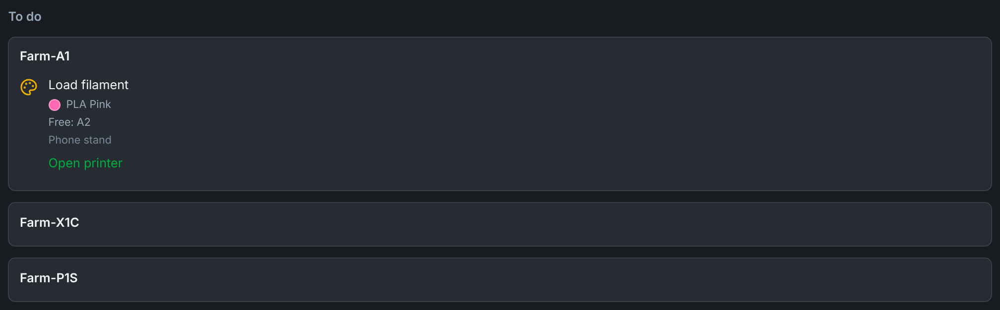
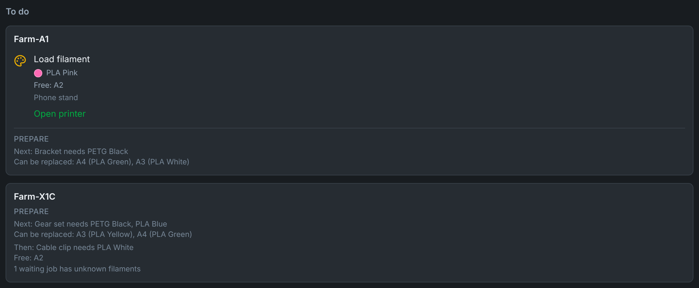
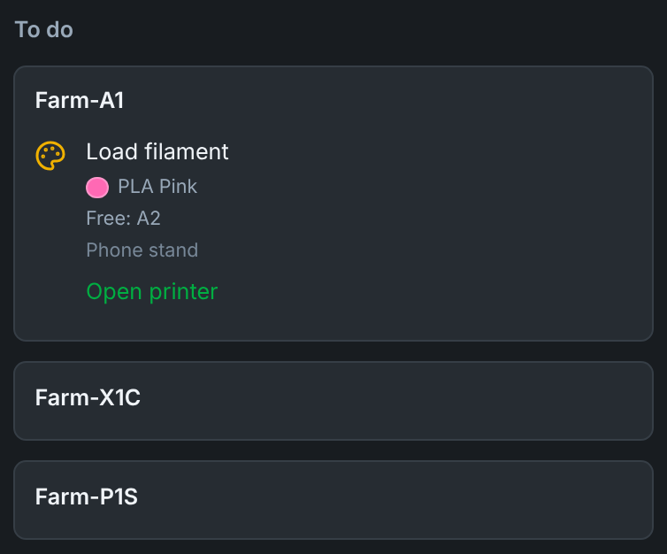
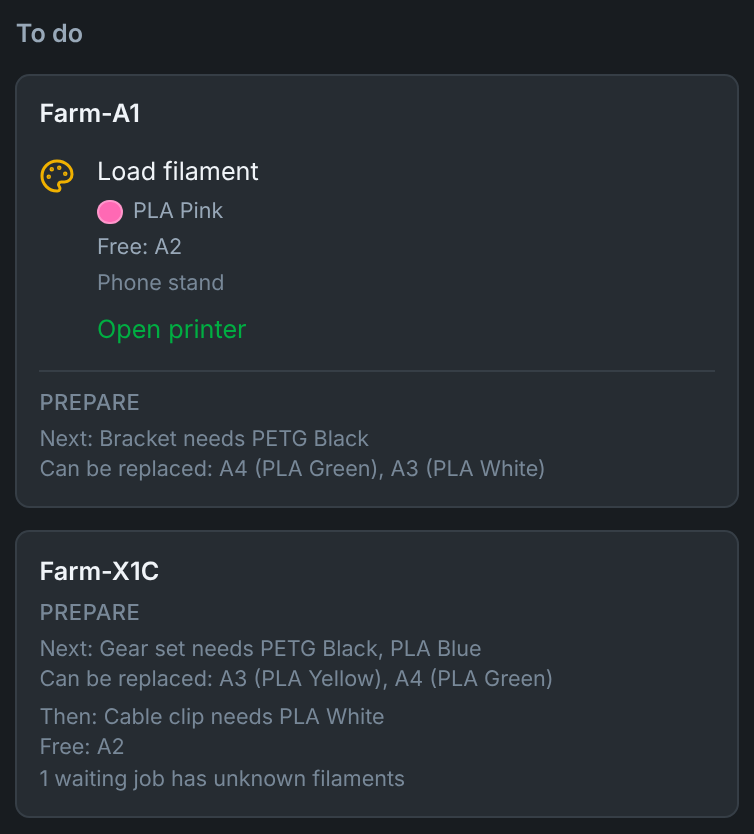

# PR draft – #3640 (To do list: prepare the next jobs' filaments)

- **Base:** `maziggy/bambuddy:dev`
- **Head:** `balin77:feature/queue-todo-prepare`
- **Title:** `Queue: the To do list says what to prepare for a printer's next jobs (#3640)`
- **Status:** Draft. Submit only after #3640 is assigned to balin77, **PR #3622 (#3615) and PR #3634 are merged**, and the user approves. Nothing is posted.
- **Builds on #3634.** The branch starts from `feature/queue-todo-replace-slot` (#3634), which itself starts from `feature/queue-todo-list` (PR #3622, #3615). Once both are merged, this PR's diff shrinks to the #3640 commits. Until then GitHub would show all three.

---

## Description

The To do list (#3615) tells what a printer waits for **now**, and with #3634 where the filament can go. It does not tell what comes **next**. A printer that is busy only shows that its next job lacks a filament once the print has ended and the printer stands idle. A Bambu AMS lets you swap a spool that the running print does not use, so the filaments of the next jobs could be loaded **during** the print, if the list said which ones and where.

This PR adds a second, quieter kind of line to a printer's group in the To do list: **Prepare**. It is a suggestion only: nothing is reserved or changed on the printer, nothing is sent as a notification, and the scheduler decides exactly as before. No migration, no new setting, no new dependency.

**What the user sees**

Under the entries of a printer (or alone, when it has none), in the quiet gray of the other rows:

```
X1C-2
  Prepare
  Next: Bracket needs PETG Black, PLA Blue
  Can be replaced: A3 (PLA Yellow), A4 (PLA Green)
  Then: Lid needs PLA White
  Free: B2
```

- **Which jobs:** the next one or two jobs of that printer that miss a filament, in the order the queue would take them: jobs pinned to the printer, and "Any model" jobs that only this printer can take. A model job that several printers could take is left out, since it is not known which one gets it. A job scheduled for later counts when it is due before the running print ends (and is left out when the remaining time is not known).
- **Which slots:** the rules of #3634 (same hint lines, same slot names and colour names), plus:
  - never a slot the running print uses (its AMS mapping, the tray the extruder holds, and while the print is paused the trays it expects);
  - never a spool the printer would switch to when a running spool ends: with AMS Filament Backup on (or not reported), a loaded slot with the same filament preset (else type) and colour on the same nozzle; any nozzle with a Filament Track Switch; with the backup off a peer may be replaced;
  - never a slot that a nearer job needs. Jobs that are held this pass and jobs that miss nothing get no line, but their trays stay reserved; the second job is offered what the first would not take (the first takes as many slots as it misses filaments);
  - a slot that already holds a spool of the wanted filament is not offered (the `tray_fits_filament` predicate of #3634), and a short spool claims no free slot.
- **Low key:** Prepare lines are not counted in the To do badge and send no notification. A printer with nothing but Prepare lines still shows the list; the badge keeps counting only what the queue waits on.
- **No guessing:** if the printer does not report what the running print uses (for example a print started from the slicer, whose mapping is unknown) there is no Prepare line for it.
- **Visibility:** only jobs the caller may see and printers in the caller's scope; the lines are numbered again for what the caller sees, so the first visible line is always **Next**.

## Related Issue

Fixes #3640

Related: #3615 / #3622 (the To do list), #3634 (where the filament can go).

## Documentation

**Companion docs PRs**:
- Wiki: maziggy/bambuddy-wiki#___ (the To do section comes from maziggy/bambuddy-wiki#156; this one depends on it)

**Pick one**:
- [x] Docs PR(s) linked above
- [ ] No docs update required — reason: ___

## Type of Change

- [ ] Bug fix (non-breaking change that fixes an issue)
- [x] New feature (non-breaking change that adds functionality)
- [ ] Breaking change (fix or feature that would cause existing functionality to change)
- [ ] Documentation update
- [x] Code refactoring: the printers a pending job could go to come from one helper that the slot hint step shares, no behaviour change
- [ ] Performance improvement
- [x] Test addition or update

## Changes Made

**Scheduler (`backend/app/services/print_scheduler.py`)**
- A pure helper picks, in the order of a queue pass, the jobs that come next on a printer (pinned to it, or model jobs only it can take). The printers each pending job could go to come from one helper that the slot hint step shares.
- A **separate read-only step after each pass**, next to the slot hint step of #3634 and in the same savepoint. It runs for printers that hold a job or print, and looks at their next two jobs that miss a filament. It does not change which job is held, started or skipped.
- Reserved slots are the running print's, the AMS Filament Backup peers of its trays, the planned mapping of held and nearer jobs; the second job is offered what the first would not take. Then the same slot classification as #3634 (`settled_hint` drops slots that already fit the filament).
- A printer whose running mapping is unknown gets nothing.
- Same per-printer memo as the slot hints (the signature adds the two jobs, the running mapping, the trays the printer expects while paused and the backup setting), same quiet logging, a hint that fails for one printer does not hide the others. At most eight held jobs and eight candidates are mapped per printer per pass. A pass that stops early keeps the last lines.

**Queue (`backend/app/services/queue_todo.py`, `backend/app/api/routes/print_queue.py`, `backend/app/schemas/print_queue.py`)**
- `build_todo` takes the scheduler's `prepare` lines and puts them on the printer group. Not part of `count`. A group with neither entries nor lines is left out.
- Additive schema fields: `prepare` on `QueueTodoGroup`, with `QueueTodoPrepare` and `QueueTodoPrepareJob`.

**API example** (`GET /queue/todo`, a printer group with one entry and two Prepare lines):

```json
{
  "printer_id": 3,
  "printer_name": "X1C-2",
  "target_model": null,
  "entries": [],
  "prepare": [
    {
      "job": {"id": 21, "name": "Bracket"},
      "position": 1,
      "filaments": [
        {"type": "PETG", "color": "#000000", "color_name": "Black", "no_stock": false, "nozzle": null,
         "short": false, "short_trays": [], "required_grams": null}
      ],
      "slot_hint": {
        "state": "replaceable",
        "slots": [
          {"ams_id": 0, "tray_id": 2, "is_ht": false, "is_external": false, "ams_type": 1, "nozzle": null,
           "type": "PLA", "color": "#FFEB3B", "tray_info_idx": "GFA00", "tray_sub_brands": "PLA Basic"}
        ],
        "unknown_jobs": 0,
        "by_nozzle": []
      }
    }
  ]
}
```

`position` is 1 for the next job that misses a filament and 2 for the one after. `slot_hint` has the shape of #3634 and is `null` while the printer reports no trays. Everything is additive: a client that ignores `prepare` behaves as before.

**Frontend**
- `api/client.ts`: types for the new fields.
- `QueueTodoList.tsx`: quiet **Prepare** rows after the entries of a printer, with the same slot lines as a Load filament entry; **Next** and **Then** are labelled by place in the list, so a dropped first line leaves no lone "Then". A printer with only Prepare rows shows the list.
- `i18n/locales/*.ts` (all 16 locales): `queueTodo.prepare.{title,next,then}`.

**Changelog:** one entry under Added.

## Screenshots

### Desktop (1280)

| View | Before | After |
|---|---|---|
| To do list, printer with Prepare rows |  |  |

### Mobile (390)

| View | Before | After |
|---|---|---|
| To do list, printer with Prepare rows |  |  |

The screenshots use a mocked API with invented printer names.

## Testing

**Covered by tests (backend, pytest)**

- `backend/tests/unit/test_predict_next_jobs_prepare.py` (new, 13 tests): which jobs come next on a printer (pinned, model jobs only that printer can take, held jobs kept apart, scheduled jobs).
- `backend/tests/unit/test_prepare_step_prepare.py` (new, 69 tests) pins the step:
  - the next job is named with what it misses and where it can go; a job that misses nothing gets no line but keeps its trays; only the first two jobs that miss something get a line; the second job is offered what the first would not take; the first takes as many slots as it misses filaments;
  - never offered: the extruder's tray, the running print's trays (also on both nozzles and an AMS-HT or external spool), the slots a paused print expects, a backup peer of a running tray (with the backup on or not reported, with the preset deciding when reported, another colour is no peer, a peer on the other nozzle is none, with a Filament Track Switch any nozzle) and, with the backup off, a peer can be replaced;
  - no line without a known running mapping (empty, only unresolved slots, none printing and nothing held, no trays reported); the running queue row gives the mapping;
  - held jobs keep their trays; unknown filaments of a nearer job are counted; the hint of the Load entry is the one that is kept out; a short spool claims no free slot;
  - future scheduled jobs (due before the print ends, unknown remaining time), print anyway between two passes;
  - cost and failures: only eight held jobs and candidates mapped, no query when nobody holds or prints, an unchanged printer is not mapped again, a changed input or a degraded result computes again, one failing printer does not stop the others, a failing step does not touch the pass, a pass that stops early keeps the last lines, both steps give their result in one pass.
- `backend/tests/integration/test_queue_todo_3615.py` (10 new tests): a line is served under its printer and not counted; it joins the group of a printer that has an entry; position order; an empty list without lines; a job that is gone is left out; a reader of own jobs sees no line for another user's job; a printer the caller may not see has none; a group has entries or lines or is not served; the first line the caller sees is numbered one; the hint of a line is cut to its nozzles.
- `backend/tests/unit/test_slot_hints_3634.py`: one test adapted to the shared helper. Scheduler decisions are not changed by this PR.

**Covered by tests (frontend, Vitest)**

- `frontend/src/__tests__/components/QueueTodo.test.tsx` (20 new tests): the next job with what it needs and where it can go; **Then** for the second job; labels by place in the list; the list for a printer with nothing but Prepare rows, without an empty entries list or a second rule; the rule between entries and Prepare rows; no empty group; hidden when nothing is to show; the hint in the plain gray of the other rows; out-of-stock filaments marked as in a Load entry; a colour code for a filament without a name; nozzle prefix; unknown jobs counted; job names with markup kept as text; translated; the badge counts what the queue waits on, not the lines; no badge when only Prepare lines are served; a server that sends no `prepare`.

**Checked in the UI**

- Screenshots only, against a mocked API.
- **Not yet on real printers.** I have not run this branch against a live printer that prints with a full AMS; I will add the result here when I have.

Checks run: the full CI workflow on the head of this branch in my fork: https://github.com/balin77/bambuddy/actions/runs/44724506316 (green)

- [x] I have tested this on my local machine (unit and component tests, mocked API)
- [ ] I have tested with my printer model: not yet, see above

## Checklist

- [x] My code follows the project's coding style
- [x] I have commented my code where necessary
- [x] My changes generate no new warnings
- [x] I have tested my changes thoroughly (tests; no real-printer run yet)

## Additional Notes

**Known limits**
- **A suggestion.** Nothing is reserved. A tray changed by hand, or a job started meanwhile, makes a line stale until the next pass (a few seconds).
- **Only two jobs, only sure ones.** Model jobs that several printers could take are left out; the further ahead, the less certain.
- **No running mapping, no line.** A print started from the slicer usually has no known mapping.
- **Same type, different colour.** As in #3634, the hint uses the scheduler's matching.

**Wiki PR:** maziggy/bambuddy-wiki#___ (depends on #156, which adds the To do section).
