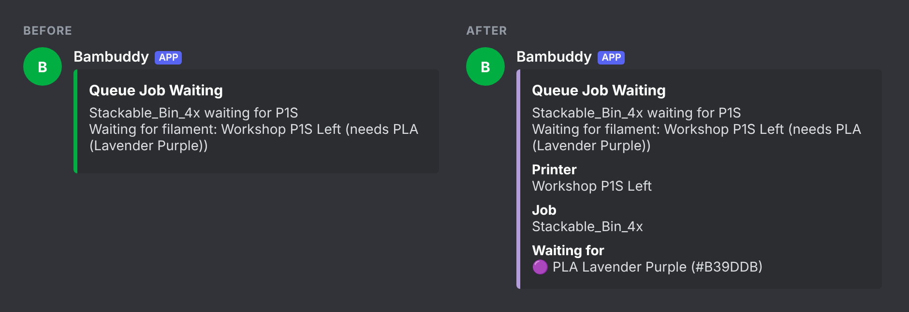
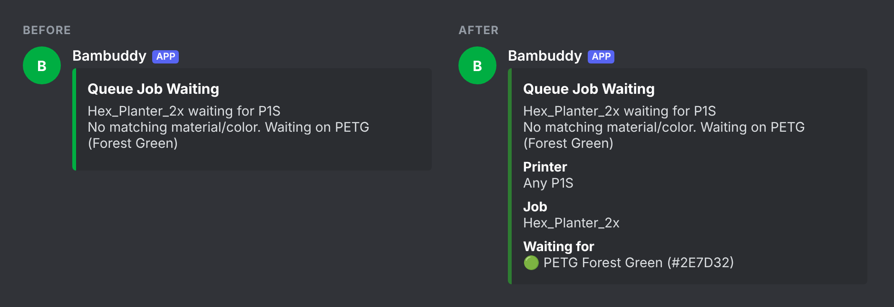
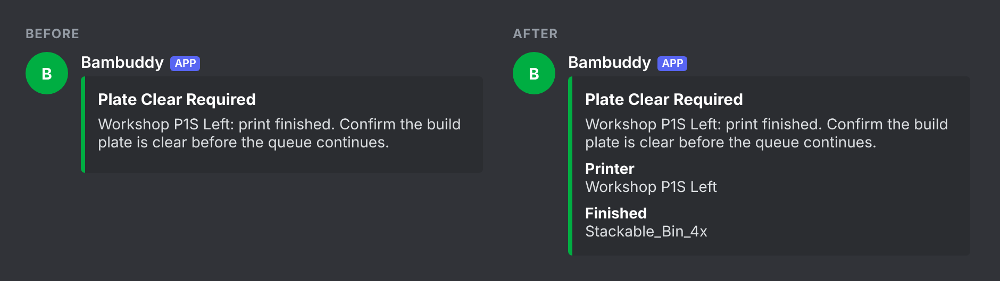
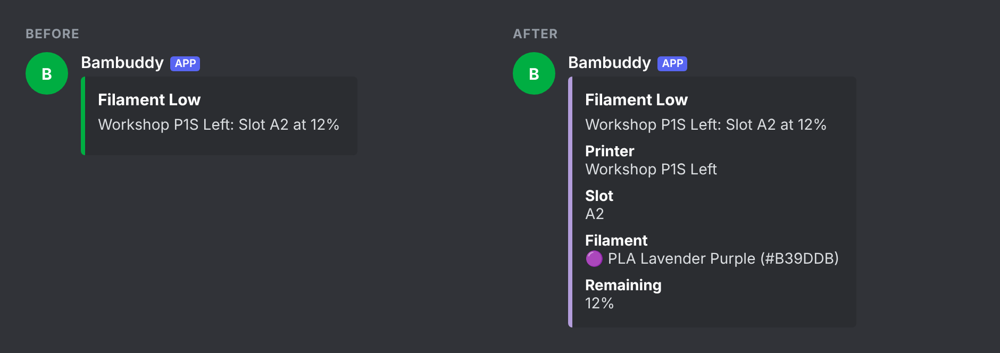

# PR draft – #3641 (readable notifications)

- **Base:** `maziggy/bambuddy:dev`
- **Head:** `balin77:feature/notification-readable`
- **Title:** `Notifications: printer, job and filament as separate fields, with a colour dot (#3641)`
- **Status:** Ready to submit after the user approves (issue #3641 was assigned to balin77 on 21 November 2026). Nothing is posted. The images are mock renderings (see Screenshots); a real Discord screenshot is added after the farm test.
- **Related PR:** #3642 (the raw code `filament_short`). Both touch the same call site (no textual conflict). One test assertion in this PR (`test_the_filament_short_gate_keeps_its_reason_and_adds_the_filament`, which expects the reason `filament_short`) has to follow whichever of the two merges second.
- **Wiki:** `WIKI-3641.md`. Submit the wiki PR together with this one and link it below.

---

## Description

A queue notification on a phone is one block of text: the printer, the job and the filament it waits for are run together in a sentence, "waiting for P1S" names the printer **model** (which of my P1S?), the colour is only a catalog name, and Plate Clear Required does not say which job finished. This PR gives the notifications the facts as data, so each channel can show them in its own way. No migration, no new setting, no new dependency. **The default templates are unchanged.**

**New template variables**, for every channel and every template:

| Variable | Meaning | Where it is filled |
|----------|---------|--------------------|
| `{printer}` | The printer's name. A job pinned to a printer: that printer's name. A job for "Any P1S" that no printer holds: `Any P1S` | Queue Job Waiting (new there; it already existed for other events) |
| `{filament_type}` | The material, e.g. `PLA` | Queue Job Waiting, Filament Low |
| `{color_name}` | The colour name, e.g. `Lavender Purple` | the same |
| `{color_hex}` | `#RRGGBB`, empty when unknown or fully clear | the same |
| `{color_emoji}` | The colour dot, see below | the same |
| `{slot}` | The slot label as the other alerts spell it (`A2`, `HT-A`, `Ext-L`) | Queue Job Waiting (a short spool), Filament Low (existed) |
| `{filament}` | All of it in one: `🟣 PLA Lavender Purple (#B39DDB)` | Queue Job Waiting, Filament Low |
| `{job_name}` | The job that just finished, without extension or folder | Plate Clear Required |

Where the data comes from: for a job that waits for a filament, the requirements the scheduler already names in the waiting reason (the forced overrides a printer lacks, or the unmatched requirements of a pinned job), handed over as data next to the sentence; for a short spool, its material, its slot and the colour of the spool loaded there; for Filament Low, the spool's material, colour name, colour and extra colours; for Plate Clear Required, the name the newest archive of the printer has (the same file name the queue and the other notifications use), else the queue item that last ran there, and only without either the name the printer reports for the print. The waiting reason text stays byte-identical. An event about several filaments joins them in order: the scalar variables with `, `, `{filament}` with `; ` (its entries have commas of their own). Anything unknown is empty, with no gap left in the others.

**Discord fields, only for a template that is still the shipped one.** While the template of an event is exactly the shipped title and body (line endings and trailing space do not count as an edit), the embed also gets fields next to the unchanged description: **Printer**, **Job** (**Finished** for Plate Clear Required) and **Waiting for**, one line per filament; Filament Low shows **Printer**, **Slot**, **Filament** and **Remaining**. A template the user edited is sent exactly as before: no fields, green side bar, the old message. The fields repeat what the shipped wording says, so they go only with that wording. The test notification is unchanged. Discord's limits are kept (25 fields, 1024 characters per value, 6000 per embed; an empty field is left out, since Discord rejects the whole message for one).

**Side colour.** When an event is about exactly one filament with a readable colour, the embed's side bar takes it. Several filaments, a multi-colour spool, an unreadable or clear colour, and a near-white one (it would vanish on Discord's light theme) keep the Bambu green.

**The colour dot.** The same colour families as the Inventory page's colour column (`colorFamily` in `frontend/src/utils/colors.ts`), ported to `backend/app/utils/color_utils.py`:

| Family | Dot |
|--------|-----|
| Red, Orange, Yellow, Green, Purple, Brown | 🔴 🟠 🟡 🟢 🟣 🟤 |
| Blue, Cyan | 🔵 |
| Pink | 🩷 (Unicode has no pink circle) |
| White, Light Gray | ⚪ |
| Gray | ⚪ or ⚫ by lightness |
| Dark Gray, Black | ⚫ |
| Clear (alpha `00`) | ⚪ and the word "clear" |
| Partly transparent | the dot of its RGB and the word "translucent" |
| Several colours (a multi-colour or gradient spool) | 🌈 |
| Unknown or unreadable | no dot and no hex, never a wrong one |

A shared fixture, `frontend/src/__tests__/utils/colorFamilyVectors.json` (hex to family), is tested by pytest against the Python port and by Vitest against `colorFamily`, so a rule changed on one side fails the other test until it is changed too.

**Other channels.** Text channels (Telegram, ntfy, email, Pushover and the like) get the variables only, with no per-channel special casing. The generic webhook forwards every variable, so it receives the new ones too (an addition, existing keys are unchanged). The presentation (fields, side colour) is passed next to the text and never inside `variables`, so the webhook cannot leak it. Telegram escapes the new values like every other variable (Markdown v1: only `_` is escaped, as before); a filament name with a `*` or a backtick could upset Telegram's Markdown parsing, as a printer or job name already can.

**No migration.** Templates in the database are not rewritten and no row is touched. Whether a template is "unchanged" is decided at send time by comparing it with the shipped text (`is_default` is no help: it is set on seeding and an edit never clears it).

**Plate Clear Required names the job as the archive does.** The finished job comes from the archive of the print (or the queue item that ran it), not from the printer's subtask name, so the **Finished** field reads like the queue row and the other notifications (`Blanket_Coaster_4x_p1s`, not `Blanket_Coaster_4x.P1s_gcode`). Only a print with neither an archive nor a queue entry falls back to the printer's own name.

## Related Issue

Fixes #3641

Related: #3642 (the raw code `filament_short`), #2933 (notification language).

## Documentation

**Companion docs PRs**:
- Wiki: maziggy/bambuddy-wiki#___ (new variables per event, the unchanged-template rule, a Discord example; draft `WIKI-3641.md`)

**Pick one**:
- [x] Docs PR(s) linked above
- [ ] No docs update required — reason: ___

## Type of Change

- [ ] Bug fix (non-breaking change that fixes an issue)
- [x] New feature (non-breaking change that adds functionality)
- [ ] Breaking change (fix or feature that would cause existing functionality to change)
- [ ] Documentation update
- [ ] Code refactoring
- [ ] Performance improvement
- [x] Test addition or update

## Changes Made

**Backend**
- `backend/app/utils/color_utils.py`: `color_family`, `color_emoji`, `color_note`, a port of the frontend's colour families.
- `backend/app/services/notification_content.py` (new): `NotificationFilament` (type, colour, name, slot), `filament_variables`, `NotificationPresentation` (fields and side colour), `is_unmodified_template`, `discord_fields` (Discord limits), `embed_color`.
- `backend/app/services/notification_service.py`: `on_queue_job_waiting`, `on_plate_clear_required` and `on_filament_low` build the variables and the presentation; `_send_to_providers` and `_send_to_provider` pass it on, and only the Discord path uses it, and only for an unchanged template; `_send_discord` takes `fields` and `color`.
- `backend/app/services/print_scheduler.py`: every `on_queue_job_waiting` call site passes the filaments it waits for (a model job, a pinned job held by Loaded Filament First, a staged job, a short spool); the matcher collects the requirements a printer lacks. The reasons themselves are unchanged.
- `backend/app/services/printer_manager.py`: the Plate Clear Required event passes the finished job's name: the printer's newest archive, else the queue item that last ran there, else the printer's own subtask name (which can differ, e.g. `Name.P1s_gcode`).
- `backend/app/schemas/notification_template.py`: the new variables in `EVENT_VARIABLES` and `SAMPLE_DATA`, so the template editor lists them and the preview works.

**Frontend**
- Tests only (`colorFamily.test.ts` and the shared vectors fixture). The editor lists variables from the API, so no editor change.

## Screenshots

The Discord embeds below are **mock renderings of the JSON the code sends** (the JSON is rendered as an embed by a small HTML mock with invented printer and job names), not screenshots of a real Discord channel. Each image shows before and after; the JSON files are next to the images. A real Discord screenshot follows after the test on my farm.

| Event | Before / after |
|-------|----------------|
| Queue Job Waiting, pinned to a printer |  |
| Queue Job Waiting, any printer of a model |  |
| Plate Clear Required |  |
| Filament Low |  |

Raw JSON: `queue-waiting-pinned-{before,after}.json`, `queue-waiting-model-{before,after}.json`, `plate-clear-{before,after}.json`, `filament-low-{before,after}.json` in `pr-assets/3641/`.

## Testing

**Covered by tests (backend, pytest)**

- `test_color_family.py` (new): the family of every vector of the shared fixture, the dot per family, an unreadable colour has no dot, several colours are a rainbow, "clear" and "translucent".
- `test_notification_content.py` (new): the line `dot type name (#hex)` and what it leaves out; clear, translucent and multi-colour; the variables for one filament, for several (joined in order) and for none; the side colour (readable, unreadable, clear, near-white, one multi-colour spool, none or several keep the green).
- `test_notification_presentation_3641.py` (new): Discord gets the fields and the colour for an unchanged template; an **edited template gets exactly the old payload**; without a stored template nothing is added; no presentation is the old payload; the photo upload carries the fields; the test notification is unchanged; the generic webhook payload keeps its keys and gains the variables; text channels get the same call; template detection (line endings, trailing space, either part edited, unknown event); Discord's field limits.
- `test_queue_waiting_notification_3641.py` (new): a pinned job shows printer, job and filament; a model job shows "Any P1S" and several filaments keep the green; no filaments means no "Waiting for" field; a near-white one keeps the green; an edited template is sent as before; the variables for text channels, the webhook, and Telegram escaping.
- `test_plate_clear_filament_low_3641.py` (new): Plate Clear Required shows the printer and the finished job, only the printer when the job is unknown, `{job_name}` for other channels, an edited template as before; the finished job's name (the newest archive first even when the printer reports another subtask name, else the queue item, else the printer's own name, else none); Filament Low shows the spool and takes its colour, without a spool there is no filament field and the green stays, and the old variables are unchanged.
- `test_scheduler_loaded_filament_first_3587.py`: every waiting notification carries what it waits for as data (a model job, each colour once, the Loaded Filament First wait, a pinned wait for short spools, the short-spool gate, an unmatched requirement) and its reason text is asserted unchanged; the matcher's collected requirements agree with the words.
- `test_filament_low_producer_2913.py`: the producer passes the spool.
- `test_notification_template_sample_data.py` (existing): every new variable has a sample.

**Covered by tests (frontend, Vitest)**

- `colorFamily.test.ts` (new): the same vectors against `colorFamily`.

**Checked in the UI**

- Not yet on Discord. The images above are mock renderings of the JSON the tests assert. The test on my farm build is pending, and a real Discord screenshot follows.

Checks run: the full CI workflow on the head of this branch in my fork: https://github.com/balin77/bambuddy/actions/runs/44920307532 (green after re-running one unrelated flaky frontend test)

- [x] I have tested this on my local machine (unit and integration tests)
- [ ] I have tested with my printer model: not yet (tests and mock renderings, farm test pending)

## Checklist

- [x] My code follows the project's coding style
- [x] I have commented my code where necessary
- [x] My changes generate no new warnings
- [x] I have tested my changes thoroughly (tests; no real Discord channel yet)

## Additional Notes

**Unchanged on purpose.** Default templates, the waiting reasons, the test notification, and any template the user has edited. Quiet hours, per-printer filtering and provider routing are untouched.

**Known limits**
- Only Discord shows fields; the other channels get the variables for their own templates.
- The fields appear only while a template is exactly the shipped one. Editing the template (even one word) opts out of them, by design.
- A short spool's colour is the colour of the spool in the slot, when the printer reports it.
- Notification language (#2933) is a separate topic.

**Wiki PR:** maziggy/bambuddy-wiki#___ (draft `WIKI-3641.md`).
