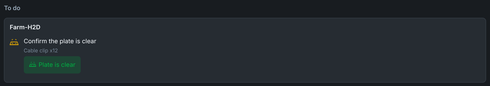
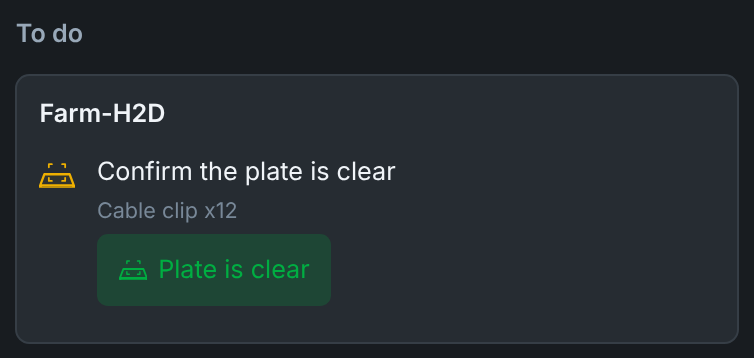
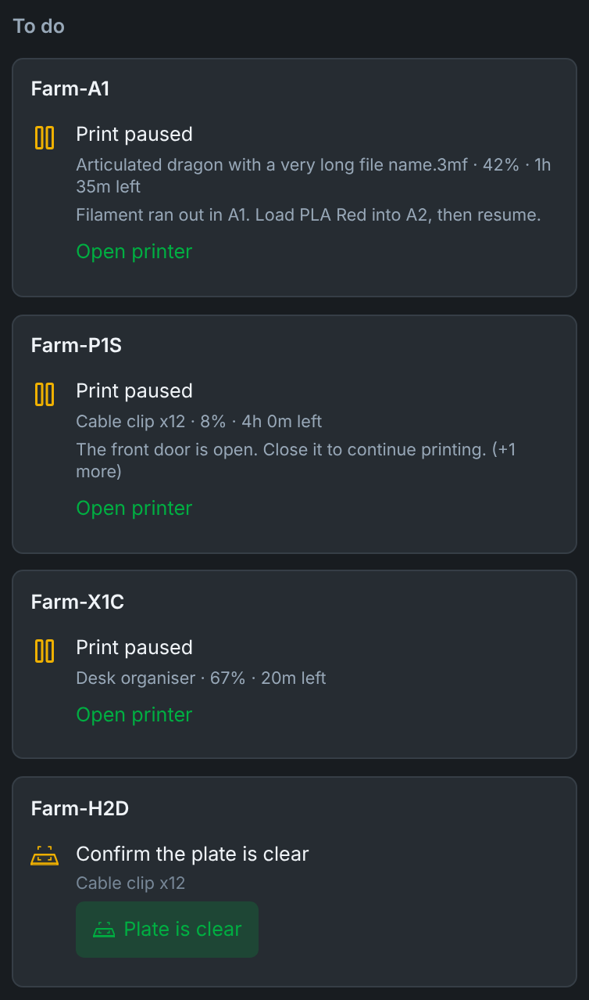

# PR draft – #3648 (To do list shows paused prints)

- **Base:** `maziggy/bambuddy:dev`
- **Head:** `balin77:feature/queue-todo-paused-print`
- **Title:** `Queue: the To do list shows a paused print and why it waits (#3648)`
- **Status:** Draft. Submit only after #3648 is assigned to balin77, **PR #3622 (#3615) is merged**, and the user approves. Nothing is posted.
- **Builds on #3622.** The branch starts from `feature/queue-todo-list` (PR #3622, #3615), because the To do list it extends comes from there. Once #3622 is merged, this PR's diff shrinks to the #3648 commits. Until then GitHub would show both.

---

## Description

The To do list (#3615) shows what the **waiting** jobs need. It does not show the most urgent case on a farm: a **running** print that has paused and waits for a person, because a spool ran out or the printer raised an error. Today you only find out by looking at the printer card. This PR adds an entry **Print paused** at the very top of that printer's group, with the reason when the printer reports one. It only reads what the printer already reports. No migration, no new setting, no new dependency, and the scheduler's decisions are unchanged.

**What the user sees**

The entry sits above every other entry of its printer, and a paused printer without any waiting job gets a group of its own at the top of the list. It counts in the number on the To do badge. Line 1 is the file, how far it got and what is left (**Benchy · 42% · 1 h 5 min left**); parts the printer did not report are left out. Line 2 is the cause:

| Cause | Text |
|---|---|
| Filament ran out, both slots known | **Filament ran out in A2. Load PLA Lava Red into A3, then resume.** |
| Only the slot the printer expects is known | **Load PLA Lava Red into A3, then resume.** |
| Only the slot that ran out is known | **Filament ran out in A2. Check the printer screen for the slot it expects.** |
| Runout, no slot known | **Filament ran out. Check the printer screen for the slot it expects.** |
| Runout on the external spool | **Filament ran out on the external spool. Load a new spool, then resume.** |
| An error or warning | The printer's own description, **(+2 more)** when other faults are active. Without a text: **Error 0500-0300-0002-000E** |
| No reason reported | No second line |

The filament named is the one that ran out (the tray's type and colour name, the same `getColorName` as the printer card). When that slot is empty now it falls back to what the expected slot still reports, and to **matching filament** when neither says. No filament is guessed.

**How the cause is found** (`pause_cause`, pure and unit-tested). While the printer is in state `PAUSE`:

1. An HMS fault whose short code is an AMS runout (`07XX_8011`, units 0-7 and the `07FF` placeholder, as the printer card's runout guidance reads them) is `runout_ams`. `ran_out` is the printer's `previous_tray`, `expected` its `expected_tray`; each may be unknown.
2. `0300_8004` is `runout_external`.
3. Otherwise the most severe fault the printer card counts as a problem is `error` (severity 1 before 2 before a print-error prompt). Its text comes from the same fault catalogue as the card.
4. Nothing is `paused`.

A runout wins over any other fault. `more_errors` is the number of other faults that count.

**Anti-flicker.** The list entry depends only on the printer being paused, never on its fault list. The printer rebuilds that list with every status payload, so a runout can read as "no reason" for a moment. The cause of the current pause (the printer and its file) is therefore kept for **20 seconds** after the status last yielded it, and dropped as soon as the printer is seen **not paused**. A later pause of the same file never inherits it, and a cause that stays gone longer than 20 seconds was cleared on the printer, so the current one wins. The store is a small in-memory object (`PauseEpisodes`); nothing is persisted.

**Visibility**

- Only printers in the caller's printer scope are listed (the same scope as every other entry).
- The file's name is the printer card's information, so it is sent only to a caller with `printers:read` (or no actor, as an API key without user). Without it `job_name` is `null` and the line shows progress and time only.
- A user with only `queue:read_own` still sees a paused printer in their scope: it is a fact about the printer, not about anybody's job. The waiting jobs listed under it are only the ones they may see, as for every other entry.
- Only connected printers count; an offline printer is not listed.

**Live update.** The frontend refetches the list when a printer's state crosses `PAUSE` or its HMS codes change while it is paused (`useWebSocket`, next to the existing refetch on `awaiting_plate_clear`).

**API example** (`GET /queue/todo`, a `print_paused` entry):

```json
{
  "kind": "print_paused",
  "jobs": [],
  "filaments": [],
  "printers": [],
  "detail": null,
  "paused": {
    "job_name": "Benchy",
    "progress": 42,
    "remaining_minutes": 65,
    "cause": "runout_ams",
    "ran_out": {
      "ams_id": 0, "tray_id": 1, "is_ht": false, "is_external": false, "ams_type": 1,
      "type": "PLA", "color": "#C12E1F", "tray_info_idx": "GFA00", "tray_sub_brands": "PLA Basic"
    },
    "expected": {
      "ams_id": 0, "tray_id": 2, "is_ht": false, "is_external": false, "ams_type": 1,
      "type": "", "color": "", "tray_info_idx": "", "tray_sub_brands": ""
    },
    "error": null,
    "more_errors": 0
  }
}
```

`cause` is `runout_ams`, `runout_external`, `error` or `paused`. `ran_out` and `expected` are slots with the same field names as the filament hints' slots (#3634), filled from the live tray; each is `null` when it cannot be told. `error` is `{code, description}` for `error` only. `jobs` lists the waiting jobs of that printer, if any. The field is additive and only on a `print_paused` entry.

## Related Issue

Fixes #3648

Related: #3615 / #3622 (the To do list).

## Documentation

**Companion docs PRs**:
- Wiki: maziggy/bambuddy-wiki#___ (the To do section comes from maziggy/bambuddy-wiki#156; this one depends on it)

**Pick one**:
- [x] Docs PR(s) linked above
- [ ] No docs update required — reason: ___

## Type of Change

- [ ] Bug fix (non-breaking change that fixes an issue)
- [x] New feature (non-breaking change that adds functionality)
- [ ] Breaking change (fix or feature that would cause existing functionality to change)
- [ ] Documentation update
- [ ] Code refactoring
- [ ] Performance improvement
- [x] Test addition or update

## Changes Made

**Backend**
- `backend/app/services/queue_todo.py`: kind `print_paused`, first in the order of a group's entries; `PausedSlot`, `PauseCause`, `PausedInfo`; the pure helpers `pause_cause`, `paused_slot`, `paused_info_from_status`; `PauseEpisodes`. `build_todo(..., paused=...)` takes a map by printer id (keyword argument). A paused entry needs no waiting job; its group sorts above all others when no job waits, and its entry counts.
- `backend/app/api/routes/print_queue.py`: `GET /queue/todo` reads the printers in the caller's scope from `printer_manager` (state, file, progress, HMS faults, expected and previous tray) and hands them to `build_todo`. It reads the cached state only; it asks no printer anything.
- `backend/app/schemas/print_queue.py`: additive `QueueTodoPaused`, `QueueTodoPausedSlot`, `QueueTodoPausedError`; `paused` on `QueueTodoEntry`; `print_paused` in `kind`.

**Frontend**
- `api/client.ts`: the types. `QueueTodoList.tsx`: the entry with the progress line and the cause line (wrapping text, no horizontal overflow at 390 px). `useWebSocket.ts`: the refetch described above.
- `i18n/locales/*.ts` (all 16 locales): `queueTodo.kind.printPaused` and `queueTodo.printPaused.*`. `moreErrors` is the base key that the Slavic plural forms (pl, ru, uk) fall back to. The German texts are impersonal.

**Changelog:** one entry under Added.

## Screenshots

### Desktop (1280)

| View | Before | After |
|---|---|---|
| To do list with a paused print |  |  |

### Mobile (390)

| View | Before | After |
|---|---|---|
| To do list with a paused print |  |  |

The screenshots use a mocked API with invented printer names. They show a filament runout with both slots, an error with more faults, a paused print without a reason and a paused printer with a waiting job.

## Testing

**Covered by tests (backend, pytest)**

- `backend/tests/unit/test_queue_todo_paused_3648.py` (new) pins:
  - `build_todo`: a paused printer without a waiting job gets its own group at the top and counts; the group sorts above a group whose job is earlier; with waiting jobs the paused entry is first and lists them; it shares a group with a plate-clear entry and both count; a printer outside the scope is left out; without `paused` nothing changes; the record is carried whole;
  - `pause_cause`: no faults, a print-error prompt, a more severe fault wins over a prompt, an AMS runout with both slots, without resolvable slots, the `07FF` placeholder, an external runout, a runout wins over an error, the most severe error is named and the others counted, a print-error code is written in two groups, a fault without text or action is no reason;
  - `paused_slot`: a loaded slot reports its filament, an empty slot has no colour, AMS-HT and the external spool, no tray is no slot; `paused_info_from_status` takes its fields from the status;
  - `PauseEpisodes`: a rebuilt empty fault list keeps the stored cause, within the 20 s window and not beyond it, seeing the cause again renews the window, a second pause of the same file or a pause after the printer was seen running does not inherit it, another file or printer is another episode, a new cause replaces the stored one, leaving PAUSE clears it.
- `backend/tests/integration/test_queue_todo_paused_3648.py` (new) pins `GET /queue/todo` with a mocked `printer_manager`: a runout is listed without a waiting job, an error names its description, a pause without a reason, a printer that is not paused or is offline is not listed, waiting jobs are listed under the entry, the cause survives a rebuilt empty fault list, the job name needs `printers:read`, and a printer outside the scope is not listed.
- `test_queue_todo_3615.py`: the exact-equality assertion of a start-staged entry lists the new `paused` key (`null`). No other assertion changed.

**Covered by tests (frontend, Vitest)**

- `frontend/src/__tests__/components/QueueTodo.test.tsx`: both slots and the filament; only the slot to refill; the filament of the empty slot is not taken from the expected one; the check-the-printer text; the external runout; an error and how many more; the code of an error without text; no reason line for a plain pause; missing parts of the progress line are left out; no progress line when nothing is known and the waiting jobs are not repeated; long text wraps; the plural forms for 1 and 3 and the Slavic few and many forms.
- `frontend/src/__tests__/hooks/useWebSocket.test.ts`: the list is refetched when a print is paused, resumed or its fault changes.

**Checked in the UI**

- Screenshots only, against a mocked API (above).
- **Not yet on a real printer.** I have not run this branch against a live printer whose spool ran out; I will add the result here when I have.

Checks run: the full CI workflow on the head of this branch in my fork: https://github.com/balin77/bambuddy/actions/runs/44773463260 (green)

- [x] I have tested this on my local machine (unit and component tests, mocked API)
- [ ] I have tested with my printer model: not yet, see above

## Checklist

- [x] My code follows the project's coding style
- [x] I have commented my code where necessary
- [x] My changes generate no new warnings
- [x] I have tested my changes thoroughly (tests; no real-printer run yet)

## Additional Notes

**Known limits**
- **Paused only.** A failed or finished print, an offline printer and notifications are not part of this. There is no Resume button: the entry says what to do, the printer card resumes.
- **The cause is what the printer reports.** A printer that reports no HMS fault and no tray ids shows **Print paused** without a second line, and a runout whose slots it does not report shows the check-the-printer text.
- **Window of 20 seconds.** A cause that really cleared on the printer while it stays paused disappears after at most 20 seconds, not at once.
- **Per pause, in memory.** The stored cause is not kept over a restart; after it the entry reads the printer's faults again.
- **Where the slot names come from.** They are the printer's `expected_tray` and `previous_tray`, which a printer sets only while paused. On a rack printer (H3C) they are resolved by its layout.

**Wiki PR:** maziggy/bambuddy-wiki#___ (depends on #156, which adds the To do section).
