# PR draft – #3649 (inventory colour for a pinned printer)

- **Base:** `maziggy/bambuddy:dev`
- **Head:** `balin77:feature/inventory-filament-pinned-printer`
- **Title:** `Print dialog: a specific printer can wait for a colour from the inventory (#3649)`
- **Status:** Draft. Submit only after #3649 is assigned to balin77, **PR #3618 (#3590) is merged**, and the user approves. Nothing is posted.
- **Builds on #3618.** The branch starts from `feature/override-from-inventory` (PR #3618, #3590), because the inventory colours it extends come from there. Once #3618 is merged, this PR's diff shrinks to the #3649 commits. Until then GitHub would show both.

---

## Description

With #3590 the print dialog can queue a job in a colour from the inventory that is not loaded yet, but only for "any printer of this model". As soon as a **specific printer** is picked, the dialog shows the slot mapping, and each filament can only go to a slot that is loaded right now. On a farm the printer is often fixed (it has the right plate, nozzle or plate changer) and the colour is on the shelf. This PR lets a job wait for such a colour on that printer. It reuses the data the scheduler already honours for a pinned job, so the scheduler's decisions are unchanged. No migration, no new setting, no new dependency.

**One printer selected.** When the job goes to **Queue** or **Schedule** and **Show inventory colours** is on, the dropdown of each file colour in the slot mapping gets a second group, **From inventory (not loaded)**, below the loaded slots. The entries, the stock text and the stock warning are the ones from #3590 (the helpers moved into a shared `inventoryOptions.ts`, no behaviour change). A slot that picked one:

- reads **Waits for filament**, never "ready", and keeps the colour the file asks for on the left;
- takes no tray; the other slots keep theirs;
- is left out of the cost estimate, which says it is partial;
- on a dual-nozzle file keeps its L/R badge, and the hint says the colour must go into the AMS of that nozzle;
- works for every plate of a multi-plate file (each plate gets the override and its own unresolved slot).

The hint under the slot says: "The job waits until this filament is loaded on {printer}." With **Loaded filament first** off it adds "Press Start once it is loaded."

**Several printers selected.** There are no slot dropdowns for several printers today, so the dialog shows the override panel of #3590 reduced to the inventory group: a pick makes **every selected printer wait** for that colour on itself ("... on each selected printer."). The colours left alone stay automatic, as before. The picks are the same ones the model-mode override keeps, so switching between one printer, several printers and "any printer of this model" keeps them (a colour that is loaded on the selected printer in the meantime becomes that tray, as if picked from the loaded rows).

**Print now is blocked while a pick exists.** A print that starts at once can only use what is loaded. The inventory group is not offered under **Print now**, and the **Print now** option is disabled while a colour from the inventory is picked, with the reason shown: "A colour from the inventory is not loaded yet. Queue or schedule the job, or pick a loaded slot." So that the colours are still found, the mapping says in one line under **Print now** that they come with **Queue** or **Schedule** (the mapping stands above that choice, and **Print now** is the default).

**A pick is always forced.** The picked slot has no force-colour box (the job must wait for exactly that colour, otherwise it could start with another one); the other slots keep theirs. Giving the pick up restores a manual tick and clears an automatic one.

**Editing a queued job.** A stored forced override whose slot is `-1` in the stored mapping comes back as a pick, and saving keeps both. A pick for a slot the file does not print blocks nothing and is not sent.

**Data shape.** For a pick of file colour slot S the request carries the #3590 override `{slot_id: S, type, color, color_name, tray_info_idx?, force_color_match: true}` and `ams_mapping[S-1] = -1` for that printer. Never a tray at S. Without a pick the request body is exactly what it was.

**Scheduler.** Unchanged in what it decides. The stored mapping with a `-1` slot is no conflict, the forced override is applied to the gap, and the job waits until the colour is loaded; then only the gap is filled and the other slots keep their trays. The one change is the stock hint, which closes the gap noted in the review of #3618: a pinned job held by **Loaded filament first** now names a forced colour the inventory has none left of ("... – none left in inventory") and sends the **Filament Out of Stock** event, like the model path and the staged job already did. The event is sent once per shortage (remembered per queue item, so a "Busy" hold in between does not repeat it), also when the printer is switched off. One helper builds that text for the three paths. The stale schema comments ("for model-based assignment") are corrected.

**How the job starts.** With **Loaded filament first** on, the job shows "Waiting for filament" and starts by itself once the colour is loaded. With it off (the default) the job is staged and you press **Start** once it is loaded; the dialog says so under the slot.

**`estimated_cost`** is sent as before but leaves out waiting slots: they have no spool to price yet.

## Related Issue

Fixes #3649

Related: #3590 / #3618 (inventory colours).

## Documentation

**Companion docs PRs**:
- Wiki: maziggy/bambuddy-wiki#___ (the inventory colours section comes from maziggy/bambuddy-wiki#155; this one depends on it)

**Pick one**:
- [x] Docs PR(s) linked above
- [ ] No docs update required — reason: ___

## Type of Change

- [ ] Bug fix (non-breaking change that fixes an issue)
- [x] New feature (non-breaking change that adds functionality)
- [ ] Breaking change (fix or feature that would cause existing functionality to change)
- [ ] Documentation update
- [ ] Code refactoring
- [ ] Performance improvement
- [x] Test addition or update

## Changes Made

**Backend**
- `backend/app/services/print_scheduler.py`: one helper words the unmatched filaments with the no-stock suffix and names the out-of-stock ones; the pinned filament-first path, the switched-off-printer path and the staged-job path use it; `_notify_out_of_stock_once` remembers the told shortage per queue item (`_out_of_stock_notified`), forgets it when the shortage ends or the job leaves the queue.
- `backend/app/schemas/print_queue.py`: comments only (an override is also kept for a pinned printer).

**Frontend**
- `PrintModal/inventoryOptions.ts` (new): the inventory helpers of `FilamentOverride.tsx` moved here without change, plus `inventoryWaitHint`.
- `FilamentMapping.tsx`, `hooks/useFilamentMapping.ts`: the inventory group, the set of inventory slots (no tray, status `inventory`), the status, cost and dual-nozzle hint.
- `PrintModal/index.tsx`, `ScheduleOptions.tsx`, `types.ts`: query gate, picks for one and several printers, `-1` in each printer's mapping, **Print now** blocked with a reason, edit seeding, forced picks.
- `FilamentOverride.tsx`: the inventory-only panel for several printers.
- `i18n/locales/*.ts` (all 16 locales): `printModal.slotGroupInventory`, `statusWaitsForFilament`, the wait hints, `asapBlockedInventory` and the estimate note.

**Changelog:** one entry under Added.

## Screenshots

### Desktop (1280)

| View | Before | After |
|---|---|---|
| Slot dropdown | 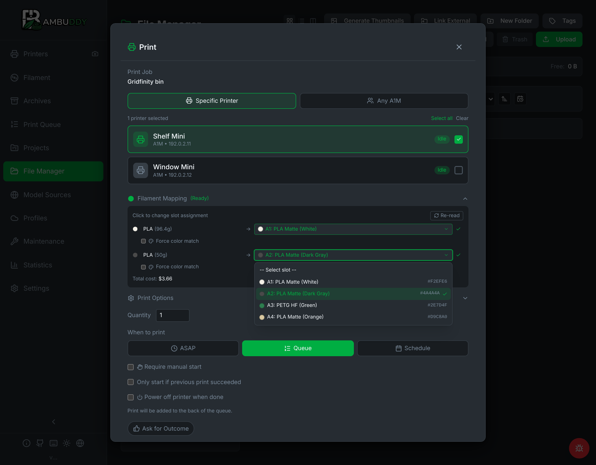 | 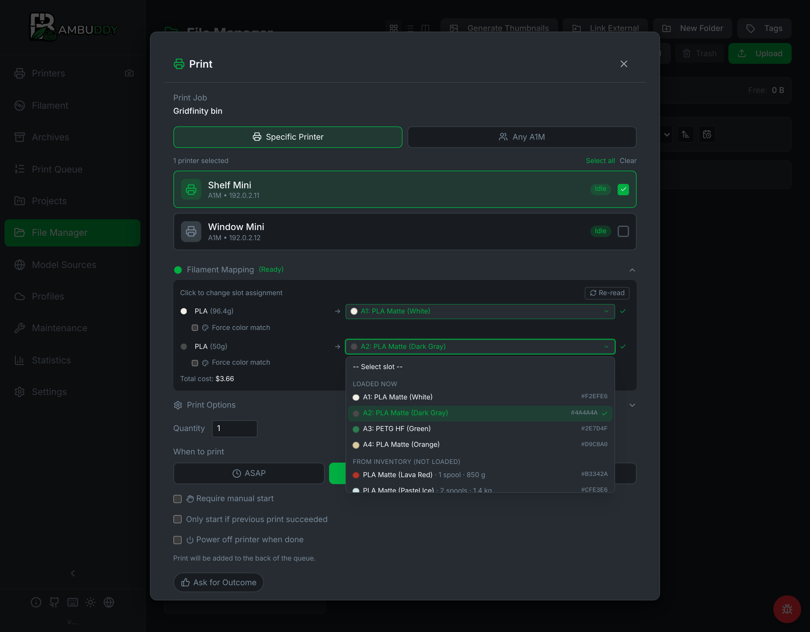 |
| A pick made |  |  |
| Schedule options | 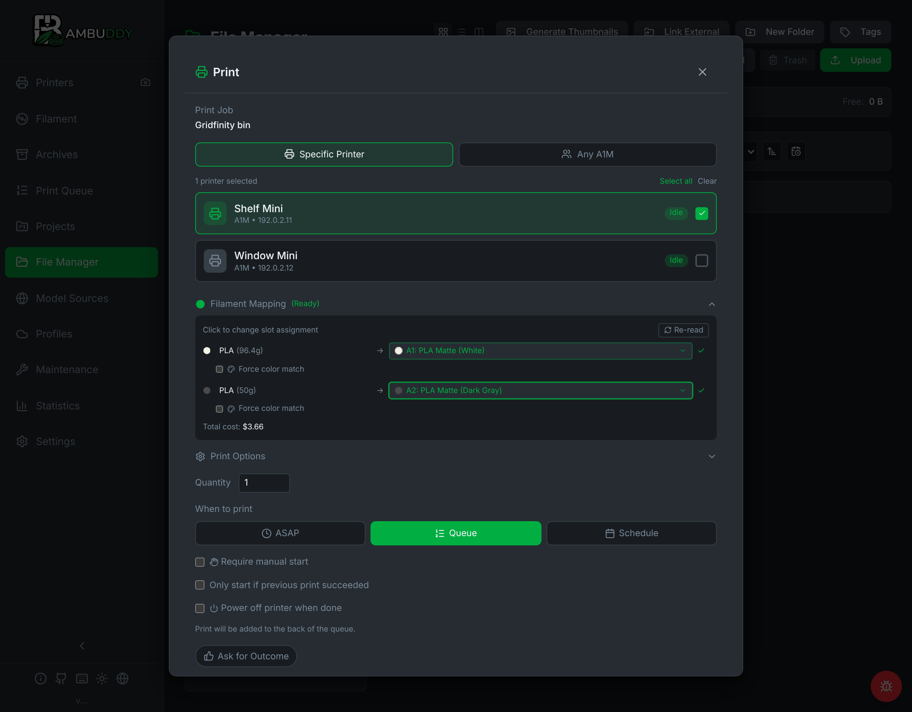 | 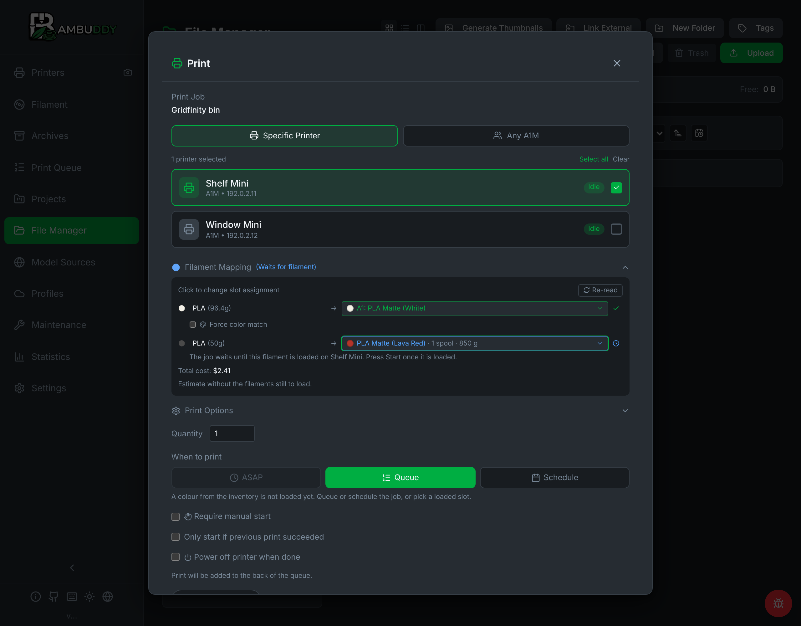 |
| Several printers | 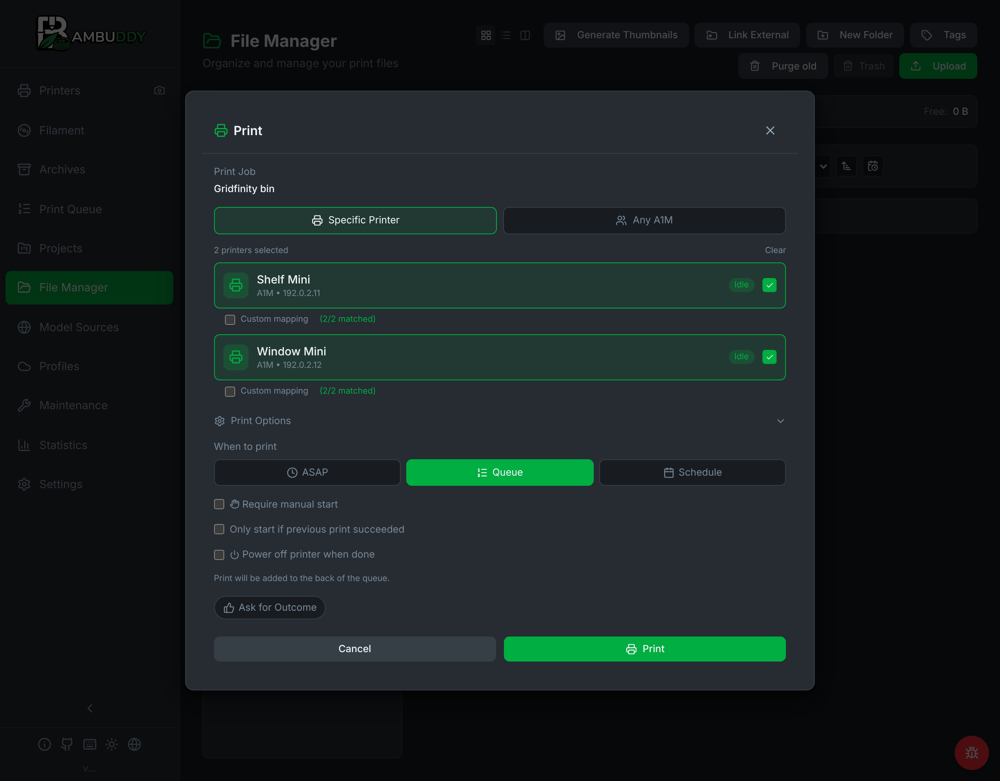 | 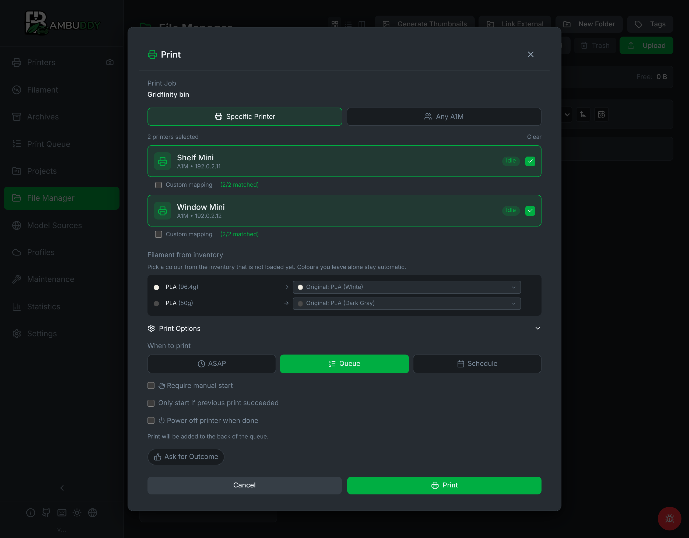 |
| Several printers, panel open | – | 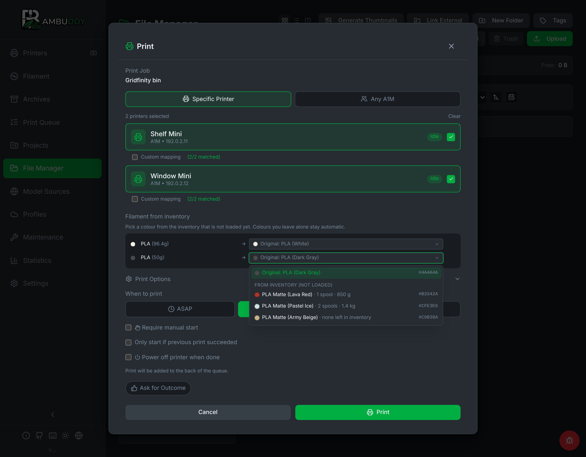 |
| Several printers, a pick made | – | 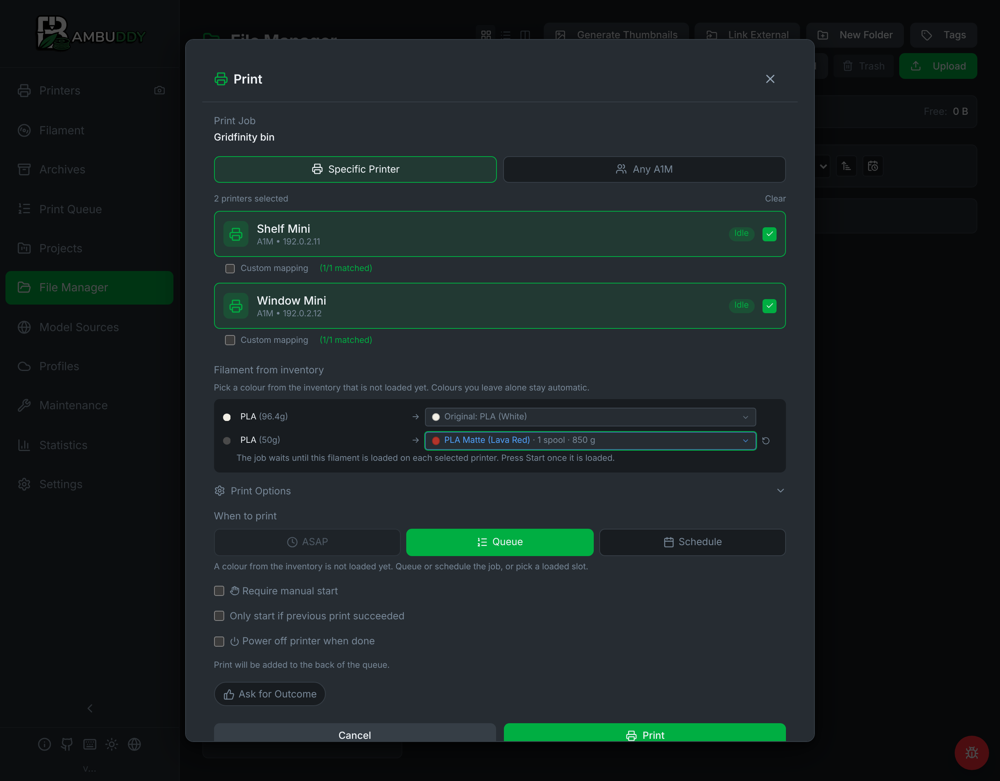 |

### Mobile (390)

| View | Before | After |
|---|---|---|
| Slot dropdown | 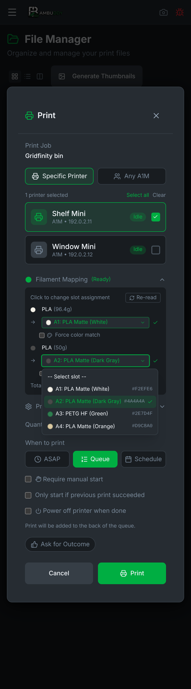 | 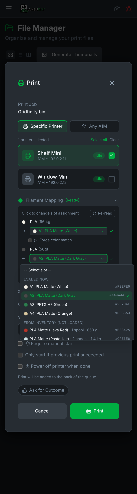 |
| A pick made | 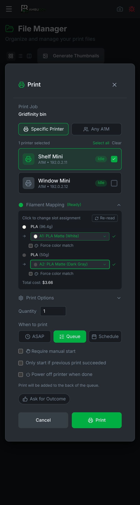 |  |
| Schedule options |  | 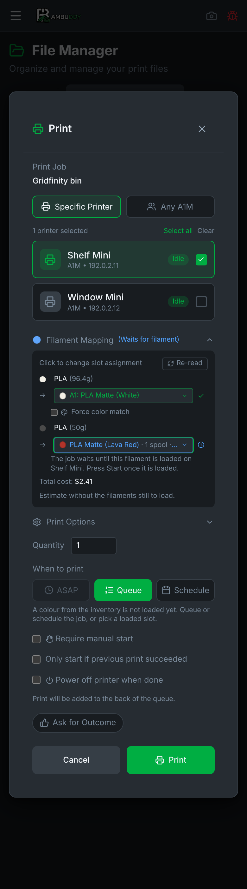 |
| Several printers | 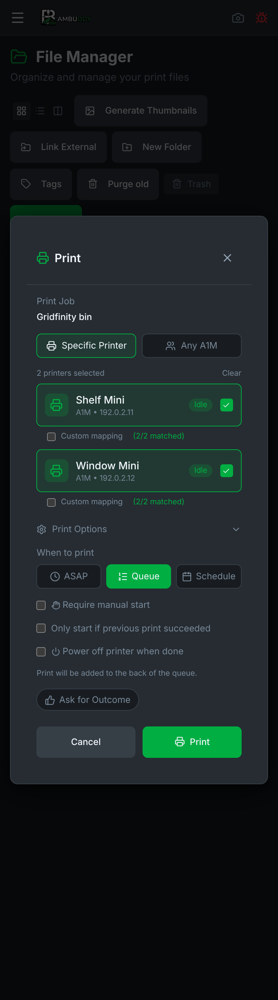 | 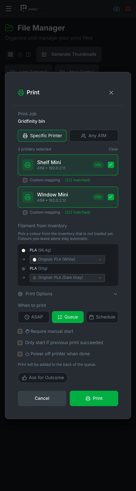 |
| Several printers, panel open | – | 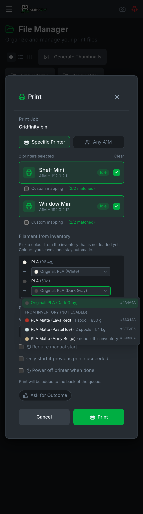 |
| Several printers, a pick made | – | 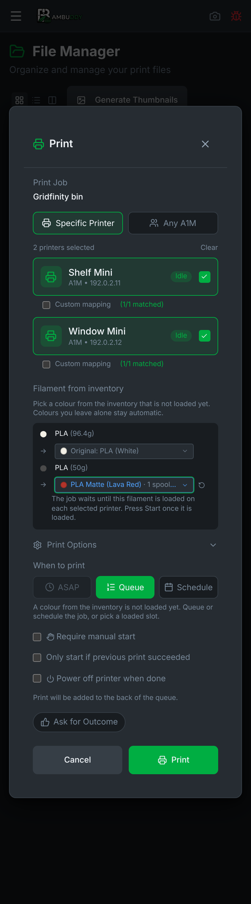 |

The screenshots use a mocked API with invented printer names.

## Testing

**Covered by tests (backend, pytest)**

- `backend/tests/unit/test_pinned_inventory_filament_3649.py` (new): a stored `[2, -1]` with a forced override on slot 2 is no conflict and the mapping is kept; the job waits for the colour on its printer; once loaded only the gap is filled (`[2, 5]`); the other colours keep their slot when a loaded tray is moved by hand; a loaded tray of the wrong colour never fills the slot; dual nozzle (the colour on the other nozzle does not fill the slot, the wait names the nozzle); the suffix and the event on the pinned filament-first path; once per shortage across a "Busy" hold, told again after a refill and a new shortage, a job that left the queue is forgotten; the switched-off printer; the model-path race. `test_the_other_colours_keep_their_slot...`, `test_a_loaded_tray_of_the_wrong_colour...` and `test_without_a_pick_the_slot_is_matched_as_before` are **regression guards**: they pin the scheduler behaviour this PR relies on and does not change.
- `test_scheduler_out_of_stock_3590.py`: adjusted for the shared helper.

**Covered by tests (frontend, Vitest)**

- `FilamentMappingInventorySlot.test.tsx` (new): the group below the loaded slots and none without a list; a pick is handed back as an override and drops a hand-picked tray; **Waits for filament**, the file colour kept; the hint with and without "Press Start"; the nozzle badge and hint; partial cost; giving the pick up; the no-stock warning; no force box on a picked slot.
- `PrintModalInventoryPinned.test.tsx` (new): group only for queue/schedule and only with the setting on; the pointer to Queue or Schedule under **Print now**, and none with the setting off; **Print now** disabled after a pick, with the reason; the request carries the override and `-1` and the other slot keeps its tray; **without a pick the request is unchanged** (regression guard); several printers (override and `-1` in each printer's mapping, a pick on the last slot pads the mapping, the pick survives going back to one printer); edit round-trip; several plates; a stored pick for a slot the file does not print; a pick carried over from model mode; a dual-nozzle printer.
- `useFilamentMappingInventorySlot.test.ts` (new): `buildFilamentComparison` gives the slot no tray and status `inventory`, does not hold a tray back for the others, is no mismatch, and **changes nothing without the set** (regression guard).
- `FilamentOverride.test.tsx`: the inventory-only panel (no force box, only an inventory pick counts, the wait says each printer).

**Checked in the UI**

- Screenshots only, against a mocked API (above).
- **First check on a real printer:** on my A1 Mini with my real inventory, against a build of my fork with this change. With **Queue** the group **From inventory (not loaded)** is offered and a picked colour makes the job wait for it. I have not yet walked through every case listed above (several printers, stock zero, edit) on the printer.

Checks run: the full CI workflow on the head of this branch in my fork: https://github.com/balin77/bambuddy/actions/runs/44827065598 (green)

- [x] I have tested this on my local machine (unit and component tests, mocked API)
- [x] I have tested with my printer model: A1 Mini (first check, see above)

## Checklist

- [x] My code follows the project's coding style
- [x] I have commented my code where necessary
- [x] My changes generate no new warnings
- [x] I have tested my changes thoroughly (tests; no real-printer run yet)

## Additional Notes

**Known limits**
- **The colour must be loaded on the printer.** The job waits for exactly that colour on that printer (forced match); there is no "close enough".
- **Start by hand without Loaded filament first.** That is the queue's existing behaviour for a held job, and the dialog says so under the slot.
- **Not under Print now.** A print that starts at once cannot use a colour that is not loaded.
- **Cost.** The estimate leaves out waiting slots and says so.
- **Inventory only.** With Spoolman the group is not offered, as in #3590.

**Wiki PR:** maziggy/bambuddy-wiki#___ (depends on #155, which documents the inventory colours).
