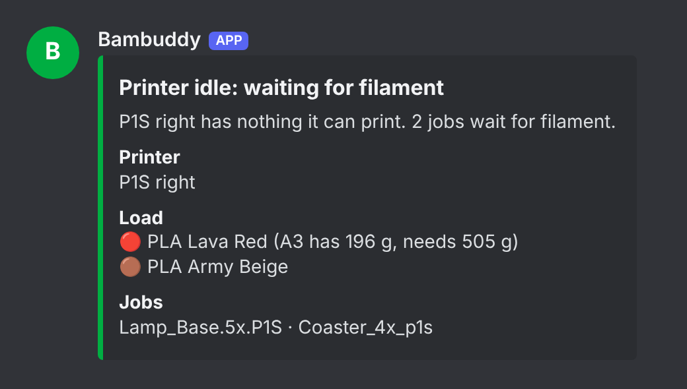
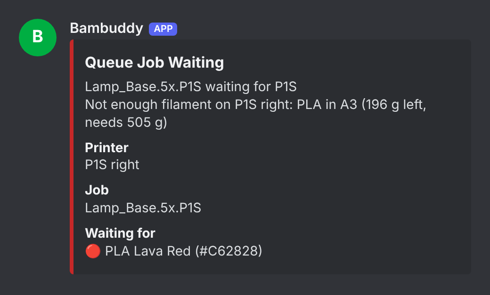

# PR draft – #3725 (printer idle: waiting for filament)

- **Base:** `maziggy/bambuddy:dev`
- **Head:** `balin77:feature/notify-idle-waiting-for-filament`
- **Title:** `Notifications: tell when a printer stands idle waiting for filament, and at once when a spool is too short (#3725)`
- **Status:** The issue is assigned to maziggy (25.11.2026). Not to be opened before #3622 and #3641 are merged (order: #3622, #3641, #3725, then #3726). Nothing is posted.
- **Depends on:** #3641 and #3642. The branch contains both (it is built on `feature/notification-readable` with `fix/notification-filament-short` merged in), so review it after they are merged; until then the diff shows their commits too.
- **Wiki:** `WIKI-3725.md`.

---

## Description

With Loaded filament first and a maximum wait (#3587) a job that waits for filament is announced once, when it gains priority. Two cases stay too quiet: a printer that stands idle because none of its jobs can start for want of filament, and a spool that is too short (that never resolves by itself).

This PR adds a new event and one rule:

1. **New event "Printer idle: waiting for filament".** A printer qualifies when it is idle, has waiting jobs held back for filament, and the pass sent nothing to it. After it has qualified for 5 minutes it sends one message: which printer, which filaments to load (with the slot and grams for a short spool) and which jobs wait. Once per standstill; again only after the printer was seen doing something else or the filaments to load changed.
2. **A too-short spool is told at once**, once per job and short spool, with the sentence of #3642, also before the job has priority (existing event "Queue Job Waiting"). A filament that is only missing keeps waiting for its priority.
3. **Quiet stays what does not stand still.** A job skipped while its printer prints other jobs sends nothing, as before. The priority message stays as the second step.

**Switched-off printers.** A printer its auto-off smart plug switched off counts as idle for this event (see Maintainer's points, 1).

**Exclusions.** A printer waiting for a plate confirmation, or held by a sensor interlock or drying, is not idle for filament; neither is one that is printing, paused, offline or updating its firmware, or one that was sent a job in the pass. Jobs with "skip filament check" never count. An "Any model" job counts only for an idle printer that lacked filament for it, and only when no printer took it.

**Storage and restart.** The new column `notification_providers.on_printer_idle_for_filament` (Boolean, default true, additive migration for SQLite and PostgreSQL, with the NULL backfill). The watch (since when a printer qualifies, what was announced, and which short spools a job was told about) is kept in the existing `settings` table under the key `queue_filament_idle_watch` as JSON, so there is **no migration for it**. It is read once after the start and written only when it changes, never on every pass. After a restart the 5 minutes continue and nothing is announced twice. An unreadable value is ignored; the entry of a deleted printer is dropped; a printer that is off or still connecting keeps its entry.

**Default template** (like the others, editable): title `Printer idle: waiting for filament`, body `{printer} has nothing it can print. {jobs_wait} for filament.` then `{load}` and `Jobs: {jobs}`. Variables: `{printer}`, `{job_count}`, `{jobs_wait}`, `{jobs}`, `{load}` and the colour variables of #3641. On Discord, while the template is unchanged, the first sentence is the description and Printer, Load and Jobs are fields; an edited template is sent exactly as written.

## Maintainer's points

Raised by @maziggy when assigning the issue (25.11.2026), and what answers each one:

- **Point 1: Is a printer that auto-off switched off idle?** Yes, under strict conditions. It counts only when its `auto_on` smart plug's last state is OFF, last known AMS trays exist, no plate clear is pending, there is no failed wake cooldown and no waiting job would switch it on. A plug that is ON while the printer is disconnected, a printer without a plug and unknown trays do not count. Code: `_off_for_filament` and `_pass_wake_fits` in `services/print_scheduler.py`. **Limitation:** the last known trays are kept in memory only; after a server restart an off printer counts once it has been on again.
- **Point 2: One message per idle printer for an "Any model" job.** Intended: each printer that stands idle lacking filament for the job is told which filament to load there. Test `test_any_model_job_sends_one_message_per_idle_printer` (`tests/unit/test_scheduler_idle_for_filament_3725.py`). Also named under Known limits below and in `WIKI-3725.md`.
- **Point 3: The event only with Loaded filament first.** The gate is in `_check_filament_idle` (`services/print_scheduler.py`); without Loaded filament first a job does not wait for filament, so there is nothing to announce. The provider checkbox description names it, in all 16 locales (`NotificationProviderCard.tsx` and the locale files).
- **Point 4: "Blocked" from the To do list code.** The upstream branch keeps its own collection of what blocks a printer until #3622 and #3641 are merged; on `farm` the idle check already reads the To do holds (`_record_hold` and `_record_filament_block`). The rebuild is described in the next section.

## Rebuild after #3622 and #3641

Merge order: #3622, #3641, then this PR. This branch is **not** rebuilt before that. Afterwards a new branch is made from `upstream/dev` (in a later session) and the farm solution is carried over.

- **Functions that go:** `blocked_out` (and its fill sites in the printer filter), `_short_facts`, `_unmatched_req_memo`, `_FilamentWait`, `_deficit_needs` with their call sites, and the `missing_out` parameters of the off-printer filament checks.
- **What replaces them:** `_record_hold`, which feeds `_record_filament_block`. It covers `_record_model_holds` (an "Any model" job) and `_carry_filament_hold` (a hold carried from an earlier pass). `_pass_wake_fit_jobs` marks the waiting jobs that would switch an off printer on, so they are not counted as blocked.
- **Tests that stay:** `test_scheduler_idle_for_filament_3725.py`, `test_scheduler_idle_for_filament_farm_3725.py` and `test_scheduler_short_spool_3725.py`.

## Related Issue

Fixes #3725

Related: #3587, #3641, #3642.

## Documentation

**Companion docs PRs**:
- Wiki: maziggy/bambuddy-wiki#___ (draft `WIKI-3725.md`)

**Pick one**:
- [x] Docs PR(s) linked above
- [ ] No docs update required — reason: ___

## Type of Change

- [ ] Bug fix (non-breaking change that fixes an issue)
- [x] New feature (non-breaking change that adds functionality)
- [ ] Breaking change (fix or feature that would cause existing functionality to change)
- [ ] Documentation update
- [ ] Code refactoring
- [ ] Performance improvement
- [x] Test addition or update

## Changes Made

**Backend**
- `models/notification.py`, `core/database.py`, `schemas/notification.py`, `api/routes/notifications.py`: the column `on_printer_idle_for_filament` (default true), additive migration, PostgreSQL column list.
- `schemas/notification_template.py`, `models/notification_template.py`, `api/routes/notification_templates.py`: event, default template, variables, sample data.
- `services/notification_content.py`: `FilamentNeed`, `IdleJob`, the Load lines, the Discord description and fields for the event.
- `services/notification_service.py`: `on_printer_idle_for_filament`.
- `services/filament_idle_watch.py` (new): the clock per printer, the saved state, the short spools told.
- `services/print_scheduler.py`: collects what each idle printer's waiting jobs lack, decides once per pass before the dispatch, sends the short-spool notice once per job.

**Frontend**
- `NotificationProviderCard.tsx`: the checkbox (default on) and the badge; texts in all 16 locales.

## Screenshots

Mock renderings of the JSON the code sends (invented names), not a real Discord channel. The JSON files are next to the images.

| Event | Rendering |
|-------|-----------|
| Printer idle: waiting for filament |  |
| Queue Job Waiting, short spool |  |

Raw JSON: `3725-discord-idle.json`, `3725-discord-short-spool.json` in `pr-assets/3725/`.

## Testing

**Covered by automated tests only, not yet on real printers.**

- Backend (pytest): fires at 300 s and not before, once per standstill, again after a print or a changed filament list; not for plate clear, interlock, drying, busy, no jobs, staged non-filament jobs; "Any model" jobs count only for idle printers; restart with the filament announced sends nothing, restart with an old `since` fires at the first pass, resets are persisted, a corrupt value is ignored; a short spool is told once per job (also with another printer short, and after a restart), in the sentence of #3642, the start message is not doubled and the priority message still follows; the printer is told the pass after; edited template gives the old payload; migration default true on SQLite and PostgreSQL; sample data and parity of the event lists.
- Frontend (Vitest): the checkbox is on by default and saves the field.
- Checked: `scripts/check_postgres_upgrade.py` against PostgreSQL, ruff, basedpyright, tsc, i18n parity.
- Backend (pytest): a switched-off printer counts only with its `auto_on` plug last OFF, known trays, no plate clear, no failed wake cooldown and no job that would wake it; plug ON but disconnected, no plug and unknown trays do not; the event needs Loaded filament first; an "Any model" job sends one message per idle printer.
- The images are renderings of the JSON, no real Discord message yet. Nothing has run on real printers.

- [x] I have tested this on my local machine (unit and integration tests)
- [ ] I have tested with my printer model: not yet

## Checklist

- [x] My code follows the project's coding style
- [x] I have commented my code where necessary
- [x] My changes generate no new warnings
- [x] I have tested my changes thoroughly (automated tests; no real printers yet)

## Additional Notes

**Known limits**
- The 5 minutes are counted from the first pass in which the printer qualifies; the queue interval adds to it.
- Only Discord shows fields; other channels get the variables.
- An "Any model" job sends one message per idle printer that lacks filament for it (intended).
- The last known AMS trays of a switched-off printer are in memory only; after a server restart an off printer counts once it has been on.
- Reviewing after #3622, #3641 and #3642 are merged keeps the diff to this change.

**Wiki PR:** maziggy/bambuddy-wiki#___ (draft `WIKI-3725.md`).
