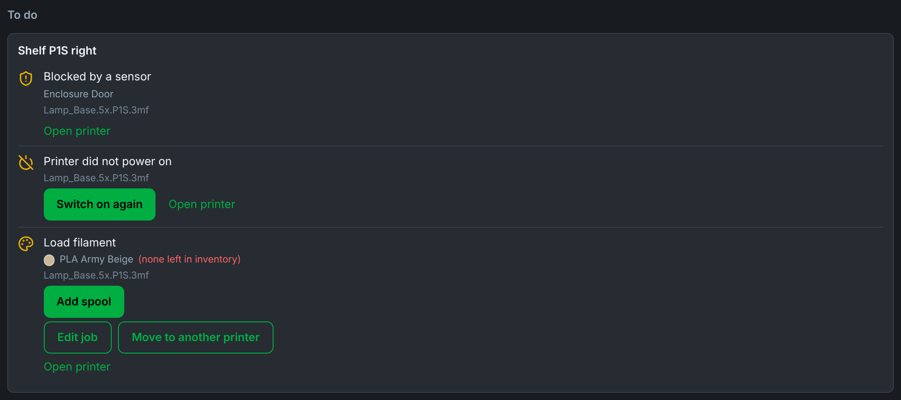
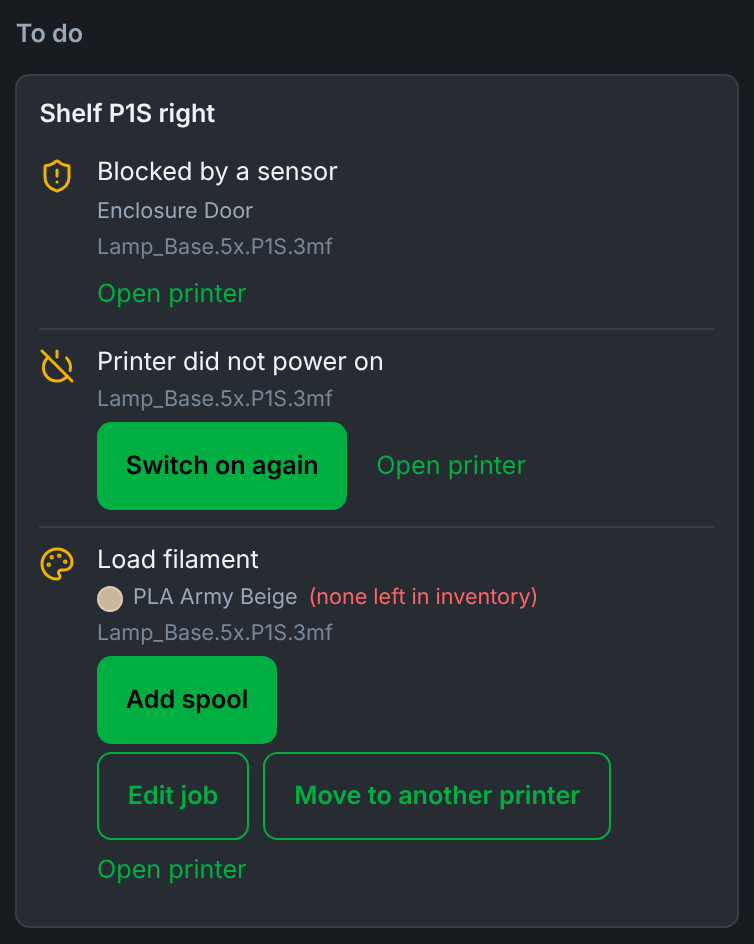

# PR draft – #3726, step 2 (To do list: act on the other entries in place)

- **Base:** `maziggy/bambuddy:dev`
- **Head:** `balin77:feature/queue-todo-actions-in-place`, branched from `feature/queue-todo-ams-picture` (step 1, `PR-3726.md`)
- **Title:** `Print queue: switch a plug on again, edit or move a job and add a spool right in a To do entry (#3726)`
- **Status:** The issue is assigned to maziggy (25.11.2026). Do not submit before step 1 is merged. Nothing is posted.
- **Resume and Stop for a paused print are not in this PR.** They need the paused entries of #3648, which is not in `dev` yet. They exist on `farm` only (commit "farm: a paused print can be resumed or stopped from its To do entry (#3726)"). After #3648 is merged, they go into a follow-up (or this PR, after merging `dev` into the branch).
- **Wiki:** `WIKI-3726.md`.

---

## Description

Step 1 draws the AMS and assigns the spool. Step 2 lets the other entries be acted on where they are listed, each button only for a user who holds the permission. No migration, no new setting.

| Entry | Button | Does | Permission |
|---|---|---|---|
| Printer did not power on | **Switch on again** | looks the plug up like the printer card and switches it on | `smart_plugs:read` and `smart_plugs:control` |
| Load filament, a filament missing | **Edit job**, **Move to another printer** | opens the queue's own edit dialog for the job (it holds the filament and printer choice) | `queue:update_all`, or `queue:update_own` for own jobs |
| Load filament, no spool of that colour in the inventory | **Add spool** | opens the spool form with the type and colour filled in | `inventory:create` |

- Edit job and Move are offered on every Load filament entry with a missing filament (not on a short spool). **Move is offered only for jobs pinned to a printer**; an "Any &lt;model&gt;" job already goes to any of them. This replaces the separate "job does not fit" entry of the proposal.
- Add spool: built-in inventory only; with Spoolman the spools are made there.
- A sensor interlock stays a hint with a link; plate clear, plate changer, staged start and Print anyway are unchanged.
- The spool form takes `initialValues` (type, colour name, colour), so the new spool starts with the filament the job needs.

## Maintainer's points

Raised by @maziggy when assigning the issue (25.11.2026). Order of the PRs: #3622 first, then one at a time (#3641, #3725, then #3726 step 1 and step 2).

- **Point 1: Reuse.** See `PR-3726.md` (step 1): the picker, `ConfigureAmsSlotModal`, `FilamentSlotCircle` and the spool form are used as they are. Step 2 adds `QueueTodoEntryActions.tsx` only, and `initialValues` on `SpoolFormModal`.
- **Point 3: Per-printer permissions.** Every action of this step uses an existing route that enforces the printer scope of #1727 (Switch on again: plug lookup and control; Edit job and Move: the queue item routes); a printer outside the scope gets 404. The 6 tests of `tests/integration/test_todo_actions_scope_3726.py` (listed in step 1) cover them. **Switch on again** shows only with `smart_plugs:read` and `smart_plugs:control`: the lookup of the printer's plug is a read, the switching a control. On the `farm` branch it also follows the fine permissions (#3248) and the hide option (#3639).
- **Point 4: Stop confirmation.** Stop of a paused print asks with the same `ConfirmModal` as the printer card (same title, message and button texts, `printers.confirm.stop*`). It is a farm-only commit with Resume and Stop until #3648 is in `dev` (`QueueTodoPausedActions.tsx`); it is not part of this PR.

## Related Issue

Fixes #3726 (second step)

Related: step 1; #3648 (paused entries, for Resume/Stop later).

## Documentation

- Wiki: maziggy/bambuddy-wiki#___ (draft `WIKI-3726.md`)
- [x] Docs PR(s) linked above

## Type of Change

- [ ] Bug fix
- [x] New feature (non-breaking change that adds functionality)
- [ ] Breaking change
- [ ] Documentation update
- [ ] Code refactoring
- [ ] Performance improvement
- [x] Test addition or update

## Changes Made

**Frontend only**
- `QueueTodoEntryActions.tsx` (new): `PowerOnAgain`, `JobActions`, `AddSpoolActions`.
- `QueueTodoList.tsx`: places them in the entries.
- `SpoolFormModal.tsx`: `initialValues`.
- i18n in all 16 locales; Vitest for each button, its permission and the Spoolman case.

## Screenshots

Rendered against a mocked API, invented names.

| Case | Desktop | Phone |
|------|---------|-------|
| Plug, Add spool, Edit job, Move |  |  |

## Testing

Automated tests (Vitest) for the three buttons: shown with the permission, absent without, Spoolman, the job of another owner with `queue:update_own`, the dialog opened with the right job, the list refreshed after. Screenshots against a mocked API. The screenshots are rendered against a mocked API. **Not tested on real printers yet.**

- [x] I have tested this on my local machine (unit tests, mocked-API screenshots)
- [ ] I have tested with my printer model: not yet

## Checklist

- [x] My code follows the project's coding style
- [x] I have commented my code where necessary
- [x] My changes generate no new warnings
- [x] I have tested my changes thoroughly (automated tests; no real printer yet)

## Additional Notes

Depends on step 1. Resume/Stop of a paused print: farm only until #3648 is in `dev`.
